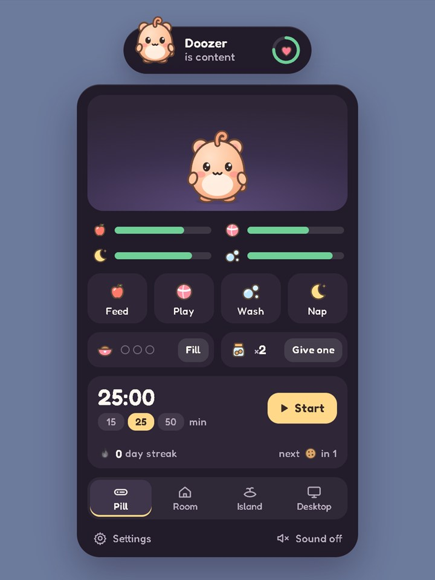
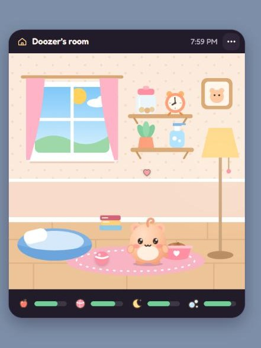
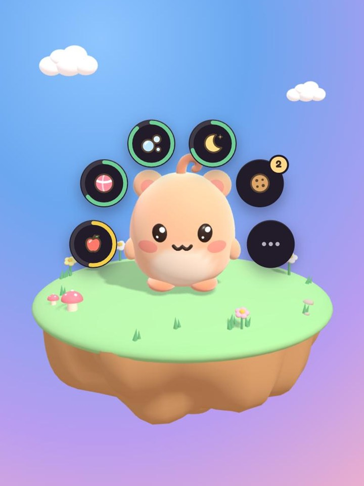
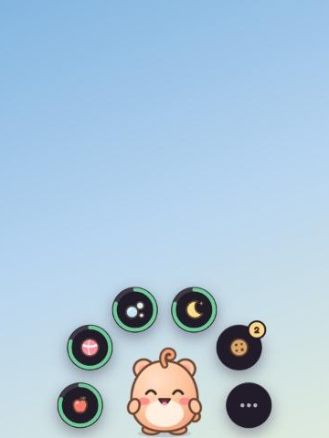
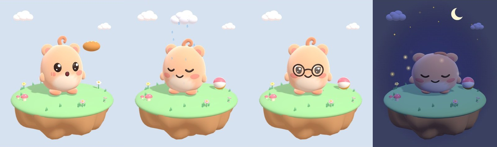

<h1 align="center">Doozer</h1>

A small creature that lives on your Windows desktop and keeps you company while you work.

  <b><a href="../../releases/latest">Download Doozer for Windows</a></b> 
  Windows 10 or 11, 64-bit · 1.7 MB · free, no account, no network requests

  
  
  
  

One pet, four homes. Switch between them whenever you like; Doozer, its mood and a running focus session all carry over.

| Home | What it is |
|---|---|
| **Pill** | A small pill docked to the edge of the screen. Click it for the Card: feed, play, wash, nap, treats and the focus timer. |
| **Room** | A framed little room you can put anywhere. Click the bowl, the ball, the soap, the lamp or the clock. |
| **Island** | A soft 3D Doozer on a floating island with no window around it. Stroke it, press it, click it. |
| **Desktop** | No window at all: Doozer stands on your taskbar and strolls about. Clicks beside it go to whatever is underneath. |

## What it does

- **It needs a little looking after.** Feed it, fill its bowl, play, give it a wash, put it to bed. Between times it gets on with its own small life.
- **It keeps you company while you work.** Every home has a focus timer (15, 25 or 50 minutes). Doozer puts its glasses on and sits still with you, and finishing a session earns treats.
- **Nothing bad ever happens to it.** It never dies, it is never hungry because you had a bad day, and stopping a session early costs nothing.
- **It stays out of the way.** It is light on the PC, tucks away while something is full screen, and never takes the keyboard unless you ask (Ctrl+Alt+D).
- **It keeps to itself.** No account, nothing collected, no network requests of any kind.

## Installing

1. Get `Doozer_<version>_x64-setup.exe` from the [latest release](../../releases/latest), under *Assets*, and run it. It installs for you alone, with no administrator password.
2. **Windows may say "Windows protected your PC".** The installer is not signed with a paid certificate, so SmartScreen does not know it yet. Choose **More info**, then **Run anyway**.
3. Doozer appears in a small pill at the top of the screen and in the tray beside the clock. Click the pill for its Card; right-click for the menu.

A newer version is installed over the old one and keeps your pet. To remove Doozer: *Settings → Apps → Installed apps → Doozer → Uninstall*; a tick box asks whether your pet's save goes too.

Everything else about living with it is in the [user guide](docs/user-guide.md); what is new and the known limits are in the [release notes](docs/release-notes-1.1.0.md).

---

## For developers

One pet with four homes (Pill, Room, Island, Desktop) and a focus timer in every one of them, built as a TypeScript page in a Tauri 2 shell.

**Version 1.1.0, ready for a public release of the installer**, and since 2026-11-27 release `v1.1.0` of this repository, which is private ([docs/release.md](docs/release.md), section 10; the text to publish with it is [docs/release-notes-1.1.0.md](docs/release-notes-1.1.0.md)). All eleven phases of the plan are built and every open decision is made; what is left is for a person's eyes, ears and hand on the mouse, and none of it blocks the release: [WORK_PLAN.md](WORK_PLAN.md), "What is left, and whose it is".

- **Using Doozer** (installing, looking after it, the four homes, removing it): [docs/user-guide.md](docs/user-guide.md)
- **The installer, and how the release was checked:** [docs/release.md](docs/release.md)
- **What gets built:** [DESIGN_SPEC.md](DESIGN_SPEC.md)
- **How and in what order, and where it stands:** [WORK_PLAN.md](WORK_PLAN.md)

## The app (`app/`)

A TypeScript/Vite page inside a Tauri 2 shell. **Milestone 1 is built:** Doozer lives in a small pill docked to the top of the screen and in the tray. Click the pill for the Card: feed, fill the bowl, treats, play, wash, nap, the focus timer and its streak, settings. A view that is not built yet is shown as "coming soon".

**Milestone 2 is built:** the **Room**, a framed little room you can put anywhere on the screen. Pick it in the tray menu or in the Card's row of views, and everything carries over, a running focus session included. Click the bowl to fill it, the ball to toss it, the soap for a bath, the lamp or the bed for bedtime, the treat jar for a treat, the clock to start or stop a session; Doozer decides the rest. The sky in its window follows the real time of day. Drag the room by its title bar; the button in the title bar opens the Card.

**Milestone 3 is built:** the **Island**, the one you touch. A soft 3D Doozer on a small floating island, in a window with no frame at all. Stroke it and it is petted; press it and it squashes under the pointer and springs back; click it for the quick menu. Snacks drop out of the sky (a different one each time), the ball stays lying about to be clicked, a little rain cloud gives it a bath, and night falls on the island when it sleeps. Drag the island by the grip that appears at its top. The 3D engine is only loaded while the Island is open. Whether it beats the mockup for charm is for the owner to say: nobody has watched it move yet ([docs/island-checks.md](docs/island-checks.md), section 10).

**Milestone 4 is built:** the **Desktop**. No window at all: Doozer stands on the top edge of the taskbar, and every click beside it goes to whatever is underneath. It strolls a little, peeks in from the edge of the screen now and then, and sits still with its glasses on during a focus session (rest the pointer on it to see the time left). Click it for the quick menu, drag it to carry it somewhere else and let go: it floats down and stays near that spot. *Desktop activity* in Settings is how much it moves on its own: Still, Calm (the default: a short stroll about every four minutes) or Lively. Whether Doozer still ever gets stuck is for a hand on the mouse to judge ([docs/desktop-checks.md](docs/desktop-checks.md), section 9).

**The polish pass (Phase 10) is done**, across all four views. Everything that moves is now drawn 24 times a second when nobody is there and 60 times with the pointer on Doozer, where it was drawn at the display's 120: a second of Doozer walking costs about a quarter of what it did, and Doozer alone in the Room and on the Island is livelier again for it. The time left in a focus session is shown to the minute while nobody is looking. **Ctrl+Alt+D** (or the tray menu) opens the Card with the keyboard, and Escape gives the keyboard back. *Interface size* in Settings makes everything larger. *Reduce motion* is honoured in every view. With Sound switched on there is a small family of soft sounds, all made in the app. What was measured, what could not be met, and what needs the owner's eyes and ears (whether 24 pictures a second reads as smooth, and how the sounds sound): [docs/polish-checks.md](docs/polish-checks.md).

**Packaging (Phase 11) is done, and versions 1.0.1 and 1.1.0 followed it.** One installer, `Doozer_1.1.0_x64-setup.exe`, for the current user, with no administrator prompt. The app's icon is Doozer. Uninstalling removes the program, its shortcuts, its *Start with Windows* entry and the browser's cache, and asks whether the pet's save goes too (it stays unless the box is ticked). It is not signed and does not update itself; why, and how to change either, is in [docs/release.md](docs/release.md), with what was checked by script and what still needs a person. **1.0.1** added a content security policy for the page, slowed the pet's clock to once a second while nobody is there (a focus session in the Pill now averages under half a percent of a core), explained the shell's "style repairs" (they never were), made the uninstaller remove the installer's own registry key, and walked the installer's pages on screen with a picture of each. One thing asked for could not be met: the frame the clock passes over on screens 24 does not divide turned out, on a real screen, to be the price of an even rhythm ([docs/polish-checks.md](docs/polish-checks.md), section 18.1). **1.1.0** adds *Frame rate* in Settings: Light (the default, as above), 30, 60, 120 or 144 pictures a second; the higher ones cost more of the PC while Doozer moves ([docs/polish-checks.md](docs/polish-checks.md), section 19).

Run everything from the `app` folder; first time only: `npm install`.

| Do this | Command |
|---|---|
| Run the app with live reload | `npm run tauri dev` |
| Build the installer (runs the tests first) | `pwsh scripts/build-release.ps1` → `src-tauri/target/release/bundle/nsis/Doozer_<version>_x64-setup.exe` |
| Check the installer: install, run, update, uninstall (only on a machine with no Doozer on it) | `pwsh scripts/run-install-checks.ps1` |
| Walk the installer's and uninstaller's pages on screen, with a picture of each and both ways through the tick box (same condition; waits until nobody is at the machine; never touches the pointer) | `pwsh scripts/run-install-pages.ps1 -Out <folder>` |
| Build the app (no installer) | `npm run tauri build -- --no-bundle` → `src-tauri/target/release/doozer.exe` |
| Rebuild the icons from the two drawings in `assets/icon/` | `node scripts/make-icons.mjs` |
| Rebuild the third-party notices after a dependency changed | `node scripts/make-notices.mjs` |
| Page-side tests | `npm test` |
| Native-side tests (window maths, hit regions, save file, start with Windows) | `cargo test` in `app/src-tauri` |
| Type-check | `npm run typecheck` |
| See the rig and the UI kit on one page | `npm run dev`, then `/viewer.html` (the 2D and the 3D Doozer side by side: `/viewer.html?only=3d`) |
| Hear the sounds; see every picture of every animation as the app draws it | `npm run dev`, then `/viewer.html#sounds` and `/viewer.html?only=rig&strip=24` |
| See the Island in a browser | `npm run dev`, then `/island.html` |
| Rebuild the 3D model (Blender 5.2, no window opens) | `& "C:\Program Files\Blender Foundation\Blender 5.2\blender.exe" --background --factory-startup --python assets/doozer/build_doozer.py` |
| Scripted checks of the built app (a day's use, never stuck, the window) | `pwsh scripts/run-app-checks.ps1` (needs the build described at the top of that script) |
| The same for the Room (the furniture, an hour alone, switching views, never stuck) | `pwsh scripts/run-room-checks.ps1` (same build) |
| The same for the Island (never stuck, a lost graphics context, click-through along its outline, memory after leaving, pictures) | `pwsh scripts/build-island-checks.ps1`, then `pwsh scripts/run-island-checks.ps1` and `pwsh scripts/measure-island-leak.ps1` (builds into its own folders) |
| The same for the Desktop (never stuck, click-through probes, a soak) | `pwsh scripts/build-desktop-checks.ps1`, then `pwsh scripts/run-desktop-checks.ps1` (builds into its own folders) |
| Reduce motion and the interface size in every view, the keyboard way into the Card; and the measuring tools | `pwsh scripts/build-polish-checks.ps1 -Label final`, then `pwsh scripts/run-polish-checks.ps1`; `measure-set.ps1` and `trace-frames.ps1` are described in [docs/polish-checks.md](docs/polish-checks.md), section 17 |
| The real Ctrl+Alt+D, pressed at the release build in every view | `pwsh scripts/run-hotkey-check.ps1` (on screen, and it takes the keyboard for a few seconds at a time; [docs/polish-checks.md](docs/polish-checks.md), section 20) |

Using it:

- **Quit** from the tray icon, from a right-click on the pill, or from the bottom of Settings. All three save first.
- **Ctrl+Alt+D** opens the Card with the keyboard in any view (Tab and the arrow keys move, Enter presses, Escape closes and hands the keyboard back). It is also in the tray menu.
- **Installed**, the program is in `%LOCALAPPDATA%\Doozer` and is removed from *Settings → Apps*; the uninstaller's tick box decides whether the save goes too.
- **The save** is `%APPDATA%\com.doozer.desktop\save.json` (with `save.bak.json` beside it). That folder name is the app's identifier and is fixed for good. A development build (`tauri dev`) keeps a separate pet in the `dev` subfolder, and "Start with Windows" only works in a release build.
- Only one copy runs at a time; starting a second one does nothing.

Where things are, each with its own `README.md`:

| Folder | What |
|---|---|
| `app/src/core/` | The pet brain: every rule and number. No DOM. |
| `app/src/character/` | The 2D Doozer rig, and the 3D Doozer (`doozer3d.ts`). |
| `app/assets/doozer/` | The 3D model, and the Blender script that builds it. |
| `app/src/ui/` | The dark-glass kit: Card, Radial, settings panel, meters, emotes. |
| `app/src/host/` | The view host: one view at a time, the clock, the save, tuck-away, and the sounds. |
| `app/src/frames.ts` | The frame clock: how often everything that moves is drawn. |
| `app/src/views/pill/` | The Pill view. |
| `app/src/views/room/` | The Room view. |
| `app/src/views/island/` | The Island view. |
| `app/src/views/desktop/` | The Desktop view. |
| `app/src-tauri/` | The native shell: one transparent window, click-through by region, tray, save file. `installer/` holds what the installer adds to Tauri's own: the uninstall hook and the third-party notices. |
| `app/assets/icon/` | The two drawings every icon file is made from. |

What was measured and what still needs a hand on the mouse: [docs/pill-checks.md](docs/pill-checks.md) for the app and the Pill, [docs/room-checks.md](docs/room-checks.md) for the Room, [docs/island-checks.md](docs/island-checks.md) for the 3D Doozer and the Island, [docs/desktop-checks.md](docs/desktop-checks.md) for the Desktop, [docs/polish-checks.md](docs/polish-checks.md) for the polish pass over all four (cost before and after, accessibility, sound), [docs/shell-spike.md](docs/shell-spike.md) for the shell, [docs/release.md](docs/release.md) for the installer.

## The mockups (Phase 1, reference only)

Run from the repository root; first time only: `npm install`.

| Do this | Command |
|---|---|
| Open the gallery in your browser | `npm run mockups` |
| Float a mockup on your real desktop | `npm run pet` (right-click Doozer to switch version or quit) |
| Start on a specific version | `npm run pet -- buddy` (`pocket`, `blob`, `buddy`, `room`, `pill`) |
