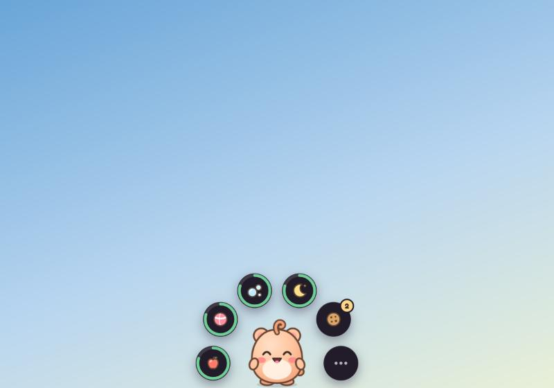
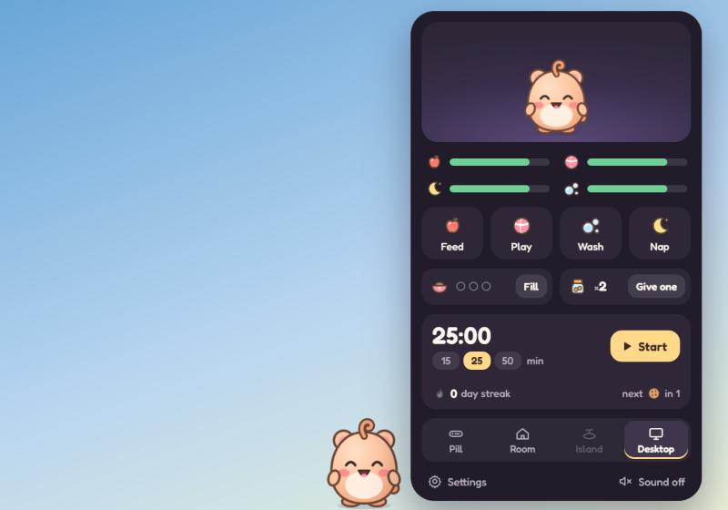

# The Desktop view: what was checked, and how

**Phase 9 of [WORK_PLAN.md](../WORK_PLAN.md)** · run 2026-11-13 and 14 · the same machine as [shell-spike.md](shell-spike.md) and [pill-checks.md](pill-checks.md): Windows 11 Pro, one 3840 × 2160 display at 150 % scaling and 120 Hz (a work area of 2560 × 1392 CSS pixels, taskbar along the bottom), 24 logical cores, WebView2.

The Desktop view is the roamer: Doozer on the top edge of the taskbar, in an overlay over the whole work area that lets every click through except on Doozer and its menus ([DESIGN_SPEC.md](../DESIGN_SPEC.md) 6.4). Its ancestor, the Desk Buddy mockup, drew the owner's one complaint: Doozer "would get stuck randomly". This file records what was done to make sure the real one does not, what was verified, by what means, and what is left for a person. How the view is built is in [app/src/views/desktop/README.md](../app/src/views/desktop/README.md).

## In short

| Asked for | Result | How it is known |
|---|---|---|
| Stuck-case tests pass with injected input: a drag whose mouse-up never arrives, and every scene interrupted at each of its steps (picked up, dropped, another action started, view switched) | Pass | On a fake clock: 16 scenes cut at 365 moments in 8 ways, 2,920 interruptions, each ending idle on the taskbar line with the watchdog having nothing to do (section 2). In the real window with injected input: the mockup's drag test, a mouse-up that never arrives (the carry ended 9 ms after the button came up), 300 scene interruptions including real view switches, and rapid clicks: all pass (section 3) |
| A soak of several hours with random injected actions, cloaked and in the background, ends with Doozer idle on the taskbar line | **Running as this is written** (three hours, started 22:04 on the 13th). Its first half hour found one bug, now fixed (section 8) | Section 4 |
| The overlay never catches a click meant for another application | It does not: 709 probe points across the work area in 13 states, none wrong | Section 5 |
| Idle cost at each pace, on a release build, against the budget (150 MB, 1 % of one core) | Memory is inside the budget at every pace (123–143 MB). CPU: **Still 0.4–1.1 %** of one core, at the line; **Calm under 1 % between strolls and 3.6 % averaged over twelve minutes**; **Lively about 23 %**, because it is nearly always walking | Section 6 |
| Switching to and from the Pill in the middle of a focus session loses nothing | Yes | In the real window and under the real host on a fake clock (section 7) |
| `npm test`, `npm run typecheck`, `cargo test` | 1,013 page tests (176 of them this view's), type-check clean, 49 native tests | Section 1 |
| The owner tries Calm and Lively and chooses the default; the owner agrees Doozer no longer gets stuck | **Not done: these are the owner's** | Section 9 says exactly what to try |

What it looks like, as drawn in a browser pane (the page is the same one the app's window shows; the flat backdrop stands in for the desktop, and the bottom of the picture for the top edge of the taskbar):

| A click on Doozer: the Radial | *More*: the Card (beside Doozer here, because this pane is short; over its head on a real screen) |
|---|---|
|  |  |

## 1. Tests that run without a window

From `app/`: `npm test` and `npm run typecheck`; from `app/src-tauri`: `cargo test`. When this was written: 1,013 page tests in 49 files, type-check clean, 49 native tests and one ignored. (The Room and the Island were being built in the same tree at the same time; their tests are in that count.)

The Desktop view's are in `app/tests/views/desktop/` (176 tests), all against the **real brain** in a test DOM on a fake clock:

| File | What it covers |
|---|---|
| `desktop-view.test.ts` | Standing on the line; the hit region and that it follows a walk; Still / Calm / Lively by what Doozer actually does over half an hour; carry and the float down; **every way a carry ends** (mouse-up, `pointercancel`, lost capture, the shell's `pointer-released` with and without a position, the window losing focus, a move with no button, 30 s of silence, the 2-minute limit, a press that never moves or ends); the Radial, the Card, the settings and the keyboard; menus closing by themselves; stroking; display changes in the middle of anything |
| `desktop-scenes.test.ts` | Peekaboo at both edges and that the hit region is only the half on screen; every care scene at Calm and at Lively (a meal eaten on the spot / run to; the ball batted / chased at 150 px/s); refusals without text; sleep; the welcome; focus manners (sits still at any pace, time on hover only, a quiet meal from the bowl, the celebration, "open the Card"); the spot per monitor; the taskbar on each edge and hidden |
| `stuck-matrix.ts`, run by `never-stuck-matrix-a..d.test.ts` | **The interruption matrix** (section 2) |
| `never-stuck.test.ts` | The mockup's drag test (a fast, far drag and no mouse-up); a carry with no word from the shell either; 300 rapid presses, drags and releases in any order; **the watchdog shown to work** by breaking the view in five ways; an hour of Lively with nothing for it to do; tucked away stops every timer; unmount leaves no timer and no listener |
| `soak.test.ts` | A soak on the fake clock: 4,500 random actions over three seeds (section 4) |
| `switching.test.ts` | The Desktop view beside the Pill under the **real host**: the Card's view row, a focus session there and back, a restart mid-session, the spot through the save |
| `stage.test.ts`, `pace-motion.test.ts` | The pure parts: the ground line and the hit area with the taskbar on any edge, the Radial's buttons all on screen wherever Doozer may stand, where the Card goes, the spot memory; the pace table, where a stroll goes, the float, the ball |
| `host-memory.test.ts` | The small addition to the host: a note per view in the save |

## 2. Never stuck: the interruption matrix

The mockup's stuck scenes were walks that were interrupted and never told the scene waiting on them. So the test is: take every scene the view can play, interrupt it at every step, in every way, and see that Doozer always ends up idle on the taskbar line with nothing left behind.

**Scenes (16):** a stroll at Calm and at Lively; peekaboo at Calm and at Lively; a meal at Calm and at Lively; a treat; ball play at Calm and at Lively; a wash; the celebration when a session ends; falling asleep; waking up; the welcome of a new pet; the float down after a carry; coming back in from the edge after a peek was cut short.

**Where each is cut.** The scene is first played through untouched, sampled every 50 ms. It is then cut at the start, just before and just after every moment anything about it changes (a walk ends, a bite is taken, a face or an emote comes or goes, a prop appears), at a dozen evenly spaced moments through its long stretches, and just after it has ended: 15 to 32 cuts a scene, 365 in all.

**How (8):**

| Interruption | What is done |
|---|---|
| Picked up | Pressed and dragged away; held for 2.5 s (the scene must be gone and everything it put out with it); released |
| Picked up and dropped at once | Released in mid-air in the same instant |
| Picked up, and the mouse-up never arrives | In turn: the shell's `pointer-released`; a pointer move with no button held; the window losing focus |
| Another action started | In turn: feed, play, wash, treat, pet, nap or wake, start a focus session, a refused feed, fill the bowl |
| The menu opened | A click on Doozer, then the Card on every other turn |
| The view switched away and back | `leave()`, then either the view is unmounted and mounted again, or the switch "does not happen" and Doozer pops back in |
| Tucked away and brought back | At the moment of tucking: no timer of the view left, nothing catching the mouse, nothing beside Doozer |
| The display changed | A different monitor, mid-scene |

**What is required each time.** After every 50 ms step up to the cut, and after the interruption, the watchdog is run by hand and must report nothing: it is a net, and nothing is allowed to fall into it. Then the pet is put back to an ordinary waking state at the Still pace and Doozer must come to rest: state idle, on the line, at a place it may stand, nothing open, no prop, no walking or carried pose, no press, exactly one hit region, no rescue and no scene ended by its time limit.

**Result: 2,920 interruptions (365 cuts × 8), all pass**, in four slices that run side by side in about half a minute.

| Scene | Cuts | Runs | | Scene | Cuts | Runs |
|---|---|---|---|---|---|---|
| A Calm stroll | 17 | 136 | | Ball play, Lively | 32 | 256 |
| A Lively stroll | 17 | 136 | | A wash | 22 | 176 |
| A Calm peekaboo | 32 | 256 | | A celebration | 20 | 160 |
| A Lively peekaboo | 31 | 248 | | Falling asleep | 17 | 136 |
| A meal, Calm | 26 | 208 | | Waking up | 17 | 136 |
| A meal, Lively | 30 | 240 | | The welcome | 22 | 176 |
| A treat | 30 | 240 | | The float down | 17 | 136 |
| Ball play, Calm | 20 | 160 | | Coming back in from the edge | 15 | 120 |

**The watchdog is shown to work, separately.** A net that is never used could be broken without anyone knowing. `never-stuck.test.ts` breaks the view in five ways that the rules never produce (Doozer drawn off the line; left in the walking pose with nothing behind it; the timers that start the next stroll gone; drawn as held with nothing holding it; a snack left out with no scene) and in each the watchdog's own timer notices within five seconds, says what was wrong, and puts Doozer back on the line with its timers running. The same five are done in the real window (section 3).

## 3. Never stuck, with injected input in the real window

`app-desktop-stuck`, in the real overlay window, cloaked. A press is made twice over, as a real one is: the shell's cursor tracker is fed a pretend cursor and button (so the window's click-through state and the shell's `pointer-released` are the real ones), and the page is given the matching pointer events. The real pointer is never moved. The pretend pointer arrives on Doozer and rests there before it presses, as a hand's does.

| Case | What was done | Result |
|---|---|---|
| **The mockup's drag test** (`shell/main.mjs --dragtest`) | Press on Doozer, twelve moves of 45 px across and 35 px up, 16 ms apart, release in mid-air | Picked up. At each of the four looks taken while the button was down the window was catching and the shell was holding the press: never click-through, which is what lost the mockup its mouse-up. Let go, Doozer floats; it lands on the line 540 px from where it started and stays there |
| **The same drag, and the mouse-up never arrives** | The button comes up. The page is given no `pointerup` at all | The carry ended 9.3 ms after the button came up, on the shell's `pointer-released`, sent exactly once. Doozer floated down, and at rest the window was click-through again |
| The shell never saw the press | Page events only, so the shell will never say the press ended; then one pointer move with no button held | The carry ended on that move |
| Nothing at all is heard again | Page events only, then silence | The carry gave up by itself after 30.2 s (its 30-second limit) and Doozer floated down |
| **Every scene, cut in every way** | 12 scenes (a stroll at Calm and at Lively, peekaboo, a meal at Calm and at Lively, a treat, the ball at Calm and at Lively, a wash, the celebration, falling asleep, the float down) × 5 moments (0, 250, 700, 1,500 and 2,800 ms in) × 5 interruptions: picked up, held, dropped; picked up and the mouse-up never arrives; another action started; **the view really switched** to the Pill and back, through the host; **really tucked away** and brought back | **300 of 300.** Each ends idle on the line, with nothing open, nothing left beside Doozer, Doozer drawn where the view says it is, one hit region in the view and in the shell, and the shell not holding a button. In the hand, the scene and everything it had put out were gone, and the window never let go |
| Rapid clicks | Forty clicks on Doozer 15 to 90 ms apart; then twelve rounds of opening the Radial and pressing one of its buttons five times fast | Everything comes to rest |
| The watchdog, through all of the above | | **Nothing to rescue, and no scene ended by its time limit.** On the way 149 carries were made and ended: 84 on a mouse-up, 63 on the shell's `pointer-released`, 1 on a move with no button, 1 on the silence limit |
| The watchdog, on purpose | The five breakages of section 2, in the real window | Each noticed by the watchdog's own timer, described correctly ("standing idle in the walk pose", "something was left lying beside Doozer"...), and put right |

The run takes twenty minutes. The unit tests go further on the same ground, on a fake clock: the matrix of section 2, and every way a carry ends one at a time.

## 4. The soak

*The soak is running as this is written: `app-desktop-soak`, three hours, seed 20261113, cloaked, in the background, started at 22:04 on 13 November 2026 on the build of commit `6d4c6f7`. This section is filled in when it ends.*

So far: an earlier run on the build before was stopped after 25 minutes and 741 actions, because one of its 18 hands-off checks had found the sliding described in section 8. Up to then the watchdog had rescued nothing and no scene had been ended by its time limit. Its twin on a fake clock (`soak.test.ts`) has run in full: 4,500 random actions over three seeds, 565 scenes and 416 carries, the watchdog asked after every action and never with anything to put right, 78 hands-off checks all finding Doozer at rest, and Doozer idle on the taskbar line at the end of each.

## 5. Click-through: the overlay never catches a click meant for another application

`app-desktop-window`, in the real overlay window (3840 × 2088 physical pixels, the whole work area), cloaked.

**Three things are compared at every point**, and all three must agree:

1. what the view told the shell to catch (`hitRegions()`);
2. what the page itself would answer to at that point (`document.elementFromPoint`: one of the view's own things, or nothing);
3. what the window's real style says once the pretend cursor is put there (`WS_EX_TRANSPARENT`, read back from Windows after the shell's cursor tracker has reacted).

A window that catches where the view asked for nothing is the failure that matters: a click meant for another application, eaten. The other direction (the page has something the window does not catch) only makes a thing unclickable, but it is counted as wrong too.

**The points:** a 9 × 6 grid across the whole work area in every state; and for each thing that catches the mouse, its middle, 9 px to its left, to its right and above it, and 2 px inside the corner of its box (inside a rounded corner, which must be let through). A point within 3 px of an edge is not probed: a pixel either way is not the question. While Doozer is moving, points are taken one at a time, and one that Doozer passed over in the meantime is skipped rather than guessed (one point in the whole run).

| State | Points | Wrong |
|---|---|---|
| At rest | 59 | 0 |
| The Radial open (kept open, as a pointer on it would) | 89 | 0 |
| The Card open | 64 | 0 |
| The settings open | 64 | 0 |
| Carried: the button held, the pointer anywhere on the screen | 15 | 0 |
| Floating down | 54 | 0 |
| Walking: on Doozer, and 400 px ahead of it, twelve times along a stroll | 24 | 0 |
| Peeking, half off the screen | 57 | 0 |
| The ball in play | 54 | 0 |
| Eating (a snack on the ground does not catch the mouse) | 54 | 0 |
| Asleep | 59 | 0 |
| A focus session running | 59 | 0 |
| Tucked away (nothing may catch anywhere) | 54 | 0 |
| A press that begins elsewhere, dragged across Doozer and off again | 3 | 0 |
| **All** | **709** | **0** |

The table is the run that found nothing after the corner fix below. The whole scenario was run once more on the final build, after the last two fixes to the view (section 8): 708 points, none wrong, two skipped because Doozer passed over them.

Two of those rows are the shell's rule that the click-through state never changes while a button is down, seen from this view. *Carried:* with the button held on Doozer, the window keeps catching wherever the pointer goes, at all 15 points across the screen, so the mouse-up cannot be lost to another window. *A press that begins elsewhere* stays the other application's as it is dragged over Doozer: the window stays click-through.

**What is drawn is where the shell is told it is.** In the real layout at 150 % scaling: Doozer's hit area is drawn at (1803.79, 1295.28), 78.40 × 94.07 px, and the shell is told (1803.80, 1295.28), 78.40 × 94.08, with the same 35.84 px corner radius in the page and in the region. The Radial's six buttons come to rest within a pixel of the six regions reported the moment it opens (the regions are where the buttons end up, not where their opening spring has got to). The Card is drawn at (1683, 745), 320 × 538.04, and reported as (1683, 745), 320 × 538.

**The first run found five disagreements, all the harmless way round**, and they are fixed. The page would have answered 2 px inside the square corner of four round Radial buttons (the need ring is a square drawing inside the round button) and of the settings panel (its square header inside its rounded box), where the window, going by the rounded region, let the click through. Now the ring ignores the pointer and the panel is clipped to its corners, so the page and the window agree at every point. At no point, in either run, did the window catch a click the view had not asked for.

**Limits.** Cloaked, a window takes no clicks at all, so Windows' own answer to "which window would get a click here" cannot be asked; the shell spike asked it with the window visible, through the same mechanism (440 of 440, [shell-spike.md](shell-spike.md) section 5). And no real click has been sent: that is on the list in section 9.

## 6. Idle cost at each pace

Release build with the test hooks, `app/scripts/measure-idle.ps1` with the `app-desktop-idle` scenario: 20 s to settle, then the windows listed; every process counted (the app and its six WebView2 processes, in a browser profile of their own so that no other copy's processes are mixed in). Memory is private working set, the figure Task Manager shows; CPU is a share of one core (this machine has 24). The window was cloaked and the pretend pointer parked. The machine was in use the whole time: its owner was watching a video, two other sessions were building and testing, and this view's own soak was running. See [shell-spike.md](shell-spike.md) section 2.1 for why these are the right numbers, and for the empty overlay of Phase 3: 107 MB and 1.1–1.5 %.

| Pace and state | Memory | CPU, share of one core | What Doozer did meanwhile |
|---|---|---|---|
| **Still** | **123–129 MB** | **0.4–1.1 %** (six 30 s windows: 0.36, 0.41, 0.57, 0.72, 1.03, 1.09; mean 0.70) | Stood, blinked, glanced about |
| **Calm**, a minute with no stroll in it | 124–137 MB | **0.1–1.0 %** (0.10, 0.34, 0.67, 1.04) | The same as Still |
| **Calm**, a minute with a stroll in it | | 1.8–5.7 % (seven such minutes) | One short walk at 30 px/s |
| **Calm**, the minute with the peek | | 13.1 % | To the edge of the screen and back, 720 px each way at 50 px/s |
| **Calm, all twelve minutes** | | **3.6 %** on average | 7 strolls and 1 peek |
| **Lively** | **133–143 MB** | **16–32 %** (eight 30 s windows; mean **23 %**) | 10 strolls and 3 peeks in four minutes: it is walking most of the time |
| A focus session running (Calm) | 124–131 MB | 0.3–0.6 % (four 30 s windows; mean 0.48) | Sat still, glasses on |
| Asleep (Calm) | 128–132 MB | 0.2–0.6 % (mean 0.37) | Slept; no blinking, no z's |
| Budget | under 150 MB | under 1 % | |

**Against the budget.**

- **Memory is inside it at every pace**, with less to spare than the Pill has (94–97 MB): the overlay is a transparent surface the size of the work area, which costs about 30 MB by itself (shell-spike 2.1).
- **At rest the view is at the line, not over it**: 0.4–1.1 % at Still, and the same in a Calm minute with no stroll, during a focus session and asleep. The view adds nothing measurable to the empty overlay, which was measured at 1.1–1.5 % in Phase 3. At these levels single windows wander between 0.1 and 1.1 for the same state.
- **Walking is not idle, and it is not cheap.** While Doozer walks the app uses a third to a half of one core: about half of it in the page (the rig redraws all its moving parts 120 times a second on this display), about a third in the graphics process, and the rest in passing the hit region to the shell thirty times a second. That is what one animation costs in this window (13–26 % for a single moving blob in shell-spike 2.1, 40–52 % for the mockup in Electron), not something this view does on top.
- So **the pace decides the cost.** Calm walks for about a tenth of the time and averages 3.6 % of one core, which is 0.15 % of this machine. Lively walks most of the time and averages 23 %, which is 1 % of this machine: the same order as the mockup it is modelled on. The owner should know that when choosing the default (section 9).

**What was done about it here.** At rest nothing animates: Doozer blinks in two redraws every 4–9 s and glances to one side in two redraws every 14–34 s. The first measurement of Still read 0.5–1.3 % (mean 0.88) with the glance *eased* across, a quarter of a second of full-rate drawing each way; making it a plain change of where the eyes are brought that to 0.4–1.1 % (mean 0.70). A sleepy Doozer yawns at most every two minutes. A pointer that merely crosses Doozer on its way to the taskbar starts nothing: it has to rest 180 ms.

**What would help most, for Phase 10.** Drawing the walk at 30 or 60 frames a second instead of 120 would cut the cost of every stroll by half or more; that is a change to the rig, which every view shares. Reporting the hit region ten times a second instead of thirty while walking would save a little more.

**A limit.** A cloaked window is not put on the screen, so whatever Windows itself spends compositing a visible overlay is not in these numbers (it would not be in the app's own processes either way). The Pill measured the same cloaked and visible ([pill-checks.md](pill-checks.md) section 3). Nobody has measured this view visible.

## 7. A focus session carried between views, and the spot

**In the real window** (`app-desktop-window`): a 25-minute session is started in the Desktop view at the Lively pace.

| Step | Seen |
|---|---|
| Started in the Desktop view | Glasses on; whatever Doozer was doing ends; it sits still. The time left is not shown |
| The pointer rests on Doozer | "24:52" over its head; gone when the pointer leaves. The chip itself catches nothing: still one hit region |
| To the Pill | The pill is a countdown; 1,490 s left, against 1,491 s a moment before in the Desktop |
| Paused in the Pill, then back to the Desktop | Still paused, still 1,490 s, glasses still on |
| Resumed in the Desktop | Counting again: 1,484 s after six seconds. Doozer has not moved, at the Lively pace |
| Before and after | Treats, streak, sessions, bowl and all four needs unchanged by the switching |
| Finished in the Desktop view | Doozer celebrates, 3 treats land (2 for 25 minutes, 1 for the first of the day), glasses off, back to rest |

**Under the real host on a fake clock** (`switching.test.ts`): the same journey with exact times (20:00 left when leaving the Pill, 10 minutes sitting still in the Desktop at Lively without one stroll, paused and resumed across a switch, finished on time, 3 treats, streak up by one); a session that is running when the app is closed in the Desktop view is running, with the right time left, when it reopens there; and switching away while Doozer is being carried in the middle of a ball game leaves nothing of the view behind.

**The spot.** Doozer was carried to 794 px from the left and put down. Within the second the save held `"3840x2160@0,0": { "f": 0.3102 }` under the Desktop view's note (how far across that monitor), and after a trip to the Pill and back Doozer was standing at 794 again. Where exactly Doozer *stood* does not carry over (spec 5.1): it comes back at its spot, which is where it was last put down, not where a stroll had taken it. The tests do the same on two monitors, each with its own spot, and across a restart.

## 8. Found on the way

Bugs in the view, found by its own tests before the real window was involved:

- **A button off the bottom of the screen.** Near a side of the screen the Radial leans away from the edge. The geometry test, which places all six buttons for every place Doozer may stand at every size, found the last button of the leaning arc 9 px below the bottom of the screen at the Small size. The arc now ends level with Doozer's middle.
- **Lively almost never peeked.** A peek that fell due while Doozer was busy was dropped until the next one fell due, and in Lively it is nearly always mid-stroll. A peek that is due now waits for the next free moment.
- **A scene one moment late.** Scenes began with an awaited "are you on the screen?" step, so the snack or the ball appeared a moment after the scene had started rather than with it. Harmless, but a scene with nothing in it yet is the kind of half-state this view is not allowed. The step is now taken only when Doozer really is off the screen.

Found by the click-through probes in the real window: the five corner points described in section 5.

Found by the soak, half an hour into its first run: **with Reduce motion on, Doozer slid.** The kit's reduced-motion rule gives every element under a kit root a 0.12 s transition, so that things fade rather than spring. On the one transform that says where Doozer is, that eased every change of position: put down, Doozer slid into place for an eighth of a second, and carried, it lagged that far behind the pointer, with Reduce motion on of all times. The soak's hands-off check saw it as "drawn somewhere other than where it is" in the instant after a landing. The view now switches transitions off on Doozer, on its props and on the panel's position. The soak was started again on the corrected build, and it is that run which section 4 reports.

Found by re-reading the view while the checks ran: **choosing a Size closed the settings panel**, because a change of size re-laid the stage and closed whatever was open, and the Size row is in the settings. What is open now stays open through a change of size or display and moves with Doozer.

Found about building, and worth knowing for anyone else who builds into their own folders: the two notes at the end of section 10. They cost this phase its first three on-screen runs, which sat showing a folder listing instead of the app.

**A wrong turn, recorded so that nobody takes it again.** While those runs stalled I suspected the app's start-up: the owner was watching a fullscreen video, the app tucks itself away behind one, and the shell bridge waits for an animation frame after changing the window. If a hidden window drew no frames, that wait would never end. I changed the bridge to give the wait a time limit before checking, then measured it: **a hidden window still gets its frames** (120 a second, counted with the window hidden; `visibilityState` stays `visible`, as [shell-spike.md](shell-spike.md) 4.8 already says). The change was taken back; nothing in the shell is different. The same measurement is why `setAwake(false)` has to stop every timer of a view by hand, and it is checked that this view's does.

And one thing the host gained: a view may now keep a small note of its own in the save (`context.memory`, [app/src/host/README.md](../app/src/host/README.md)). The Desktop view keeps Doozer's spot on each monitor there.

## 9. Not verified: needs a person at the mouse

Everything above used scripted input and a cloaked window, because the machine was in use (its owner was watching a video for most of it). None of the rows in the second table is expected to fail. The first two are different: they are decisions, and they are the owner's.

Run `npm run tauri dev` in `app/` (or the release `doozer.exe`), then right-click the pill and choose **Desktop** (or the Desktop button at the bottom of the Card, or the tray menu). Doozer appears on the top edge of the taskbar, right of the middle.

**The two things only the owner can settle**

| | What to do |
|---|---|
| **Calm or Lively as the default** (spec 6.4 "Pace", spec 12 item 3) | Leave it at Calm, the default, for a quarter of an hour of ordinary work. It should mostly stay where it is, take a short slow stroll every minute or two, and about every ten minutes walk to the edge of the screen, slip half-way off and peek back in. Then: click Doozer, *More* (the three dots), *Settings*, **Desktop activity → Lively**, and give that a quarter of an hour. It is off again a second or three after it arrives, anywhere along the taskbar; feed it (click Doozer, the apple) and it runs to the food; play (the ball) and it chases the ball and kicks it. *Still* is the third choice: it never leaves its spot. Say which should be the default. It is one word to change: `desktopActivity` in `defaultSettings()`, `app/src/core/tuning.ts`. |
| **That Doozer no longer gets stuck** | Try to get it stuck, the way the mockup did and any other way. Pick it up with a fast flick right across the screen and let go in mid-air, twenty times, quickly: over another window, over the taskbar, in the corners, at the very top. Pick it up and, still holding, press Alt-Tab or the Windows key, then let go. Pick it up while it is walking, eating, chasing the ball, peeking at the edge, asleep. Click it fast, many times; press the Radial's buttons fast; start one thing and at once another. Switch to the Pill from the tray menu in the middle of any of that, and back. Leave it on Lively for an afternoon. Each time it should end up standing on the taskbar. If it ever does not within a few seconds, that is the bug this phase exists to prevent: note what you had just done. (In a development build, `window.doozer.desktop.snapshot()` in the console lists under `rescues` anything the watchdog had to put right.) |

**The rest**

| Not verified | What to do |
|---|---|
| **A real click beside Doozer** | With Doozer on the taskbar edge, click, drag and scroll in the windows all around and above it: every one should react as if Doozer were not there. Only Doozer itself (and an open menu) should take a click. Scripted probes say so at 700 points; no real click has been sent. |
| **Focus when really clicked** | Type in an editor, click Doozer, press a Radial button, keep typing: the text should keep going into the editor. |
| **How it looks and moves in the real window** | The waddle at Calm, the trot at Lively, the float down, the peek, the ball. Nobody has watched any of it move in real time; the checks know where Doozer is, not how it looks getting there. |
| **Carrying with a real hand** | Slow drags and fast flicks. Carry it down over the taskbar and off the top of the screen: it should stop at the edge and stay in the hand. |
| **Doozer and the taskbar's own things** | Open the Start menu, the tray flyouts, a taskbar thumbnail preview next to Doozer. Both are "always on top"; which is in front has not been seen. |
| **The taskbar on another edge, or auto-hidden** | Windows 11 only offers the bottom, so this is for Windows 10 or a tool that moves it. Doozer should stand on the bottom of the screen. With auto-hide on, the taskbar should still slide in (the overlay leaves it one pixel), and it will cover Doozer's feet or be covered by them. |
| **A second monitor, mixed scaling** | The overlay covers the monitor the window is on. Move the Pill or the Room to the other monitor, then switch to the Desktop: Doozer should be on that monitor's taskbar edge, at its own spot there, and back at its old spot when you return. Nothing here ran on a second monitor. |
| **The Radial at the edge of the screen** | Put Doozer down hard against the left and right edges and click it: the six buttons should lean inward, all on screen. |
| **The time left on hover** | Start a focus session, rest the pointer on Doozer: the time appears over its head, and goes when the pointer leaves. |
| **The right-click menu** | Right-click Doozer: the menu at the pointer, closing on a click elsewhere, typing going back to the app you were in. |
| **A real fullscreen app** | With "Tuck away" on, start a game or a fullscreen video: Doozer should go, and be standing at its spot afterwards. With it off, Doozer stays over the game. |
| **Sleep and resume, lock and unlock** | Afterwards Doozer should be on the line and clickable. |
| **A whole day** | The longest real run is the soak in section 4. |

## 10. Running it again

From `app/`:

```
npm test                          # the matrix is four of the test files; about half a minute in all
npm run typecheck
cd src-tauri && cargo test
```

The scripted checks and the measurements need a build with the test hooks. `build-desktop-checks.ps1` makes one in its own folders (`src-tauri/target/desktop/`), leaving `app/dist` and the usual `target` alone, so it can be used while someone else is building:

```
pwsh scripts/build-desktop-checks.ps1                         # about two minutes the first time
pwsh scripts/run-desktop-checks.ps1                           # the stuck cases and the window checks; nothing shown
pwsh scripts/run-desktop-checks.ps1 -Only app-desktop-hello   # ten seconds: does the view come up here at all
pwsh scripts/run-desktop-checks.ps1 -Soak 180                 # the soak: three hours, in the background
pwsh scripts/measure-idle.ps1 -Exe src-tauri/target/desktop/release/doozer.exe -Scenario app-desktop-idle -ScenarioArgs '{"pace":"calm"}' -Cloak -SampleSeconds 60 -Samples 12
```

| Scenario | What it does |
|---|---|
| `app-desktop-hello` | Switches to the Desktop view and reports that it is there, how many animation frames the page gets and whether its clock keeps time |
| `app-desktop-stuck` | Section 3: the drag test, the lost mouse-up in every form, every scene cut in every way, rapid clicks, the watchdog on purpose |
| `app-desktop-window` | Sections 5 and 7: geometry, click-through probes in every state, a focus session to the Pill and back, the spot, tuck-away |
| `app-desktop-soak` | Section 4. `{"minutes": 180, "seed": 20261113}`. Writes `app-desktop-soak.progress.json` once a minute, so a run that is stopped still has its numbers |
| `app-desktop-idle` | Sits in the view for `measure-idle.ps1`. `{"pace": "still" \| "calm" \| "lively"}`, and optionally `"focus": true` or `"asleep": true` |

Every scenario leaves `desktop-trail.json` in the report folder as it goes: where it had got to and when. A run that stalls says where.

A build without `--features spike` contains none of this: the scenario code is not even loaded.

Two things about building that cost time here and are now in the build script: the page folder given to the shell must be a path relative to `src-tauri` (an absolute Windows path is taken for a URL, and the app opens a folder listing instead of the page), and it must be a *new* folder each time (cargo does not notice that the page inside a folder has changed, and silently keeps the old one in the executable).
