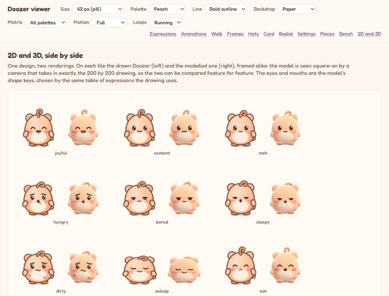
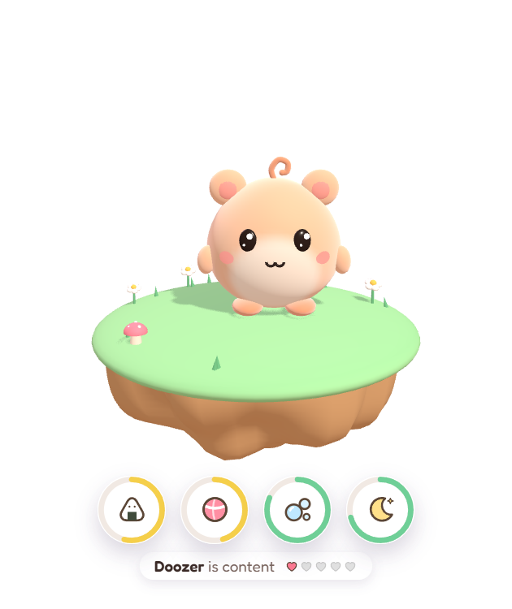
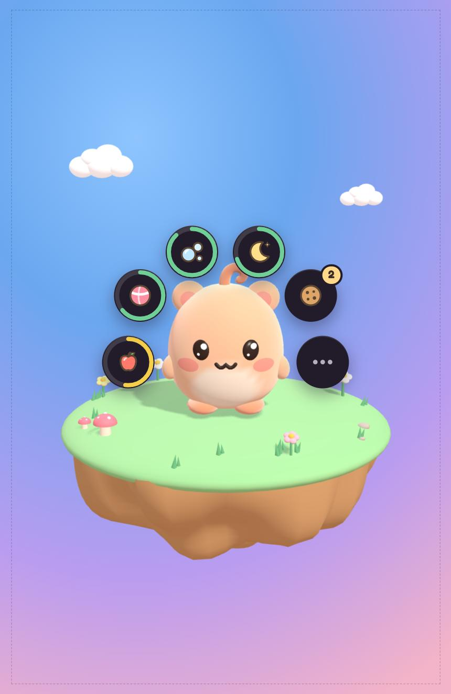
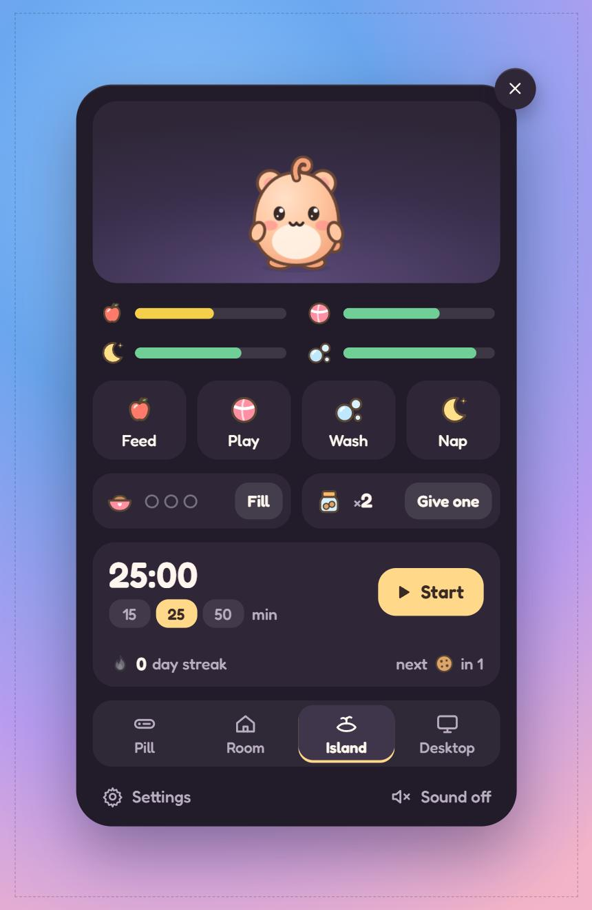
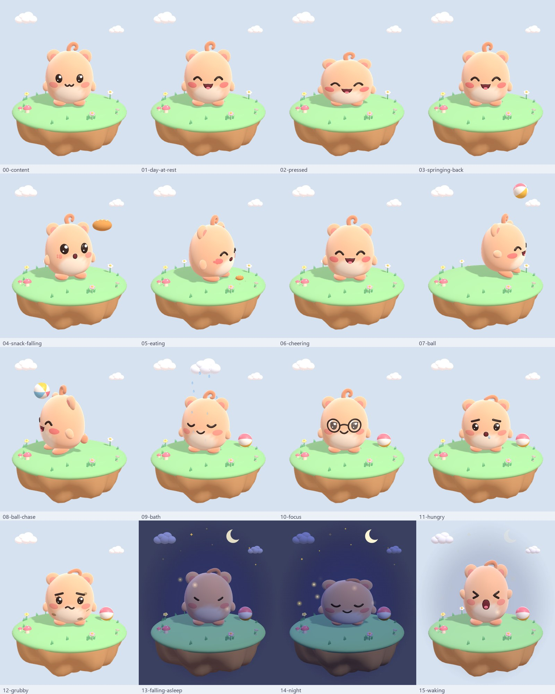

# The 3D Doozer and the Island: what was checked, and how

**Phase 8 of [WORK_PLAN.md](../WORK_PLAN.md)** · run 2026-11-13 · the same machine as [shell-spike.md](shell-spike.md): Windows 11 Pro, one 3840 × 2160 display at 150 % scaling and 120 Hz, 24 logical cores, WebView2.

Phase 8 gives Doozer a modelled 3D body and its third home: a soft 3D Doozer on a small floating island, in a frameless, transparent window. This file records what was verified, by what means, what the numbers were, and what is left for a person.

## In short

| Asked for | Result | How it is known |
|---|---|---|
| The model: scripted in Blender, shape keys for the expression list, a small armature, five palettes | Done: one script, one 631 KB glTF file, 13,700 triangles, 10 bones, all sixteen expressions, five palettes | `app/assets/doozer/build_doozer.py`; 17 tests read the exported file (section 2) |
| The 2D and the 3D Doozer are one creature | Same outline, same pivots, same faces, shown side by side | The viewer page, and tests that compare the model's measurements with the 2D rig's (section 2) |
| The Island matches or beats the mockup for charm | **In my judgement it beats it; the owner's eye decides.** Sixteen stills from the real window are below | Section 3 |
| Ten switches into and out of the Island leak nothing | **Nothing piles up, but memory does not return to where it was.** The 3D engine is collected after every visit and every figure levels off (22 trips). Yet the Pill reads about 109 MB before the first visit, 119 to 125 after one, and about 140 after a dozen. About 11 MB of that is the browser's own (a trip to the Room leaves the same); about 20 MB is the Island's and I could not get it back | Release build, `measure-island-leak.ps1`, with two control runs (section 4) |
| Idle cost in the Island, awake and asleep, against 150 MB and 1 % of one core | **Inside, awake and asleep.** Awake: 122–126 MB and 0.53 % of one core averaged over ten minutes (0.60 % in a second run). Asleep: 126–127 MB and 0.71 % (0.62 %). As first built it was 1.1 to 4.6 % awake; section 5 says what was changed. A focus session is at the line, about 1 %, because the countdown repaints once a second | Release build, `measure-idle.ps1` (section 5) |
| Never stuck, with injected input: rapid pokes, a stroke whose mouse-up never arrives, every scene interrupted, the view switched mid-scene, the WebGL context lost and restored | All pass: 150 rapid pokes; a stroke whose mouse-up never arrives ended 10 ms after the button came up; 30 of 30 scenes cut short come to rest; 6 of 6 switches mid-scene; the context lost and restored, and lost for good | Injected input in the real window (section 6), and the same cases on a fake clock in the unit tests |
| Pill ↔ Island in the middle of a focus session loses nothing | Nothing lost: twice to the Pill and back, the countdown carries on to the second, and the session pays in full at the end | Through the real host in the tests, and in the real window (section 7) |
| three.js loaded only on mount, everything disposed of on unmount | Yes, and the engine itself is given back too: it lives in a hidden frame that is removed on leaving | A test walks what the app loads at start-up; the leak run asks the browser whether the engine was collected (section 4) |
| `npm test`, `npm run typecheck`, `cargo test` | 1,029 page tests (222 of them new), type-check clean, 51 native tests (2 new) | Section 1 |

## 1. Tests that run without a window

From `app/`: `npm test` (1,029 tests) and `npm run typecheck`; from `app/src-tauri`: `cargo test` (51 pass; a 52nd entry is a helper process that one of them starts). 222 of the page tests are this phase's, in `app/tests/views/island/`:

| File | Tests | What it covers |
|---|---|---|
| `model.test.ts` | 17 | The exported `doozer.glb` itself, read as a file: size, triangle count, the bones and what hangs from what, every pivot where the 2D rig has it, the body as wide and as tall as the 2D outline, a shape key for every way an expression draws the eyes and the mouth, the five palettes exactly as the 2D rig has them |
| `doozer3d.test.ts` | 16 | The 3D Doozer as a character: each of the sixteen expressions shows the eyes and mouth the 2D rig draws for it; faces ease rather than jump; blinks, including the two-redraw blink for when nobody is there; palettes, hats, glasses; every performance ends on its own timer; `destroy` leaves no timer |
| `body-motion.test.ts` | 27 | The squash-and-stretch spring and everything else the body does, as pure numbers: a hop always lands, a press lets go by itself after 8 s, everything comes to rest and says so |
| `world.test.ts` | 30 | What happens on the island, as pure numbers: Doozer's trips, the ball (cannot leave the island, is put to rest after 7 s), the snack, crumbs and raindrops, night |
| `geometry.test.ts` | 21 | The camera as arithmetic, the island's outline cut into hit regions, and what is under the pointer |
| `island-view.test.ts` | 61 | The whole view against the **real brain**, the real model file and the real three.js scene in a test DOM (only the drawing itself is stood in for): mounting and unmounting, every scene, stroke and poke, the Radial, the Card and settings, the focus chip, hit regions, the three sizes, render on demand and the frame cap (including a countdown that ticks for a minute and draws nothing), a lost graphics context, ten minutes of being watched with nothing piling up |
| `never-stuck.test.ts` | 23 | Section 6's cases on a fake clock, and further: every scene cut at seven moments by eight kinds of interruption, a press that nobody ever ends, frames that never come, four hundred random things in a row |
| `switching.test.ts` | 9 | The Island under the **real host**: a focus session carried Pill → Island → Pill, each scene left part-way, ten times in and out, a switch asked for while the Island is still loading, tuck-away |
| `lazy-three.test.ts` | 7 | Walks every module the app loads at start-up and fails if three.js is among them |
| `engine.test.ts` | 11 | The hidden frame the 3D engine is loaded into: always removed, whatever goes wrong, and it cannot keep the view waiting |

Two more native tests are in `app/src-tauri/src/hit.rs`, for a crash these runs found in the shell (section 9).

## 2. The model, and the two Doozers side by side

`app/assets/doozer/build_doozer.py` builds the whole model from numbers, with no hand work, in Blender 5.2 run without a window:

```
"C:\Program Files\Blender Foundation\Blender 5.2\blender.exe" --background --factory-startup --python app/assets/doozer/build_doozer.py
```

It writes `app/assets/doozer/doozer.glb`: 631 KB, 13,700 triangles.

| Asked for | In the file |
|---|---|
| A smooth low-poly body | The 2D rig's own body outline, turned into a solid of revolution (a little flatter front to back than wide), with a belly patch painted by a mask stored per vertex |
| Shape keys for the expression list | Eyes: open (the resting shape) and calm, half, heavy, sad, wide, happy, closed, squeeze, blink. Mouth: the small "w" (resting) and smile, open, o, flat, frown, wavy, chew, yawn, chew-shut. The sixteen expressions are combinations of these, chosen by the **same table the 2D rig uses** (`EXPRESSIONS` in `app/src/character/`), so the two cannot drift apart |
| A small armature | Ten bones: root; body and the two feet under it; ears, tuft, arms and tail under the body. Every bone rests unrotated, so its axes are the model's own |
| Palettes as material parameters | Each coloured material names the palette colour it takes; the five palettes are stored in the file exactly as the 2D rig has them, and a test compares the two |
| Extras | Cheeks, glasses (for a focus session), grime (when dirty), a drool drop, the nightcap and the bow, each fixed to a bone |

**Side by side.** `npm run dev`, then `/viewer.html?only=3d`: on each tile the drawn Doozer (left) and the modelled one (right), framed alike. The model is seen square-on by a camera that takes in exactly the 200 by 200 drawing, so the two can be compared feature for feature.



What the tests hold the model to: the body is as wide and as tall as the 2D outline; ears, tuft, arms and feet pivot where the 2D rig pivots them; it stands on the ground. What only the eye can judge, and what I see in the picture above: the faces read the same at a glance (the same eyes, the same small mouth, the same cheeks in the same place); the 3D one is softer and has no outline, as the mockup's had none; the tuft and the ears sit where they sit in the drawing.

On the island Doozer is drawn a fifth larger than the model's own size (`DOOZER_SCALE` in `layout.ts`): at the 2D rig's proportions it looked small there beside the mockup's ball of a Doozer.

## 3. The Island against the mockup

The mockup the owner saw and liked is `mockups/v2-blob`. This is it in the shell (from Phase 3), beside the Island as built (from a browser pane; the page is the same one the app's window shows):

| The mockup | The Island: the Radial open | The Island: the Card open |
|---|---|---|
|  |  |  |

Sixteen moments, **as the real window drew them** (the release build, cloaked; `app-island-stills` reads each picture back from the window's own canvas, at 570 × 675 pixels, which is Medium at 150 % scaling). The flat backdrops stand in for the desktop: the window itself is transparent.



What I judge from these, moment by moment:

- **At rest** (content, then joyful): Doozer sits on the grass with a soft contact shadow, small flowers, a mushroom and tufts of grass around it, two clouds behind. Its face is the 2D rig's face; content, it is also the mockup's: round eyes with a highlight and the small "w" mouth.
- **Pressed and springing back**: held under the pointer it is squashed flat and wide, feet on the ground; let go, it overshoots upward and settles. This is the mockup's spring, kept procedural.
- **A meal**: the snack falls beside it (one of eight, a different one each time the brain says so), Doozer looks up at it open-mouthed, hops over, turns to it and eats it in three bites, then cheers.
- **The ball**: served from the sky, chased, kicked; it stays on the island afterwards as a toy lying about.
- **A bath**: a small rain cloud over Doozer, drops, eyes closed in contentment.
- **A focus session**: round glasses on, sitting still in the middle of the island.
- **Hungry and grubby**: the worried brows and the drool drop; the smudges on its body.
- **Night**: the light cools, a dark sky glows behind the island, moon and stars fade in, fireflies drift; Doozer lies flat, asleep. Waking, the sky fades out as it stretches.

**Against the mockup.** The mockup had one face (round eyes with a highlight and a "w" mouth) on a ball, an island with a few flowers and a mushroom, and the spring. The Island keeps all of that (compare the first still with the mockup above) and adds what makes it Doozer rather than a ball: sixteen faces, a body with the 2D rig's shape, ears and a tuft that move, snacks you can recognise, a bath, glasses, night with a sky of its own, clouds. What the mockup has that the Island does not: its Doozer is a rounder, simpler ball and a little larger on its island, which some may find cuter at a glance. I think the Island beats the mockup for charm: clearly in the moments where something happens (eating, the bath, night), and about level at rest. **That is a judgement from stills; nobody has watched it move in real time** (section 10).

## 4. Ten times in and out: what is left behind

**The short answer.** Nothing is leaked in the sense of piling up with use: the 3D engine itself is collected after every visit (the browser was asked, every time), nothing is left in the page, and over 22 trips every figure rises for the first dozen visits and then stays level. But the app does **not** go back to what it was before the first visit, and waiting does not bring it back. Before any visit the Pill reads about 109 MB; after one visit 119 to 125; after a dozen or more it settles around 140 (137 to 146). About 11 MB of that is the browser's own and a trip to the Room leaves the same; the rest, about 20 MB once it has settled, is in the page's own process and is the Island's. Loading the engine into a frame that is thrown away on leaving helped, without curing it: measured the same way, the Pill after ten visits read 148 MB with the engine imported into the page (as first built) and 131 MB with the frame, and the page heap after a visit fell from 7.7 to 4.7 MB.

**How it was measured.** `app/scripts/measure-island-leak.ps1` starts the release build, cloaked, with a browser profile of its own (so no other copy shares its processes) and with a way for the page to ask for a garbage collection (so that what is read is what is held, not what has not been tidied yet). The `app-island-leak` run sits in the Pill; then, ten times: switches to the Island as the host does it, uses it for seven seconds (a meal, a game of ball, a bath), and switches back. After each return it waits 12 seconds, collecting garbage twice, and the script reads every process of the app. Memory is private working set, the figure Task Manager shows; "video memory" is what Windows accounts to the app's GPU process (the "GPU Process Memory" counters: dedicated, and shared after the plus sign); the page's own heap is the browser's figure. The run also asks the browser a direct question on every return: has the 3D stage been garbage-collected? (a weak reference to it, which holds nothing).

**The Island, ten trips:**

| When | All processes | Page (renderer) | GPU process | Video memory | Page heap | 3D engine |
|---|---|---|---|---|---|---|
| In the Pill, before the Island was ever opened | 109.0 MB | 32.8 | 30.5 | 22.3 + 4.7 | 1.72 MB | |
| In the Island (1st and 10th visit) | 155.1 / 157.7 | 62.2 / 63.8 | 44.6 / 49.3 | 52.9 + 4.5 / 53.2 + 7.6 | 9.03 / 9.87 | 25 geometries, 15 textures, 15 shader programs on the graphics card, the same every visit |
| Back in the Pill after 1 visit | 119.1 | 36.7 | 38.4 | 26.5 + 5.2 | 4.75 | collected |
| Back after each of visits 2 to 9 | 127.9 to 139.8 | 40.9 to 48.5 | 40.5 to 46.7 | 26.4 to 30.1 + 5.4 to 7.2 | 4.87 to 5.32 | collected, every time |
| Back after 10 visits | 129.5 | 41.8 | 42.9 | 25.9 + 7.2 | 5.34 | collected |

(One reading of the video-memory counters, after the third visit, came back as zero and is left out.) The same ten trips were made again on the very last build, after the one-line change described in section 5: 108.0 MB before, 124.9 after one visit, 131 to 142 after visits 2 to 9, 130.4 after ten; page heap 1.89, 4.73, 5.34 MB; the engine collected every time. No canvas and no engine frame is left in the page after any return, and what three.js holds on the graphics card while in the Island is the same on the tenth visit as on the first.

**Two control runs**, to tell what is the Island's from what is not. The same script, the same waits:

| Run | Before | Back after 1 | Back after 10 | The ten returns | Page heap: before, after 1, after 10 |
|---|---|---|---|---|---|
| **The Island** | 109.0 MB (page 32.8, GPU 30.5) | 119.1 (36.7, 38.4) | 129.5 (41.8, 42.9) | 119 to 140 (page 37 to 49, GPU 38 to 47) | 1.72, 4.75, 5.34 |
| **By way of the Room instead** (no 3D anywhere) | 110.1 (33.8, 31.0) | 123.3 (37.2, 42.7) | 121.2 (33.2, 44.5) | 118 to 123 (page 32 to 37, GPU 42 to 46) | 1.90, 2.01, 2.63 |
| **No trip at all: a bare WebGL canvas** put up in the Pill for seven seconds and taken down, one triangle, nothing of three.js | 109.6 (33.1, 30.8) | 104.8 (32.5, 28.4) | 100.5 (27.4, 29.4) | 100 to 105 (page 27 to 33, GPU 28 to 30) | 1.71, 1.92, 1.98 |

What these say:

- **The GPU process's 8 to 16 MB, and the extra video memory, are not the Island's.** A trip to the Room, which draws no 3D, leaves the GPU process 11 to 15 MB higher and its video memory 3 to 13 MB higher; a trip to the Island leaves them 8 to 16 and 4 to 8 MB higher. Presumably it is what the browser keeps once the window has been larger than the pill. A page cannot give it back.
- **WebGL by itself leaves nothing.** The bare canvas run ends *below* where it started.
- **The slow rise of the page heap, 0.07 MB a visit, is not the Island's either:** the Room run rises by exactly the same 0.07 MB a visit. It belongs to switching views (or to the measuring run itself), and the longer run below shows it stopping after about a dozen visits.
- **What is the Island's:** over these ten visits the page's renderer process is 4 to 16 MB higher than before (37 to 49 MB, where the Room run returns to 32 to 37), and over more visits it settles 13 to 23 MB higher (below). About 2.7 MB of that is page heap that a garbage collection does not return. The stage and everything it made *are* collected, so this is not the scene; my best understanding is compiled code and memory the browser has set aside and returns on its own schedule (the figure swings by 6 MB between one return and the next, in both directions). **I could not get this to zero, and I do not know how to from inside a page.**

**Does it level off? Twenty-two trips.** Ten trips are too few to tell a slow leak from a figure that is still settling, so the same run was made with 22 (while the scripted checks of section 6 were running in a second copy of the app):

| When | All processes | Page (renderer) | GPU process | Page heap | 3D engine |
|---|---|---|---|---|---|
| Before | 108.6 MB | 32.8 | 30.4 | 1.71 MB | |
| Back after 1 visit | 124.8 | 42.9 | 38.0 | 4.74 | collected |
| Back after visits 2 to 11 | 130 to 147, mean 136.5 | 42 to 55 | 39 to 46 | 4.85 to 5.35 | collected, every time |
| Back after visits 12 to 22 | 137 to 146, mean 141.6 | 46 to 56 | 43 to 48 | 5.36 to 5.42 | collected, every time |
| of which visits 12 to 16, and 17 to 22 | mean 141.0, and mean 142.1 | | | | |

(One reading, after the eighth visit, was taken before the Island's graphics memory had been released: 166.6 MB with 56 MB of video memory, the Island's own figure. It is left out of the ranges; the readings either side of it are ordinary.)

It levels off: the page heap stops at 5.4 MB, the GPU process at 43 to 48, and the total wanders between 137 and 146 MB with no trend over the last eleven visits. **So the fair figure for "the Pill after the Island has been used a good deal" is about 140 MB, against 109 before and about 121 after as many trips to the Room.** About 20 MB of the difference is in the page's own process, 3 MB of it page heap; the readings alternate between a higher and a lower value from one visit to the next (about 7 MB apart), which looks like memory the browser's own allocators hold and reuse rather than anything the page still refers to.

**Does it come back if left alone? Three minutes of rest.** The same run with two trips and three minutes of waiting before every reading, in case the browser simply returns memory late:

| When | All processes | Page (renderer) | GPU process | Page heap |
|---|---|---|---|---|
| In the Pill, three minutes after starting | 101.4 MB | 29.5 | 28.0 | 1.81 MB |
| In the Island, three minutes at rest (both visits) | 130.3 / 131.0 | 42.7 / 46.2 | 42.4 / 41.2 | 9.12 / 9.44 |
| Back in the Pill, three minutes after the 1st visit | 119.2 | 38.3 | 36.1 | 4.81 |
| Back in the Pill, three minutes after the 2nd | 121.9 | 40.4 | 37.6 | 4.93 |

No: three minutes later the app is still 18 to 20 MB above where it was (the Pill itself, left alone for three minutes, settles 8 MB lower than it reads after twelve seconds, which is why this "before" is 101 and not 109). Waiting is not what gives it back.

**What was tried, in order.**

| Build | Back in the Pill after 1 visit | After 10 visits | Page heap after 1 and after 10 |
|---|---|---|---|
| The engine imported into the page (three.js loaded with `import()` on mount; scene, model and WebGL context disposed of on unmount). 6 s settle | 145.4 MB (page 57.0, GPU 42.3), from 111.3 before | 147.8 (page 54.0, GPU 46.8) | 7.65, 9.43 MB |
| **The engine in a frame of its own, removed on unmount** (as it is now). 6 s settle | 144.6 (page 55.8, GPU 42.2), from 110.9 | 131.4 (page 43.4, GPU 43.2) | 4.70, 5.33 |
| The same build, 12 s settle (the table above) | 119.1 (page 36.7, GPU 38.4), from 109.0 | 129.5 (page 41.8, GPU 42.9) | 4.75, 5.34 |

Disposing of everything three.js made was not enough: a script that a page has loaded stays loaded, and so does all the memory its code occupies. So the engine is now loaded into a hidden frame (`app/src/views/island/engine.ts`, `app/island-frame.html`) and the frame is removed when the Island is left; the page heap after a visit fell from 7.65 to 4.7 MB and the browser confirms the engine is collected. The first try with the frame looked *worse* (the heap rose 1.1 MB with every visit), and that was the measuring run's own doing: it kept the small report the stage hands out, and an object keeps alive the whole script world that made it (section 9).

**Against the "done when".** "Ten switches leak nothing", in the sense of nothing growing without limit: yes, measured over ten and over twenty-two. "GPU and process memory return to baseline": **no, not fully, and I could not make them.** After the Island has been used the Pill sits at 119 to 146 MB where it sat at 109 before, and stays there; as many trips to the Room leave it at about 121. That is still under the Pill's idle budget of 150 MB, but with little to spare, and on a machine or a day where the Pill starts higher it would not be. Restarting the app gives everything back. What I would try next, if this matters: keep one engine frame for the life of the app instead of a new one per visit (the engine's code would then stay in memory for good, so it is only worth it if the leftover turns out to come from making and removing frames), and ask the browser's own tools what the page's process is holding (a heap snapshot and `chrome://tracing` memory dump, which need a person at the screen).

## 5. Idle cost

Release build, `app/scripts/measure-idle.ps1` with the `app-island-idle` scenario: 40 s to settle, then windows of 60 seconds; every process counted (the app and its WebView2 processes); the window cloaked and the pretend cursor parked. Memory is private working set, the figure Task Manager shows; CPU is a share of one core. See [shell-spike.md](shell-spike.md) section 2.1 for why those are the right numbers. The budget is **under 150 MB and under 1 % of one core**. The scenario also writes down how many frames the island drew in every ten seconds, so each figure can be read against what Doozer was doing. (The owner's machine was in use throughout, and other sessions were compiling on it at times; the figures are this app's own processes only.)

| State | Memory | CPU, share of one core, per 60 s window | What was drawn meanwhile |
|---|---|---|---|
| **At rest in the Island, awake**: ten minutes, on the final build | **122–126 MB** | 0.29, 0.31, 0.34, 0.42, 0.44, 0.47, 0.55, 0.68, 0.78 and one of 1.09 (the first). **Average over the ten minutes: 0.53 %** | 284 frames in 620 s: a blink of two redraws every 5 to 11 s, and five small stirs of 16 to 32 frames each |
| The same ten minutes on the build before it | 122–127 MB | 0.21, 0.36, 0.39, 0.44, 0.54, 0.60, 0.62, 0.62, 0.65 and one of 1.60 (the first). Average: 0.60 % | 277 frames in 620 s; five stirs of 19 to 31 frames |
| **Asleep on the island, at night**: four minutes, on the final build | **126–127 MB** | 0.41, 0.55, 0.67 and 1.22 (the first). **Average: 0.71 %** | 64 frames in 260 s: one frame every 4 s as the fireflies move |
| The same four minutes on the build before it | 125–129 MB | 0.29, 0.55, 0.75, 0.88. Average: 0.62 % | 69 frames in 260 s |
| **A focus session**, Doozer in its glasses, the chip counting down: three minutes, on the final build | 123–124 MB | 0.86, 1.09 and 2.18 (the first) | 52 frames in 200 s: blinks only. The chip under the island repaints once a second |
| For comparison, **at rest in the Pill** (the build before the final one) | 101 MB | 0.36, 0.49 and 1.40 (the first again) | |
| Not idle: **the pointer resting on Doozer the whole time**, so that it never stops moving (30 s windows; the build before the final one, as is the next row) | 154–159 MB | 18.0, 25.3 | 43 frames a second |
| The same for four minutes, with a garbage collection every ten seconds | 132–137 MB | 13.2, 16.0, 18.5, 19.3 | 10,807 frames. The page heap after each collection: 8.90 MB at the start, 9.12 MB at the end |
| Budget | under 150 MB | under 1 % | |

**Verdict: inside the budget, awake and asleep**, on the averages and in 25 of the 28 one-minute windows; the three over the line are each the first window of a run. Memory is about 25 MB more than the Pill, for three.js, the model and a WebGL context. CPU at rest is what a still pill costs plus very little, because at rest the island is a still picture: nothing is drawn unless something changed. In every run the one window over the line (1.09 and 1.60 % awake, 1.22 % asleep, 2.18 % in a session) is the first after the 40 seconds of settling, when nothing unusual was being drawn (two to four frames in every ten seconds); the Pill's first window reads high in the same way. I take it for the tail of start-up, and it is counted in the average all the same.

**It did not meet the budget as first built, and this is what was changed.** The first measurement of the finished view (the same script, 30 s windows) read:

| State, as first built | Memory | CPU per 30 s window |
|---|---|---|
| At rest, awake (two runs) | 119–124 MB | 1.09, 1.60, 2.74, 2.87, 4.64, 7.51 |
| Asleep (two runs) | 119–125 MB | 0.52, 0.57, 0.88, 0.93, 1.19, 1.39 |
| A focus session | 140–142 MB | 1.45, 1.60, 2.79 |

Awake, that is two to seven times the budget. The cause was what Doozer did by itself: every 50 to 110 seconds it "came alive" for 2.6 seconds for a small stir (breathing, looking about, perhaps hopping to a new spot), drawn at up to sixty frames a second. A second of animation in this window costs about a fifth of a core-second (the "watched" row above: 43 frames a second for 18 to 25 % of a core, about 5 ms of processor time a frame across the page, the GPU process and the browser), so one such spell was half a core-second or more, and a wander on top of it more again. So the pace with nobody there was set by that arithmetic (as the Room's was):

| Alone on the island | As first built | Now |
|---|---|---|
| A blink (two redraws) | every 4 to 9 s | every 5 to 11 s |
| A small stir | every 50 to 110 s, Doozer lively for 2.6 s | every 70 to 170 s, only the second or so its body moves; it does not come alive for it |
| Frame rate for anything done unwatched | up to 60 a second | 30 a second |
| Asleep: the fireflies move | every 2.6 s | every 4 s |

With the pointer resting on the island nothing was changed: Doozer breathes, looks at the pointer, and hops somewhere new every 2 to 5 seconds, at sixty frames a second when something happens. Whether the island is now *too* still when nobody touches it is a question for the owner's eye (section 10); the four numbers are at the top of `app/src/views/island/index.ts`.

**A focus session is at the line, not under it: about 1 %.** Nothing of the 3D scene is drawn for it (blinks only), but the countdown chip under the island changes once a second, and the browser then has to put the whole window on screen again, 3D picture and all. That costs here about what a 3D frame costs. The Pill's status line and the Room's title bar tick the same way (0.4 to 1.0 % and 0.7 to 1.8 % in their write-ups). The first measurement of a session read 1.2 to 1.9 % and showed a second cause, which is fixed: the frame counts gave it away, one 3D frame a second for the whole session. The view woke its frame loop on every change in the brain, and during a session the brain changes every second. It no longer does; what changes the picture asks for its own frame, and a test now ticks a countdown for a minute and counts the frames. To get a session clearly under the line, the chip would have to tick less often when nobody is looking (minutes, with seconds only for the last minute or while the pointer is on the island). That is a change to the shared kit and to what all four views show, so it is left for Phase 10 and not made here.

**Watched, it costs what animation costs here, and nothing piles up.** With the pointer resting on Doozer it animates without a break: about a fifth of one core, split evenly between the page and the GPU process. Memory reads 154 to 159 MB in that state and climbs while it is watched, which is over the 150 MB line and looked like a leak. It is not: with a garbage collection asked for every ten seconds the same four minutes of animation sit at 132 to 137 MB and the heap is flat (8.9 to 9.1 MB across 10,807 frames, with the same 22 geometries, 12 textures and 12 shader programs throughout). The 20 MB is garbage the browser had not collected yet; drawing a frame makes a fair amount of it. A unit test also watches Doozer for ten minutes and counts everything that could pile up (elements, scene objects, geometries, materials, textures, particles, listeners, timers): the same at the end as at two minutes. Being watched is not "idle", so the budget does not apply to it; it is written down so that nobody is surprised by the number in Task Manager.

## 6. Never stuck, with injected input

The rule is the Desk Buddy's lesson: every temporary state has a time limit and a guaranteed way back to rest. "At rest" is asked the same way everywhere: no scene, no performance, nothing moving, nothing being drawn, no press held, no snack, crumb, raindrop or emote left, Doozer facing front where it belongs, the mood's own face showing, and only the timers that belong to rest still armed.

**On a fake clock** (`never-stuck.test.ts`, 23 tests):

| Case | What was done | Result |
|---|---|---|
| Rapid pokes | Two hundred presses on Doozer in a few seconds; then pokes on everything at once (Doozer, the ball, the snack, the grass) | Every poke jiggles; the brain hears none of them (a poke is not a rule); everything comes to rest |
| A press whose mouse-up never arrives | Ended by the shell's `pointer-released`; by the next move with no button held; by the pointer being cancelled, losing capture or leaving; by nobody saying anything at all; and with frames stopped as well | Ends every time (by itself after 6 s; the body lets go after 8 s in any case) and toggles nothing. A mouse-up that is merely late still counts as one click |
| Every scene, interrupted at several moments | Nine scenes (feed, treat, play, wash, fall asleep, wake, a session starting, a session ending, a refusal), each cut at seven moments from 0 to 4.2 s, by: another action; a poke and a stroke; falling asleep; being tucked away; the Card opening and closing; the graphics context lost and restored; the context lost for good; frames stopping for a while | Always comes to rest, with nothing left on the island |
| The view left mid-scene | Unmounted at four moments of each scene; popped out for a window change mid-scene, with and without frames | No timer, no listener, no element and nothing on the graphics card left behind; the pop-out settles in time |
| Frames that never come | Every scene played with nothing ever drawn | Every scene still reaches its end: after 300 ms without a frame a timer moves time on |
| Tucked away | At any moment of anything | Every timer and every frame stops; it comes back whole; a session that ended meanwhile is celebrated on coming back |
| Random prodding | Four hundred things at random, then rest | At rest |

**With injected input, in the real window** (`app-island-stuck`). Presses are made as a real press is, twice over: the shell's cursor tracker is fed a pretend cursor and button, so the window's click-through state and the shell's `pointer-released` are the real ones, and the page gets the matching pointer events. The real pointer is never moved.

| Case | What was done | Result |
|---|---|---|
| Rapid pokes | 150 presses on Doozer in quick succession (one every 30 ms or so), the native side seeing each button go down and up | Every poke jiggles (squashed to 97 % at the least, read between presses); the brain heard none of them; afterwards everything is at rest, the shell is not holding a press, the window lets clicks through again, the watchdog never had to step in, and the next click opens the Radial |
| A stroke whose mouse-up never arrives | Press on Doozer; stroke back and forth across it with the button held; then the cursor leaves at speed, still held, and the button comes up 800 pixels away. The page is given no `pointerup` | While held, the window kept catching and never went click-through. The press ended **10 ms** after the button came up (9 ms in an earlier run), on the shell's `pointer-released`, sent exactly once. The stroke had counted as one pet, as it should; nothing was toggled; Doozer came back to rest |
| Each scene interrupted at several moments | Six scenes (feed, treat, play, wash, fall asleep, a session ending), each cut at 0, 300, 900, 1800 and 3200 ms, in turn by a poke, by another action, and by being put to sleep or woken: 30 cuts | 30 of 30 come to rest, with no snack, ball in flight, raindrop or emote left |
| The view switched mid-scene | Six times, Island → Pill → Island, each in the middle of a different scene | Every time: the Island is gone whole (no canvas, no snapshot), the Pill is itself, and back in the Island Doozer is at rest |
| The WebGL context lost and restored | Lost through the browser's own test hook (`WEBGL_lose_context`); a meal begun while it was lost; then restored | The view notices at once and arms its 2.5 s timer; the meal goes on though nothing can be drawn. The context was back 66 ms after it was asked for: the same canvas, no rebuild, the picture as before (35 % of the canvas covered, before and after), and Doozer comes to rest |
| The WebGL context lost for good | Lost and never restored | After 2.5 s the renderer is rebuilt on a new canvas: one canvas in the page, the picture back (35 % covered), first frame 66 ms after the rebuild, a press on Doozer still works, Doozer at rest, only the timers of rest armed |

Six scenes rather than the tests' nine, and five moments rather than seven: the real-window run is there to check that the real window, the real WebGL context and the shell agree with the tests, not to repeat them. It takes eight and a half minutes as it is. The whole run was made twice, on the last two builds, with the same results; the figures are the last run's.

## 7. A focus session carried between the Pill and the Island

**Through the real host** (`switching.test.ts`: the Pill view, the Island view, the host and the brain all real; only the shell and the drawing itself are recording stand-ins). A 25-minute session is started from the Island's Card. Four minutes in, the chip under the island reads 20 or 21 minutes. Into the Pill: the Island is gone whole, the session is running, and the pill is a countdown showing the same time. Six minutes later, back to the Island: still running, six minutes further on, glasses on, the chip showing. Paused there and taken to the Pill: still paused, and three minutes later the time left has not moved by a millisecond. Resumed, back to the Island, and it runs out there: Doozer celebrates, 2 treats for the 25 minutes and 1 for the first of the day, 1 session counted. Also: a session started in the Pill and finished while the Island shows is celebrated on the island; needs, bowl, treats, sleep and colour are the same on both sides of a switch; the Island's window position from a drag is handed back on the next visit and the app reopens in the Island.

**In the real window** (`app-island-focus`):

| Step | Seen |
|---|---|
| Before | 5 treats, no session yet today |
| A session started in the Island | Running; Doozer has its glasses on and its focus face; the chip under the island reads 24:59, and 24:57 two seconds later; emotes are silenced |
| To the Pill, by the host's own switch | Still running; the pill is a countdown showing the time that was left on the island (24:57), and its ring is the session's |
| Back to the Island | Still running, three seconds further on (24:54); glasses on, chip showing |
| The same round trip again | 24:54 in the Pill, 24:51 back in the Island |
| Sampled 93 times across all of that | The time left never went backwards, the session was never anything but running, and the countdown never differed from the wall clock by more than 0.9 s (the brain counts in whole seconds) |
| Finished while the Island shows | Doozer celebrates and comes back to rest; 5 → 8 treats (2 for the 25 minutes, 1 for the first of the day); 1 session, streak 1 |

## 8. The window: click-through along the island's outline, and the three sizes

The window is one transparent rectangle (408 × 640 CSS pixels at Medium: the island's 380 × 450 drawing with an empty band above and below for the Card, which is taller than the island). It lets clicks through everywhere except its hit regions, and a hit region is a rounded rectangle. The island is not one, so its silhouette is worked out from the camera's own numbers (not read back from the picture) and cut into slabs about 16 pixels tall; Doozer adds two rounded boxes that follow it, the ball a round one, and the Radial, the grip and an open panel their own.

`app-island-window` asks Windows itself, point by point, whether a click there would reach the island or go through to what is underneath (the shell's probe, as in Phase 3), with the pretend cursor at each point:

| Where | Expected | Windows says |
|---|---|---|
| On Doozer; on its ear; on the grass, left and right; on the earth underneath; on the ball | Caught | Caught, all six |
| The four corners of the drawing; beside the earth, under the rim of the grass; the sky above Doozer; the bands kept for the Card, above and below | Through | Through, all eight |
| The Radial open: on its first and its last button | Caught | Caught |
| The Radial closed again: where its first button was | Through | Through |
| The Card open: on the Card; beside the Card, in the band | Caught; through | Caught; through |

19 of 19. The open Radial's hit regions cover all six of its buttons as the page lays them out.

| Size | Window, CSS pixels | Window on this screen (150 %) | Hit regions at rest |
|---|---|---|---|
| Small | 408 × 640 | 612 × 960 | 12 |
| Medium | 408 × 640 | 612 × 960 | 13 to 14 |
| Large | 476 × 642 | 713 × 962 | 17 |

The window is never narrower than the Card needs, so Small and Medium share a window and differ in the island drawn inside it. After each change of size Doozer is back at rest and the window is the size asked for. The shell's limit is 64 regions.

**Switching in.** `app-island-hello` goes from the Pill to the Island as the host does it: 1.3 s in all (1.3 to 1.6 s over three runs), of which the pop-out, the window change and the pop-in are most. Loading the engine into its frame and the model took 46 ms, building the scene 25 ms, and the first frame 469 ms (469 to 719 ms over three runs: the graphics driver compiling twelve shader programs; the frame is drawn inside `mount`, so the island is complete when it is shown). A context rebuilt later, in the never-stuck run, drew its first frame in 66 ms, the programs then being in the browser's cache.

## 9. Found on the way

Things the real-window runs turned up that the unit tests could not, each fixed:

1. **A round hit region could crash the whole app** (in the shell, so it concerned every view; fixed in commit `fd4a8bd`). `Region::contains` in `app/src-tauri/src/hit.rs` found the nearest point of a region's inner box with `f64::clamp`. For a region whose corner radius is exactly half its width (a circle: the ball, the Radial's buttons, the round end of a pill) the two bounds are the same point, and rounding can leave them out of order by a hair (204.0 against 203.99999999999997). `clamp` panics on that; the panic is on the cursor thread; a release build aborts on a panic; the app was gone with exit code `-1073740791` and no report. It only happened while the cursor was inside the bounding box of such a region, so it looked random. `nearest()` replaces `clamp`, with two tests.
2. **Several Doozer builds running at once share one browser profile**, and with it the browser process and its cache: one session's test build could be handed another's page, and memory measured per process tree was wrong. Every scripted run and measurement here sets `WEBVIEW2_USER_DATA_FOLDER` to a scratch folder.
3. **A build can come out with no page in it.** With `frontendDist` given as an absolute Windows path, Tauri embeds nothing and the exe starts blank. The path must be relative to `src-tauri`; `build-island-checks.ps1` now checks that pages were embedded.
4. **The test hook for losing the graphics context has to be fetched before the context is lost.** Asked for afterwards, the browser returns nothing, so the first real-window run could lose the context but not give it back, and what it exercised was the other path (the context "lost for good", the renderer rebuilt on a new canvas after 2.5 s), which worked. The hook is now kept from the start and both paths are run.
5. **An object made by the 3D engine keeps the whole engine alive.** With the engine in a frame of its own (section 4), the first measurement showed the engine being kept, once more with every visit (the page's heap grew by 1.1 MB each time): the measuring script itself held the small report `stage.info()` returns, and an object belongs to the script world that made it. The check now copies numbers out and asks the browser directly whether the engine was collected. The view's own code holds nothing past `unmount`; the README of the view says what to watch for.
6. **What Doozer did alone was too dear.** The first idle measurement was 1.1 to 4.6 % of one core awake, against a budget of 1 %: every minute or so Doozer "came alive" for 2.6 seconds for a small stir, at up to sixty frames a second. Section 5 has what was changed.
7. **Doozer looked small on the island** at the 2D rig's exact proportions, beside the mockup's ball. It is drawn a fifth larger there.
8. **The night sky was a rectangle.** The dark glow behind the island was cut off by the edge of the drawing; it is now sized from the camera's own numbers and fades out before the edge.
9. **A focus session drew a 3D frame every second.** The view woke its frame loop on every change in the brain, and during a session the brain changes once a second. The unit tests did not tick the brain as the host's clock does, so they saw nothing; the idle run's frame counts did (section 5). Fixed, with a test that ticks.

## 10. Not verified: needs a person at the mouse

Everything above used scripted input and a cloaked window, because the machine was in use; the look was judged from still pictures. None of the following is expected to fail; each takes a minute. Run `npm run tauri dev` in `app/` (or a release `doozer.exe`), and pick **Island** in the tray menu or in the Card's row of views.

| Not verified | What to do |
|---|---|
| **How it looks and moves, and whether it beats the mockup** | Watch it for a minute with the pointer resting on the island: it should breathe, look at the pointer and hop to a new spot now and then. Feed it, play, wash it, send it to sleep and wake it. Compare with `npm run pet -- blob` from the repository root. This is the one "done when" that is the owner's to call |
| **The squash** | Press and hold on Doozer: it flattens under the pointer. Let go: it springs back. Click it quickly many times |
| **A real stroke** | Move the pointer back and forth across Doozer without pressing: a heart, at most every 0.6 s |
| **A real click on Doozer** | The Radial opens around it; click a button; click Doozer again to close it. "More" opens the Card over the island |
| **Clicks beside the island** | Click in the window's empty corners, just beside the grass and under the rim of the earth: whatever is underneath should react. The whole window is 408 × 640 at Medium, most of it empty |
| **Moving it** | The grip appears at the top while the pointer is on the island: drag by it. Put the island at the very top and at the very bottom of the screen and open the Card there. Quit and start again: it should be where it was left |
| **The ball and the snack** | After a game the ball stays on the island: click it and it hops. Click a snack as it lands |
| **Night on your wallpaper** | Send Doozer to sleep on a pale wallpaper and on a dark one. The dark-blue glow behind the island should fade out softly with no visible edge, and the moon and stars should show on both |
| **A focus session** | Start one from the Radial or the Card: glasses on, the chip under the island counts down. Switch to the Pill and back in the middle. At the end, a celebration and the treats; with "Open the Card" chosen, the Card opens without taking the keyboard |
| **Typing elsewhere** | Type in an editor, then stroke, poke and feed Doozer: the text should keep going into the editor |
| **The right-click menu** | Right-click the island |
| **Small and Large** | Change Size in Settings: the island scales, the Radial and the Card do not. At Small the Radial should still sit inside the window |
| **Colours and hats in 3D** | Try the five palettes, the nightcap and the bow in Settings |
| **Reduced motion** | Switch it on in Settings: Doozer is placed rather than hopped, nothing springs or loops |
| **A real fullscreen app** | With "Tuck away" on, start a game or a fullscreen video while in the Island: it should go, and come back whole afterwards |
| **A graphics context really lost** | Sleep and wake the machine, lock and unlock, or restart the graphics driver (Win+Ctrl+Shift+B) while the Island shows. It should carry on within a few seconds. The scripted run lost the context through the browser's own test hook, which is not quite the same thing |
| **Other screens** | Nothing here ran at 100 % or 200 % scaling, on a 60 Hz screen, on a second monitor, or on a laptop's integrated graphics. The idle figures in section 5 are for this machine |
| **The pace when nobody is looking** | It was set by measurement to fit the budget (section 5): a blink every 5 to 11 seconds and a small stir every minute to three. If the island feels too still when you are not touching it, the numbers are at the top of `app/src/views/island/index.ts`, and section 5 says what each second of movement costs |
| **Leaving it open all day** | The longest run so far is ten minutes |

## 11. Running it again

From `app/`:

```
npm test
npm run typecheck
cd src-tauri && cargo test
```

To look at it in a browser: `npm run dev`, then `/island.html` (the view on a plain page; `?bg=sky`, `?size=large`, `?palette=mint`, `?regions=1` to see the hit regions) and `/viewer.html?only=3d` (the two Doozers side by side).

The scripted checks and the measurements need a build with the test hooks. The script builds into folders of its own (`src-tauri/target/island`), so it does not disturb another build, and fails loudly if the exe came out with no page in it:

```
pwsh scripts/build-island-checks.ps1 -Plain      # also a plain release build, in target/island-plain
pwsh scripts/run-island-checks.ps1               # about a quarter of an hour, nothing shown on screen
pwsh scripts/run-island-checks.ps1 -Only app-island-stills -Out ../docs/screenshots/island
pwsh scripts/measure-island-leak.ps1 -SettleMs 12000              # ten trips; add -Control room or -Control webgl
pwsh scripts/measure-idle.ps1 -Exe src-tauri/target/island/release/doozer.exe -Scenario app-island-idle -Cloak -WarmupSeconds 40 -SampleSeconds 60 -Samples 10 -Set "WEBVIEW2_USER_DATA_FOLDER=$env:TEMP\doozer-island-webview"
```

Every run uses a scratch save folder and a browser profile of its own, feeds the shell a pretend cursor, never moves the real pointer, and is cloaked unless `-Show` is given.

| Scenario (`app/src/views/island/checks.ts`) | What it does |
|---|---|
| `app-island-hello` | From the Pill to the Island: the window, the drawing, the engine in its frame, Doozer at rest |
| `app-island-stuck` | The never-stuck cases of section 6 |
| `app-island-window` | Click-through probes along the outline, the Radial's regions, the three sizes |
| `app-island-focus` | A focus session carried between the Pill and the Island |
| `app-island-stills` | The sixteen pictures of section 3, read back from the window's canvas |
| `app-island-leak` | Ten trips for `measure-island-leak.ps1`. `{"control":"room"}`, `{"control":"webgl"}` |
| `app-island-idle` | Sits in the Island for `measure-idle.ps1`, and writes how many frames were drawn every ten seconds. `{"asleep":true}`, `{"focus":true}`, `{"watched":true}` |

The model is rebuilt with the Blender command in section 2 (no window opens). A build without `--features spike` contains none of the scripted checks: their code is not even loaded.
