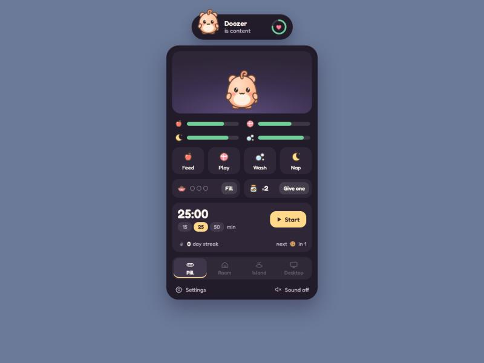
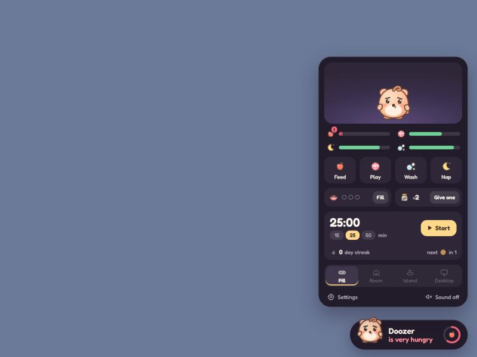

# The Pill and the app basics: what was checked, and how

**Phase 6 of [WORK_PLAN.md](../WORK_PLAN.md)** · run 2026-11-13 · the same machine as [shell-spike.md](shell-spike.md): Windows 11 Pro, one 3840 × 2160 display at 150 % scaling and 120 Hz, 24 logical cores, WebView2.

Phase 6 joins the shell (Phase 3), the pet brain (Phase 4) and the rig and UI kit (Phase 5) into the first app that ships: Doozer in a pill docked to the screen edge, the Card unfolding from it, settings, the tray. This file records what was verified, by what means, and what is left for a person.

## In short

| Asked for | Result | How it is known |
|---|---|---|
| Runs from the repo as a tray app with the pill docked | Yes | `npm run tauri dev` built and started the app, and within about a minute it had hatched its pet and saved by itself (run with the test hooks compiled in, only so that the window could be cloaked; no script was driving it). The release build was driven through the checks below |
| A full day's use behaves as the spec says | Yes | Scripted in the real window: first run, then "the next morning" (section 2) |
| Idle in the pill under 150 MB and under 1 % of one core | 94–97 MB and 0.3–1.0 % at rest: inside, with little to spare on CPU | Release build, `measure-idle.ps1` (section 3) |
| Never stuck: rapid presses, Card closed mid-scene, lost mouse-up, session ending with the Card closed | All pass | Injected input in the real window (section 4), and the same cases on a fake clock in the unit tests |
| `npm test`, `npm run typecheck`, `cargo test` | 522 page tests, type-check clean, 44 native tests | Section 1 |

What it looks like, as drawn in a browser pane (the page is the same one the app's window shows; the flat backdrop stands in for the desktop):

| The pill with the Card unfolded (top-centre dock) | Bottom-right dock, Large, a need urgent |
|---|---|
|  |  |

## 1. Tests that run without a window

From `app/`: `npm test` (522 tests, 144 of them new in this phase) and `npm run typecheck`; from `app/src-tauri`: `cargo test` (44).

| Where | What it covers |
|---|---|
| `tests/host/host.test.ts` | The host against a fake shell and fake views: the order of the three-step switch, the last view remembered, window positions kept per view, every "never stuck" path (a pop-out that never settles, frames that never come, a view that throws while mounting, a window that refuses to change), tuck-away, the clock, when the save is written, quitting |
| `tests/host/store.test.ts` | The save document and the saver's timing, including a failed write and a write in flight |
| `tests/views/pill/pill-view.test.ts` | The whole Pill view against the **real brain** in a test DOM: opening and closing, the Card's every button, settings in place, hit regions, the first run, the never-stuck cases, render on demand, tuck-away, unmount leaving no timer |
| `tests/views/pill/face.test.ts`, `attention.test.ts`, `layout.test.ts` | The pure parts: status words and ring, the lively/still clock, window numbers |
| `tests/core/brain-rewards.test.ts` | `brain.rewards` is the table the brain really pays from |
| `src-tauri/src/autostart.rs` (5 tests) | Registering and unregistering "start with Windows", against a scratch registry key |

One bug was found by these tests before it reached the window: a hatching cut short (by tuck-away) could end the *next* hatching early, which would have left a pet never marked as welcomed. It is the same family as the Desk Buddy's stuck scenes, an interrupted scene reaching into what comes after it. Each run now carries its own number.

## 2. A day's use, in the real window

`app/scripts/run-app-checks.ps1` starts the release build with a scratch save folder and runs scripts from `app/src/spike/app-scenarios.ts` against the real app. Presses are made as a real press is, twice over: the native cursor tracker is fed a pretend cursor and button, so the window's click-through state and the shell's `pointer-released` are the real ones, and the page gets the matching pointer events. The real pointer is never moved, and the window is cloaked, so nothing appears on screen. (The owner was using the machine during these runs.)

**Day one** (`app-day1`, a fresh save):

| Step | Seen |
|---|---|
| First run opens in the Pill | `lastView` is `pill` |
| Doozer hatches | Egg in the pocket, about 7.6 s, then the pet is marked as welcomed |
| It arrives with 2 treats, a biscuit and a favourite snack | Yes |
| The sound question is asked | A third hit region appears for it; sound is off |
| Answered "No thanks" | Gone; `soundAsked` is saved; two hit regions again |
| Click the pill | The Card opens |
| Feed | Tummy + 32 |
| Fill the bowl | 3 servings |
| Three focus sessions, started from the Card | Each: the pill becomes a countdown that moves, glasses on, `quiet`; on completion Doozer celebrates, the treats land (3, then 2, then 2), and across about 70 samples per session Doozer never has the keyboard |
| End of day | 3 sessions, streak 1, 9 treats, cookie and donut unlocked, next unlock the yarn ball at 6 |
| Quit from the tray menu | The page is told, saves, and the app exits with code 0 |

**The next morning** (`app-day2`, the same save, the app's clock moved 14 hours on):

| Step | Seen |
|---|---|
| The same Doozer, no second hatching, no second sound question | Yes |
| Time passed while closed | Tummy 20, fun 0, energy 93, clean 38; the bowl is empty: Doozer ate all three servings overnight |
| Yesterday is remembered | 3 sessions, streak 1, 9 treats, unlocks kept |
| One session | Streak 2, treats 9 + 2 + 1 for the first of the day = 12, 4 sessions |

Fun at 0 after a night is the brain's tuning (Phase 4), not something this phase changed: nobody played on day one of the script.

Also checked this way (`app-window`):

- **Click-through:** 10 of 10 probe points have the right window style: on the pill and on Doozer's head above it the window catches; beside the pill, inside the pill's rounded corner, and where the Card would be, it lets clicks through; with the Card open, the Card catches and the space beside and below it does not; closed again, it lets through again. (Cloaked, Windows' own hit-test cannot be asked; the shell spike did that with the same mechanism.)
- **The four docks:** the window lands exactly on the top-left, top-right and bottom-right corners and the top centre of the work area, Doozer is back after the move, and the pill is clickable there.
- **Tuck away:** with a fullscreen app reported in front, the window is hidden, nothing catches the mouse, the Card is folded and the view has no timer running; when the app leaves, everything is back and no focus was taken. (The fullscreen report itself was simulated here; the shell spike confirmed detection against a real game.)
- **Always on top** follows the setting, read back from Windows.
- **Start with Windows** registers this copy and unregisters it. The run uses a scratch registry key (`DOOZER_AUTOSTART_KEY`), so the real Run key was never written.
- **The tray menu:** the icon exists, Pill is ticked, Room / Island / Desktop read "(coming soon)" and are disabled, and Settings… opens the settings panel.
- **Settings and the keyboard:** with the settings panel open a click may give the window focus; opening it takes none; closed, the window refuses focus again.

Separately: a second copy started against the same save folder exits at once (code 0) while the first keeps running; a copy pointed at another save folder runs alongside; and a first run left alone hatches and saves by itself.

Nothing these runs did touched the owner's own data: afterwards there was no `%APPDATA%\com.doozer.desktop` folder, no `Doozer` value under the real Run key, and no scratch registry key left behind.

## 3. Idle cost

Release build, `app/scripts/measure-idle.ps1`: 20 s to settle, then three 30-second windows; every process counted (the app and its WebView2 processes). Memory is private working set, the figure Task Manager shows; CPU is the range across the three windows, as a share of one core. See [shell-spike.md](shell-spike.md) section 2.1 for why those are the right numbers and for the Phase 3 figures (73 MB and 0.4–0.9 % for the empty test page).

| State | Memory | CPU, share of one core (six 30 s windows over two runs) | Seen |
|---|---|---|---|
| **At rest in the pill** (the everyday state) | **94–97 MB** | **0.3–1.0 %** (0.26, 0.57, 0.57, 0.62, 0.67, 0.98) | Cloaked, pretend cursor parked |
| The same, window really on screen | 93 MB | 0.2–0.8 % (0.16, 0.21, 0.31, 0.47, 0.57, 0.83) | Visible in the bottom-right corner, pretend cursor parked |
| A focus session counting down | 97–103 MB | 0.4–1.0 % (0.41, 0.42, 0.67, 0.73, 0.83, 0.99) | Cloaked. The status line repaints once a second |
| The Card left open, nobody there | 100–105 MB | 0.4–1.1 % (0.41, 0.41, 0.78, 0.78, 0.99, 1.14) | Cloaked. The Card goes still after a few seconds |
| Doozer asleep | 100 MB | 0.2–0.8 % (0.21, 0.26, 0.31, 0.36, 0.52, 0.83) | Cloaked. No blinking, no z's |
| Budget | under 150 MB | under 1 % | |

**Verdict: inside the budget at rest, with little to spare on CPU.** The empty test page of Phase 3 measured 73 MB and 0.4–0.9 %, so the real pill adds about 20 MB (the rig, the kit, the Card and the settings panel are all built but closed) and nothing measurable in CPU. At these levels the measurement itself is coarse: one step is 0.05 % of a core over a 30-second window, and single windows wander between 0.2 and 1.0 for the same state.

**While the machine is in use it reads higher, and that is not idle.** The plain release build (no test hooks) was also measured visible, in the bottom-right corner, while the owner was working:

| Run | Memory | CPU per 30 s window | What happened |
|---|---|---|---|
| Before the "crossing" rule below | 98 MB | 1.14 %, **4.97 %**, 0.52 % | In the middle window the GPU process and the renderer each used 2.5 %: one lively spell of a few seconds. Almost certainly the pointer passing over the pill, which sat beside the tray |
| Final code | 92.5 MB | 0.72 %, 0.46 %, 0.36 % | Inside the budget. Of that, 0.2-0.26 % is the shell's cursor tracker, busy because the mouse was moving |

Two things are at work there. The shell's cursor tracker samples at its fast rate whenever the mouse is moving anywhere on the screen (the shell process itself reads 0.26–0.36 % in those windows against 0.05 % at rest). And a pointer on the pill makes Doozer lively for a few seconds, which costs what any animation costs here. The first finding led to a change: **a pointer that merely crosses the pill is now ignored**. It has to rest on the pill for 180 ms before the pill shows its hover look or Doozer stirs, because the default dock, the top centre of the screen, is exactly where a pointer crosses all day on its way to title bars and tabs.

One of the "Card open" runs counted a stray process (`vctip.exe`, a compiler helper whose dead parent's process id had been reused inside the app's tree); its 17 MB and its CPU are left out of the row above.

What makes the difference is in `app/src/views/pill/README.md` ("Render on demand"): at rest nothing animates. Doozer blinks every 4–9 seconds in two redraws; everything else waits for a reason.

## 4. Never stuck, with injected input

`app-stuck`, in the real window:

| Case | What was done | Result |
|---|---|---|
| Rapid presses on every Card button | 200 presses, about 40 a second: Feed, Play, Wash, Nap/Wake, Fill, Give one, Start/Pause, Stop, mute and the three lengths, with the native side seeing each button go down and up | Everything comes to rest: no scene, no face, no emote and no prop left; the Card open and whole; the shell not holding a press; click-through restored; the next Feed works |
| The Card closed in the middle of a scene | Six scenes (feed, treat, play, wash, fall asleep, session complete), each closed at 0, 250, 700, 1500 and 2600 ms: 30 cuts | Every time: closed, the stage empty and not busy, only the pill catching the mouse. Afterwards the pill comes to rest and the Card opens again |
| A press whose mouse-up never arrives | Press on the pill; the cursor leaves at speed with the button held; the button comes up far away; the page is given no `pointerup` and no click | While held, the window kept catching and never went click-through. The press ended 5 ms after the button came up, on the shell's `pointer-released`, sent exactly once. Nothing was toggled; the next press worked |
| A focus session ending while the Card is closed | Start, wait, complete | The pill was a countdown; Doozer celebrates and comes back to rest; the Card stays closed; the pill shows the mood again; Doozer never has the keyboard and the window still refuses it |
| The same with "Open the Card" chosen | | The Card opens; Doozer still never has the keyboard |

The unit tests run the same cases on a fake clock and go further: the Card is closed at 13 moments of each scene, a press with no word from the shell at all still ends (3 s), the hover look relaxes by itself, a hatching whose animations never settle still ends (12 s), and after `unmount` not one timer is left.

## 5. Not verified: needs a person at the mouse

Everything above used scripted input and a cloaked window, because the machine was in use. None of the following is expected to fail; each takes a minute. Run `npm run tauri dev` in `app/` (or the release `doozer.exe`).

| Not verified | What to do |
|---|---|
| **How it looks and moves in the real window** | Watch the hatching, a feed, a celebration. The look was checked in a browser pane, from still frames; nobody has watched the motion in real time. |
| **A real click on the pill and on the Card** | Click the pill: the Card should unfold under it. Press each button. Click beside the pill and beside the Card: the window underneath should react. |
| **Focus when really clicked** | Type in an editor, click Feed on the Card, keep typing: the text should keep going into the editor. |
| **Stroking Doozer to pet it** | Move the pointer back and forth across Doozer in the pill: a small heart. |
| **The hover look letting go** | Rest the pointer on the pill, then move away slowly and quickly. The pill should settle back. (It relaxes by itself after 4 s in any case.) |
| **The right-click menu** | Right-click the pill: the menu should appear at the pointer and close when you click elsewhere, and typing should go back to the app you were in. |
| **The tray icon** | Find it (new icons often start in the overflow area). Pill ticked, the other three greyed out; Settings… opens settings; Quit quits. |
| **Typing and arrow keys in settings** | Open Settings, click a row, use Tab and the arrow keys. This is the first time the window takes keyboard focus. After closing settings, click back into your own app. |
| **The chime** | Turn sound on (the first-run question, or Settings), finish a session (use the 15-minute one, or `window.doozer.brain.debug.finishFocusNow()` in the dev build's console). One soft two-note chime. |
| **A real fullscreen app** | With "Tuck away" on, start a game or a fullscreen video: the pill should go, and come back afterwards. Then with it off. |
| **Start with Windows** | Release build only. Switch it on, sign out and in. |
| **The four pill positions** | Change "Pill position" in Settings and watch the move. On the bottom dock the Card should unfold upward. |
| **Small / Large** | Change Size in Settings: the pill's face scales, the Card does not. |
| **A small or a second screen** | On a screen shorter than about 750 CSS pixels the Card should scroll inside the space there is. Nothing here ran on a second monitor. |
| **Leaving it running all day** | The longest run so far was a few minutes. |

## 6. Running it again

From `app/`:

```
npm test
npm run typecheck
cd src-tauri && cargo test
```

The scripted checks and the measurement need a build with the test hooks:

```
npx vite build
cd src-tauri && cargo build --release --features spike,tauri/custom-protocol
cd ..
pwsh scripts/run-app-checks.ps1                       # about four minutes, nothing shown
pwsh scripts/measure-idle.ps1 -Exe src-tauri/target/release/doozer.exe -Scenario app-idle -Cloak
```

| Scenario | What it does |
|---|---|
| `app-day1` | First run and a day's use, ending with a save and a quit through the tray menu |
| `app-day2` | The next morning. Needs `{"clockOffsetMs": …}` and the save `app-day1` left |
| `app-stuck` | The never-stuck cases of section 4 |
| `app-window` | Click-through, docks, tuck-away, always on top, start with Windows, the tray menu |
| `app-idle` | Sits in the pill for `measure-idle.ps1`. `{"focus":true}`, `{"card":true}`, `{"asleep":true}` |

A build without `--features spike` contains none of this: the scenario code is not even loaded.
