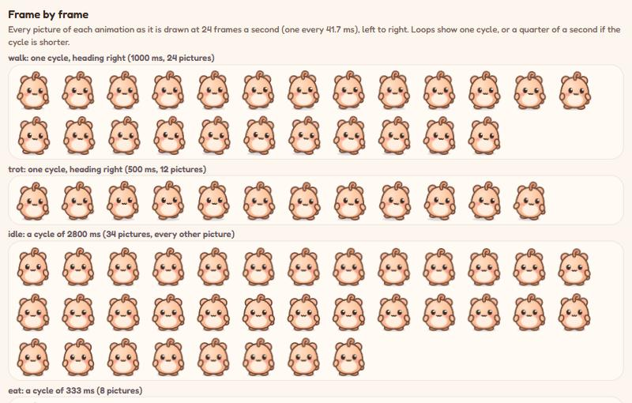
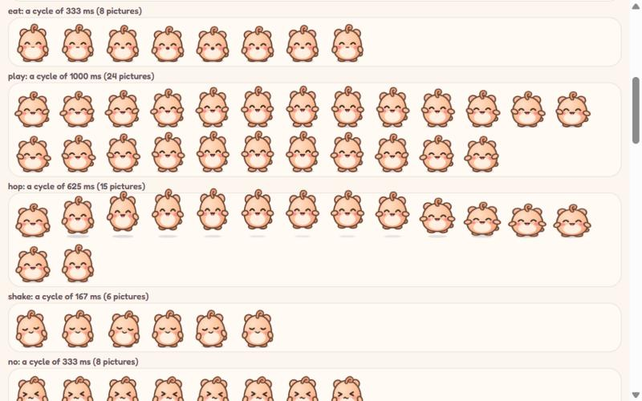
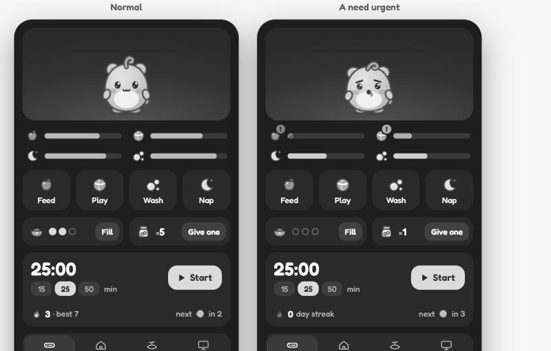

# Polish: what was measured, changed and checked

**Phase 10 of [WORK_PLAN.md](../WORK_PLAN.md)** · run 2026-11-14 and 15 · the same machine as the four view write-ups: Windows 11 Pro, one 3840 × 2160 display at 150 % scaling and 120 Hz, 24 logical cores, WebView2.

Phase 10 is the pass over all four views at once: performance first, then the two fragile tests, a way into the Card from the keyboard, accessibility, timing, and sound. The view phases had each measured the same thing and left it here: anything that moves in this window is expensive. This file records why, what was done about it, the numbers before and after, what could not be met, and what is left for a person.

Everything in the real window was done with scripted input in a cloaked window. The machine was never quiet (its owner at it for the first hours, and throughout half a dozen long-running jobs of other programs, which with this phase's own runs held it at between a quarter and two thirds of all its cores), so every before-and-after number below was taken with the old build and the new one **running side by side at the same moment**: whatever else the machine was doing weighed on both alike.

## In short

| Asked for | Result | How it is known |
|---|---|---|
| Why does animation cost what it does? | Every picture the window shows costs 2 to 3 ms of processor time, spread over five threads in three processes, whatever is on it; and there were 120 a second. On top, a walk told the shell where it was thirty times a second, each time through the browser's network stack | Thread-by-thread traces of the old build (section 2) |
| Every view at rest under 1 % of one core and 150 MB | **Met by the median half-minute in every view**, as it was before this phase (at rest nothing moves, so there was nothing here to save): 0.3 to 0.4 % of one core in the Pill, on the Island and in the Desktop view late in the evening, 0.8 % in the Pill in a later, noisier hour; 100 to 131 MB | Section 4 |
| A focus session under 1 % in every view | **Met in the Room, on the Island and in the Desktop view** (median half-minute 0.70, 0.41 and 0.31 %; the Island was 0.88). **The Pill is at the line:** 0.88, 1.17 and 0.93 % in three samples, where the old build beside it measured 0.98, 1.55 and 2.07 | Section 4 |
| The Room's ten-minute average under 1 % | **Met: 0.82 %** (the median minute 0.64 %), with Doozer really going somewhere six times in the ten minutes. The old build, beside it, measured 0.81 % while going somewhere once | Section 4 |
| The Desktop view's Calm twelve-minute average under 1 % | **Not met.** 1.40 % in one twelve-minute run and 2.74 % in a second, in which Doozer happened to walk twice as much. The old build beside them: 2.81 and 2.89 % (Phase 9 measured 3.6 %). A second of a Calm stroll costs about 40 % of what it did; a minute with no stroll in it is under 1 %, a minute with one is 2 to 3.4 % | Section 4 |
| The cost of a second of walking at least halved | **Met: 31.6 % → 8.4 %** of one core (medians, side by side), a little over a quarter; 36.5 % → 7.8 % in the first comparison of the phase. Memory while walking: about 200 MB → 133 to 139 MB | Section 4 |
| Lively's average measured | **8.6 %** of one core, where the old build beside it used 25.8 % (Phase 9 measured 23 %); and 140 to 149 MB, where the old build was at 155 to 161, over the budget | Section 4 |
| Find and return the Island's 20 MB, or show that it cannot be returned | **Found, and only partly returnable.** None of it is anything the Island made or kept: it is the browser's own allocators holding on to what they were given. Asked to hold less for a few seconds after the Island (a switch WebView2 has for this), the browser hands it back: the app reads 104 to 115 MB after each of twelve visits, against 111 before the first, where Phase 8 read 119 to 146. Committed memory does not come back, and use takes some of the rest up again | Section 7 |
| Doozer alone as lively as the budget allows | The Room: a real outing about every three minutes where it was every six, a page turned every minute or two. The Island: the blink, the stir and the fireflies back to, or near, what they were first built as | Section 5 |
| Motion still reads as smooth at the capped rate | Every picture of every animation at 24 a second is in two film strips; the quick loops were retimed so that each is a whole number of pictures; the pictures reach the screen evenly. **Whether it reads as smooth is for the owner's eye** | Sections 6 and 11 |
| The two fragile tests, fixed without weakening them | The save test never had a bad save: its reader dropped the writer's first report. Fixed in the reader; 200 runs in a row under disk load, none failed. The page tests have a 30-second limit where they had 5 | Section 8 |
| A keyboard way into the Card that does not take focus unasked | **Ctrl+Alt+D**, or *Open Doozer's card* in the tray menu, in every view. The keyboard goes back to the window that had it when the Card closes | Section 9 |
| Reduce motion checked in every view | Clean in all four views on the final build: 45 scenes, nothing travelling, springing or looping, every scene coming to rest. It found two things on the way, both on the Island, both fixed | Section 10 |
| Need indicators that do not depend on colour | They did not; now a test holds the rules that make it so, and a greyscale picture shows it | Section 10 |
| A scalable interface | *Interface size* in Settings: Normal, Large (115 %), Larger (130 %). In every view at every size the window is exactly the page's size and catches the mouse exactly where things are drawn: 240 probe points, none wrong | Section 10 |
| A timing and easing pass, judged from frame captures | Done from the film strips; what was changed and why is listed | Section 11 |
| A small coherent set of sounds, off by default, made in code | Thirteen, from one instrument and one five-note scale, synthesised in the page. **Nobody has heard them yet** | Section 12 |
| Every view's never-stuck checks and click-through probes pass on the final build; the Desktop soak rerun for an hour | **All pass on the final build:** the Pill's four scripted checks, the Room's six, the Island's five, the Desktop view's two (300 of 300 interruptions; 708 click-through points, none wrong, a walking Doozer among them) and this phase's own. **The soak:** an hour, 1,727 random actions, 44 hands-off checks all finding Doozer at rest, the watchdog with nothing to rescue, and Doozer idle on the taskbar line at the end | Section 13 |
| `npm test`, `npm run typecheck`, `cargo test` three times in a row, once on a busy machine | Pass, three rounds in a row on the final code, with the machine at 36 to 65 % of all its cores throughout: 1,139 page tests, type-check clean, 56 native tests | Section 1 |

## 1. Tests that run without a window

From `app/`: `npm test` and `npm run typecheck`; from `app/src-tauri`: `cargo test`.

At the end of the phase: **1,139 page tests in 53 files, type-check clean, 56 native tests** and one ignored (110 page tests and 5 native ones more than Phase 9 left).

**Three times in a row, on a busy machine.** All three suites were run three times running on the final code, and every run passed. The machine was not idle for any of them: the Desktop soak and two chains of view checks were running in cloaked windows, on top of the other programs' jobs, and the machine stood at 65, 36 and 46 % of all 24 cores as the three rounds began. (An earlier round was run while three processes hammered the disk for the save test's loop of section 8: the page tests and the type-check passed there too. The native tests could not be built at that moment, because the loop was holding their program open.)

What Phase 10 added:

| File | Tests | What it covers |
|---|---|---|
| `tests/frames.test.ts` | 36 | The frame clock on a fake clock, with fake animations and a pretend screen that hands out frames as a browser does: the rate with nobody there and with somebody; every picture on the refresh it was aimed at, at 120 Hz and at 60; that an animation taken over keeps its place and its speed, ends when it should and is handed back if anything goes wrong; held animations; no timer left when nothing moves; a frame that never comes replaced by a timer; no jump after a rest |
| `tests/shell.test.ts` (grown to 47) | | A moving region: what is sent, and that nothing is sent while the shell's own reckoning is still right; the keyboard request; the interface size; the memory hint |
| `tests/host/sound.test.ts` | | The set as data: every pitch on the scale, nothing louder than a tenth of full volume or longer than a second and a half, no two sounds the same; and the player against a fake audio device: silent when off, the device let go after the last note |
| `tests/host/host.test.ts` (sound, interface size, memory, the keyboard) | | When each sound is and is not played; the interface size told to the shell at start-up and on every change; the memory hint while tucked away and after a heavy view, never left on; the Card request passed to the view |
| `tests/views/pill/`, `src/ui/focus-chip.test.ts` | | The countdown in minutes when nobody is looking, in seconds when somebody is and in the last minute |
| `tests/views/island/world.test.ts`, `body-motion.test.ts` | | With motion reduced: nothing flies, falls or drifts on the island, and no pose of the 3D body loops |
| `src/ui/kit.test.ts` | | The rules that mark a low or urgent need by shape |
| Native: `hit.rs`, `shell.rs`, `win.rs` | 56 in all | A region in motion and where it is after any time; the keyboard taken and given back; the zoom counted into every scale |

## 2. Why animation costs what it does

The view phases' diagnosis was that everything is drawn at the display's 120 pictures a second. That is right, and it is nearly the whole of it. The old build was traced thread by thread while Doozer walked along the taskbar (`scripts/trace-frames.ps1`, which asks the browser itself where its time went).

| Thread | Processor time, ms per second of walking | What it is doing |
|---|---|---|
| The page's main thread | 110 | Working out styles and layout for the moving parts and painting them, 120 times a second |
| The page's compositor thread | 44 | Putting the painted layers together, 120 times |
| The display compositor (in the graphics process) | 35 | Drawing the window's surface, 120 times |
| The graphics process's main thread | 33 | Presenting it: two swaps for every picture |
| The browser process's main thread | 18 | Passing the hit region on (below) |
| The vertical-sync thread | 9 | Woken 120 times a second for as long as anything animates |
| The network service and the browser's I/O thread | 14 | The hit region again |
| Everything else | 16 | |
| **All** | **279** (28 % of one core while being traced; 37 % measured from outside, below) | |

Two things in that table:

- **A picture costs about 2.3 ms of processor time, and there were 120 of them a second.** No one stage is at fault: every stage of the browser's pipeline does a little work for every picture, in three processes, and it adds up. What is on the picture hardly matters. A single moving blob cost 13 to 26 % in the shell spike; the whole rig walking cost 37 %.
- **Telling the shell where Doozer is cost a tenth of a walk by itself.** The Desktop view reported its hit region thirty times a second while walking. Each report is a call to the shell, and Tauri carries a call as a web request: through the page's network code, the browser's network service and back. About 32 ms of processor time a second, in threads that have nothing to do with drawing.

**What each rate costs.** With the frame clock of section 3 in place, the same walk was measured at different rates, three copies of the app walking side by side for each comparison:

| Pictures a second | Share of one core while walking (median of ten 20-second windows) |
|---|---|
| 120 (the old build) | 36.5 % |
| 60 | about 16 % |
| 30 | 10.7 % |
| **24** | **7.8 %** |
| 20 | 7.5 % |

So the cost follows the number of pictures, nearly: about 3.0 ms of processor time a picture at 120 a second and 3.2 ms at 24 (a picture drawn by the clock costs a little more than one of the browser's own: section 14 says why, and what was tried against it). Below 24 the measurements stop telling the rates apart. **24 was chosen**: it is the rate drawn animation and film are made at, it is a whole number of this display's refreshes (every fifth), and 20 saves nothing measurable. 30 would cost about a third more for everything Doozer does alone. The two numbers are `AMBIENT_FPS` and `ATTENDED_FPS` at the top of `app/src/frames.ts`, and they are the owner's to change.

## 3. What was changed

**A frame clock for the whole page** (`app/src/frames.ts`). The browser runs stylesheet animations, transitions and Web Animations at the display's rate and offers no way to slow them. But an animation that is paused costs nothing and can be set to any moment. So the clock takes over every running animation in the page (pauses it where it is) and moves them all forward itself, together, once a tick: **24 ticks a second when nobody is there, 60 for four seconds after the pointer or a key touches anything of Doozer's**. The motion is the same motion, with the same easing and the same length; it is only drawn less often. The window is click-through everywhere but on Doozer's things, so any pointer event the page sees means somebody is at it.

- Nothing in the rig, the kit or the views had to change to be paced: the clock finds animations by itself. What a view moves from script (the Desktop walk, the Island's 3D picture, the Pill's ring) asks the same clock for its frames, so that everything changes on the same ticks. Two things each drawn 30 times a second out of step would be 60 pictures.
- Each tick is aimed at one of the display's refreshes, so that every picture stays up for the same number of them: five at 24 a second on this display, two at 60. Getting that right took a second look (section 6).
- **Never stuck.** The clock decides only how often the picture is redrawn. Every scene, face and performance is still ended by a timer elsewhere, as before; nothing waits on the clock. It fails toward the browser's own behaviour: an animation it has not taken over runs as the browser runs it, one that throws is handed back, a frame that does not come within 300 ms is replaced by a timer (a hidden window), and it holds no timer at all when nothing is moving.

**A walk is reported to the shell once.** A hit region may now carry a speed and a time (`vx`, `vy`, `ms`): where it is, how fast it is going, for how long. The shell works out where the region is each time it looks at the pointer. The Desktop view sends a stroll as one such region; the bridge sends again only if Doozer is no longer where the shell thinks (`compareRegions` in `app/src/shell.ts`, `Region::at` in `hit.rs`). The network threads of the table above went from 14 ms a second to under 1.

**A countdown nobody is looking at counts in minutes.** During a focus session every view showed the time left to the second, which had the window drawn again every second for nobody. With the pointer away the Pill, the Room's title bar, the Island's chip and the Card now show "25 min", rounded up so that they never say less than is left; the seconds come back the moment the pointer is on them, and for the last minute. (The Desktop view already showed the time only on hover.)

**The Island draws on the same clock**, and unwatched at 24 pictures a second where it had its own 30.

**The browser is asked to hold less memory** while Doozer is tucked away and for a few seconds after the Island is left (section 7).

Smaller things: the Desktop view's walk is stepped by the clock's frames and by a timer only if none has come for 150 ms (it was stepped by both); the kit's and the views' own `requestAnimationFrame` loops go through the clock.

## 4. Before and after

`app/scripts/measure-set.ps1`: release builds with the test hooks, each state in the old build ("before": the tree as Phase 9 left it, with only the measuring hook added) and in the final one ("after") **at the same moment**, each with its own save and its own browser profile; 20 s to settle, then the windows listed; every process of the app counted (the app and its WebView2 processes); the window cloaked and the pretend pointer parked. Memory is private working set, the figure Task Manager shows; CPU is a share of one core (this machine has 24). The figure given first is the **median** window, because single windows on a machine in use wander a great deal (the same state, the same build: 0.2 to 1.9 %); the mean follows.

| State | Before: median (mean) | After: median (mean) | Memory, MB: before → after | What Doozer did meanwhile |
|---|---|---|---|---|
| **At rest** | | | | |
| The Pill (six 30 s windows), 23:30 | 0.41 % (0.75) | **0.31 % (0.62)** | 101–108 → 102–109 | Blinked |
| The Pill again, 00:45 | 0.93 % (0.93) | **0.78 % (1.01)** | 96–102 → 100–107 | The same, in a noisier hour (below) |
| The Island | 0.38 % (0.49) | **0.44 % (0.55)** | 115–124 → 116–125 | Blinked, stirred a little; the new build blinks and stirs more often (section 5) |
| The Desktop view, Still | 0.39 % (0.52) | **0.34 % (0.43)** | 125–131 → 125–131 | Blinked, glanced about |
| The Room, ten minutes (ten 60 s windows) | 0.83 % (0.81) | **0.64 % (0.82)** | 116–122 → 116–128 | Old: five glances and a fidget. New: two wanders across the room, two nudges of the ball, two fidgets (a hop or a yawn) and a glance |
| **A focus session** | | | | |
| The Pill, 23:40 | 0.98 % (1.35) | **0.88 % (1.08)** | 104–111 → 102–110 | Sat with its glasses on. The first three windows were high in both builds at once (1.29, 2.00, 3.15 and 1.14, 1.44, 2.78): the machine, not the app |
| The Pill again, 00:27 | 1.55 % (2.00) | **1.17 % (1.55)** | 104–112 → 106–113 | |
| The Pill a third time, 00:48 | 2.07 % (2.10) | **0.93 % (0.96)** | 98–105 → 99–106 | |
| The Room | 0.75 % (0.77) | **0.70 % (0.71)** | 115–123 → 112–123 | Read on the rug; the new build turns a page more often |
| The Island | 0.88 % (0.76) | **0.41 % (0.47)** | 119–128 → 117–126 | Sat with its glasses on; 224 pictures of 3D drawn in 200 s, where the old build drew 316 |
| The Desktop view | 0.36 % (0.40) | **0.31 % (0.46)** | 132–140 → 132–140 | Sat still (the time is shown on hover only, before and after) |
| **Moving** | | | | |
| The Desktop view on Calm, twelve minutes (twelve 60 s windows), 00:04 | 1.08 % (**2.81**) | 0.91 % (**1.40**) | 126–137 → 126–133 | Old: four strolls and a peek, walking 5.3 % of the time. New: six strolls, 5.1 % |
| The same again, 00:30 | 2.37 % (**2.89**) | 2.52 % (**2.74**) | 127–138 → 130–136 | Old: five strolls, walking 4.3 % of the time. New: seven strolls and a peek, 9.9 % |
| The Desktop view on Lively (twelve 30 s windows) | 25.8 % (23.7) | **8.6 % (8.6)** | 155–161 → 140–149 | Old: 14 strolls and 3 peeks, walking 74 % of the time. New: 15 and 3, 78 % |
| Walking without a pause (six 20 s windows) | 31.6 % (31.4) | **8.4 % (8.7)** | 194–202 → 133–139 | One stroll after another |
| Budget | under 1 % at rest | | under 150 | |

**Against the targets.**

- **Every view at rest under 1 % and 150 MB: met by the median, with nothing to spare in a noisy hour.** At rest nothing moves, so this phase had nothing to save there, and the two builds differ by less than two windows of the same build do. The Pill read 0.31 % at half past eleven and 0.78 % (mean 1.01) an hour later, with the old build beside it at 0.41 and 0.93: the hour, not the app.
- **A focus session under 1 % in every view: met in three, at the line in the Pill.** The Island's came down from 0.88 to 0.41 %: that is the countdown no longer repainting every second. In the Pill the three samples read 0.88, 1.17 and 0.93 %, the old build 0.98, 1.55 and 2.07. So the change is real there too, but a session in the Pill sits at the line, not under it. Where its time goes: with nothing drawn at all, the page still spends about 0.3 % on the brain's tick and the view's bookkeeping four times a second (0.1 % at rest), and the browser's own process another 0.2 to 0.5 %. The first is a saving nobody has yet tried for.
- **The Room's ten-minute average under 1 %: met**, at 0.82 %, with six times the outings of the old build at the same cost (section 5).
- **The Desktop view's Calm twelve-minute average under 1 %: not met.** 1.40 % in one run and 2.74 % in another, against 2.81 and 2.89 % for the old build beside them. The two runs differ because Calm is random: Doozer walked for 5 % of the first and 10 % of the second (it peeked, which is a walk to the edge of the screen and back). Set against the walking in each, a second of a Calm stroll costs about 40 % of what it did. The average is rest, at 0.3 to 0.9 % depending on the hour, plus walking: and with a second of walking at 8 % of a core or more, **Calm cannot average under 1 % while Doozer walks more than a few seconds in a minute.** Three things would bring it under, and I took none of them. *Strolling less:* but how much Calm moves is the very thing the owner has still to settle (spec section 12, item 3), and it should be settled by eye, not by this budget. *A lower rate for the walk:* 20 pictures a second measured the same as 24 (section 2). *A cheaper picture:* section 14 lists what was tried.
- **The cost of a second of walking at least halved: met.** 31.6 % to 8.4 % of one core, a little over a quarter of what it was.
- **Lively's average: 8.6 %** of one core, a third of what it was. That is 0.36 % of this machine.
- **Memory:** inside the budget in every state. The old build was not, while it walked: 155 to 161 MB on Lively and about 200 MB walking without a pause, because the graphics process holds more while it presents 120 pictures a second. The new one is at 133 to 149 MB.

**What these numbers are worth.** The machine was never quiet, and a half-minute window of a resting app wanders between 0.1 and 2 % for the same build in the same state; hence two builds at once, medians, and in the long runs the mean as well (an average over twelve minutes is the target, and a median hides the minutes with a stroll in them). The comparison between the two columns is sound. Each absolute figure is a figure for this machine at that hour, which is why the hour is given where a state was measured twice: after midnight everything read higher, in both builds. Two more things bend them. In each set of runs the Pill came first, with a browser profile made that minute, which spends its first minutes on chores of its own (about a third of a percent in the browser's own process, in both builds); the 00:45 and 00:48 rows were made with a profile that was no longer new. And after midnight the display was not refreshing at a steady 120 a second (section 6), which lowers the old build's cost a little and raises the new one's: the walk measured 36.5 % against 7.8 % earlier in the phase, and both Calm runs were made in that state.

## 5. Livelier alone

Phases 7 and 8 made Doozer quieter when nobody is watching in order to fit the budget: in the Room most of what it did alone became a glance, and on the Island the blink, the stir and the fireflies were slowed. With a second of movement at about a quarter of what it cost, some of that was given back, and the numbers of section 4 are with it given back:

| | As Phases 7 and 8 left it | Now |
|---|---|---|
| The Room: how often Doozer alone really goes somewhere (a stroll, a look out of the window, a nudge of the ball, a hop, a yawn) | About every six minutes: 28 in 100 of the things it does alone, the rest glances | **About every three minutes**: 60 in 100 (`ALONE_OUTING_SHARE`) |
| The Room: a page turned while reading | Every 2½ to 5½ minutes | Every 1 to 2½ minutes (`PAGE_MS`) |
| The Island: a blink | Every 5 to 11 s | Every 4 to 9 s, as first built |
| The Island: a small stir (a little hop or a wobble) | Every 70 to 170 s | Every 50 to 110 s, as first built |
| The Island: the fireflies of a sleeping island move | Every 4 s | Every 3 s |
| The Desktop view | Unchanged: its paces are the owner's three settings, and Calm and Lively now simply cost less (section 4) | |

In the ten minutes of section 4 the new build really went somewhere six times (two wanders across the room, two nudges of the ball, two fidgets) and glanced once, where the old one beside it glanced five times and fidgeted once; and the two cost the same, 0.82 % against 0.81 %. On the Island the at-rest figure is level too (0.44 % against 0.38 %, less than two windows of the same build differ by).

These are knobs, at the top of `app/src/views/room/behaviour.ts` and `app/src/views/island/index.ts`, and how lively Doozer should be alone is a matter of taste: they are the owner's to turn.

## 6. Smooth at the capped rate

Three kinds of evidence, none of which is a person watching it:

**Every picture, as drawn.** The viewer can lay out every picture of every animation exactly as the app draws it at a given rate (`npm run dev`, then `/viewer.html?only=rig&strip=24`). Two of those strips are kept here. At 24 a second a walk cycle is 24 pictures and no two neighbours differ by more than a small step of a foot; the quick loops are few pictures but each is a whole cycle (section 11).

| The walk and the trot, one cycle each, every picture at 24 a second | The quick loops at 24 a second |
|---|---|
|  |  |

**The rhythm of the pictures on the screen.** A capped rate looks smooth only if the pictures arrive evenly: a cap that shows one picture for three refreshes and the next for seven would stutter at any average. The browser was asked when each picture was put on the screen while Doozer walked (`trace-frames.ps1`, "gaps between pictures"):

| | Pictures a second | Gap between one picture and the next: median | Eight gaps in ten are within | 99 in 100 are under |
|---|---|---|---|---|
| The old build: every refresh | 119.9 | 8.3 ms | 8.2 to 8.4 ms | 8.6 ms |
| **The final build, nobody there** | 24.7 (two runs: 24.7 and 25.6) | **41.7 ms: five refreshes** | **40.1 to 42.8 ms** | 48.5 ms |
| **The final build, the pointer on Doozer** | 60.2 | **16.7 ms: two refreshes** | 16.3 to 17.1 ms | 17.8 ms |
| For comparison, the capped build as first measured | 24.4 | 45.7 ms | 31.2 to 50.6 ms | 57.5 ms |

(The rate reads a little over 24 because the test starts a new stroll the moment the last one ends, and each start is drawn at once; those extra pictures are also the handful of short gaps. The machine was busy during all of these.)

**The last row is why this was looked at.** The first capped build drew 24 pictures a second on average and looked right in every other measurement, but its pictures came anything from 31 to 50 ms apart: shown for four refreshes or for six, as it fell. Two causes, both the browser's, both now worked around in `frames.ts`:

- **A long timer slips.** The browser keeps a timer to the millisecond only if it is short. The 37 ms a tick waited was left to the system's 15.6 ms beat, and came after 31 or 47. The wait is now taken in hops of at most 24 ms.
- **An idle page is handed the frame it just missed.** A page that has asked for no frame for a few refreshes is given, the moment it asks, the frame of the refresh that has just gone by. A tick that asked a little before the refresh it wanted was therefore drawn on the one before. At a slow rate the clock now asks just *after* the refresh it is aiming for, so that the frame it is handed is the right one. Every frame carries the moment of the refresh it belongs to, and the clock reads it: a frame from before the refresh aimed for is passed over for the next one; a frame from after it is a picture one refresh late, and the next is asked for beforehand; and the ticks are counted from those moments, so that they do not drift across the screen's refreshes.

Asked directly, with a probe that asks for frames at chosen moments (120 times each, on a busy machine): asked 1 ms after the refresh it wants, an idle page was handed that refresh 105 times in 120; asked 5 ms before, it was handed the *previous* one 112 times in 120. At 60 a second the page is not idle between pictures and asking beforehand gets the right refresh 119 times in 120.

A first fix, which passed over the stale frame and waited for the next, gave the same even rhythm at 13 to 24 % more processor time per second of movement; the one kept costs nothing extra (side by side: 10.0 % against 10.3 % for the uneven build, at the same moment on a busy machine).

**In step.** Doozer's place along the taskbar, its feet, and its hit region are all moved on the same tick, from the same clock; the tests hold that a thing taken over by the clock is at exactly the moment it would have been at had the browser drawn it.

**A caution about the display itself.** A picture can only be shown on a refresh the screen makes. The table above was taken while the screen was refreshing at a steady 120 a second. Around midnight, with the owner away and other programs drawing, the browser was being offered frames about 9.6 ms apart, not 8.3: about 104 a second, and not evenly. (Why was not established. A display with a variable refresh rate does this when something else is drawing full screen, and the owner's machine is often running a game.) 24 a second then falls on every fourth or fifth of whatever refreshes come, and the clock's own counters say so: in the Calm run of section 4, made at that hour, about half the pictures counted as a refresh late, against 1 to 2 in 100 in a run at a steady 120. Nothing can make a rhythm even on a screen whose own is not.

The same rule covers a screen where 24 does not divide the refresh rate: at 60 Hz it becomes an even 20 a second, every third refresh (held by a test). There the clock at present spends one passed-over frame per picture finding its refresh, where a clock that measured the screen's refresh interval and aimed at whole refreshes would spend none. That is the one improvement to `frames.ts` I can see and did not make; no 60 Hz screen was here to try it on.

**What this does not show.** Whether 24 pictures a second *reads* as smooth on a 120 Hz display, next to a mouse pointer and windows that move at 120, is a judgement for an eye, and nobody has looked. If it does not, `AMBIENT_FPS = 30` costs about a third more for everything Doozer does alone and is one number to change; with the pointer on Doozer it is drawn at 60 already. Section 16 says what to look at.

## 7. The Island's memory

Phase 8 found that after the Island had been used, the Pill sat at 119 to 146 MB where it had sat at 109 before, and that waiting did not bring it back ([island-checks.md](island-checks.md) section 4). The task here was to find it and return it, or show that it cannot be returned.

**Where it is.** The browser was asked for its own account of every allocator in every process, before the Island, in it, and back in the Pill after it (`scripts/memory-dump.mjs`, the browser's memory-infra dump):

| In the page's process, MB | Before | In the Island | Back in the Pill after one visit | After three |
|---|---|---|---|---|
| The WebGL context | 0 | 16.5 | 0 | 0 |
| Script heap | 3.4 | 17.4 | 8.5 | 5.7 |
| The page's own objects | 13.4 | 15.9 | 11.3 | 11.3 |
| General allocator, in use | 15.1 | 20.3 | 18.7 | 11.7 |
| General allocator, held | 23.3 | 32.9 | 30.2 | 15.1 |
| Other allocators (partitions, shared memory, caches) | 4.2 | 15.5 | 11.4 | 8.9 |

- **Everything the Island made is given back.** The graphics context, the engine and the model are gone from the browser's own account the moment the Island is left: the hidden frame of Phase 8 does its job.
- **What stays is the browser's, not the Island's:** 2.3 MB of script heap that a collection does not return, and memory the allocators have been handed by Windows and keep for next time: in use it is back to where it was, but "held" stays high for a while after each visit. In the graphics process the same: about 8 MB more than before, which a trip to the Room leaves too.
- **Waiting does not return it** (three minutes: nothing), and neither did telling the browser that memory is short (the pressure signal a browser gets from the system, sent by hand).

**What does return it.** WebView2 has a switch for exactly this (`MemoryUsageTargetLevel`): set to low, the browser hands back to Windows what it is not using and takes it up again as needed. The host now sets it low while Doozer is tucked away, and for four seconds starting three seconds after a view that says it is heavy (the Island) has been left, then back to normal.

`scripts/measure-island-leak.ps1` on the final build: twelve visits, each reading taken in the Pill six seconds after leaving the Island (private working set, every process of the app; the page's heap from the page itself, after a collection).

| | The whole app | The page's process | The graphics process | Page heap |
|---|---|---|---|---|
| In the Pill, before the Island was ever opened | 111.1 MB | 32.0 | 32.9 | 2.0 MB |
| In the Island | 138 to 154 | 43 to 55 | 48 to 51 | 9.1 to 10.0 |
| **Back in the Pill after one visit** | **104.4** | 20.0 | 38.2 | 4.9 |
| **After each of visits 2 to 11** | **110.7 to 115.0** | 20.3 to 23.7 | 42.1 to 46.6 | 5.0 to 5.6 |
| Phase 8, at the same points | 109 before; 119 to 125 after one visit; 131 to 146 after more | 33 before; 37 to 49 after | 31 before; 38 to 48 after | 1.7 before; 4.7 to 5.4 after |

(The reading after the twelfth visit caught the browser in the act of handing memory back, at 45 MB. It is left out: it is not a state the app stays in. The run was made twice, on the final build and on the one before; the two agree to within 3 MB at every point.)

**What it is and is not.** The figure in the budget, and in Task Manager, is the private working set: memory the app actually has in use. That figure comes back. *Committed* memory, what the app has reserved, does not: it was 214 MB before the switch and 209 after. Pages handed back this way stop occupying memory as soon as Windows wants it for something else, but they still count as committed, and a tool that shows commit will show no difference. And what is handed back is taken up again as it is used: with the Card opened and used after the switch, the app read 126 MB.

**Against "find and return the Island's 20 MB".** Found: it is the browser's allocators holding on to what they were given, plus about 2 MB of script heap, and none of it is anything the Island made or kept. Returned, by the measure the budget uses: yes, at the moment the Island has been left: 104 to 115 MB against 111 before, where Phase 8 read 119 to 146. The page's own process is then *below* where it started (20 to 24 MB against 32). The graphics process is still 5 to 14 MB above, as it is after a trip to the Room, which draws no 3D; and the page's heap is 3 MB above. **But it is a lower figure after each visit, not a permanent one:** what is handed back is taken up again with use, and in an earlier run of this phase, with the Card opened and used after a dozen visits, the app read 126 MB, where it had read 130 without the switch and 110 before any visit. Not returned: the committed memory, and the 2 MB of script heap, for which I found no handle a page can pull.

## 8. The two fragile tests

**`save::tests::kill_mid_write_small_payload`** had failed once in Phase 9 while the disk was busy. The test starts a child that saves over and over and reports each save, kills it at a random moment, and checks that what is on disk is a whole save no more than one step ahead of the last report. Run in a loop with the disk kept busy it failed about once in forty runs, always the same way: the file was *two* steps ahead of the last report.

The save was never at fault. The test harness prints `test save::tests::torture_writer ... ` with no line break before the test runs, so the child's first report arrived as `test save::tests::torture_writer ... saved 236`, and the parent's reader, which wanted lines *beginning* with `saved `, dropped it. Every run lost the first report. That did not matter as long as a second one followed; but a child killed just after its second save had gone in, and before it could say so, left the parent believing nothing had been saved, with a file two steps on.

The reader now finds the report wherever it is on the line (and a test holds the three shapes a line can have). **Nothing the test proves was loosened**: the rule is still "a whole save, at most one step ahead of the last report". 200 runs in a row with three processes hammering the disk: none failed.

**The page tests that hit the 5-second limit.** A few Pill and Desktop tests run thousands of steps on a fake clock and take one to two seconds on a quiet machine; on a loaded one they had taken more than five and been reported as failures. They prove what they proved before; the limit is now 30 seconds for the whole suite (`app/vite.config.ts`), which a test that is really hung still exceeds. On a machine at 65 % of all cores the whole suite passed (section 1); the slowest single test took a few seconds.

## 9. The Card from the keyboard

The window never takes the keyboard when it is clicked, so that petting Doozer never pulls you out of what you are typing in. The cost, since Phase 6: the Card's keyboard support (tab order, arrow keys, Escape) could not be reached without the mouse.

**Ctrl+Alt+D** (or *Open Doozer's card* in the tray menu, which says the shortcut) opens the Card in whichever view is showing.

- The shortcut is the one moment the keyboard is asked for, and the person has just asked. The shell remembers which window had it, lets its own window be activated and takes the keyboard (Windows allows that at a key press and at no other time), and the Card opens with focus on its first button, *Feed*.
- **Escape** closes the Card, and the keyboard goes back to the window it was taken from, unless you have clicked somewhere else in the meantime, in which case it stays where you put it.
- From the tray menu the Card opens without the keyboard, as a click on Doozer does: you used the mouse.
- **Never stuck with the keyboard.** If the page does not claim the keyboard within a second and a half of the shortcut (it is tucked away, or busy), the shell gives it back by itself.
- If another program already owns Ctrl+Alt+D, registering fails quietly and the tray item is the way in. The combination is one constant (`hotkey.rs`); making it a setting is left for later.

Checked in the real window in all four views (`app-polish-keyboard`): all pass.

- **From the tray menu:** the Card opens; the window does not become focusable and does not take the keyboard.
- **From the shortcut:** the Card opens; the window has the keyboard; the page has the focus; the focus is on *Feed*.
- **Escape:** the Card closes; the window refuses the keyboard again; and the keyboard is back with the very window that had it before (the same window, by its handle, in all four views).

The shortcut part really takes the keyboard for half a second, so the check runs it only when nobody has touched the machine for a minute, and says so when it skips it. On the final run nobody had for over an hour. The press itself is injected into the shell at the point where the real key press arrives; the real combination was not pressed (section 16).

One failure, once, and not since: in the first full run, on the build before the final one, the Island's hand-back failed (the keyboard stayed with Doozer's window) at a moment when other test copies of the app were being started. Three reruns alone passed, and so did the final run. The one cause the code offered is fixed: the hand-back was skipped if Windows reported no foreground window at that instant, which it does in passing while the foreground changes; it now waits that out. Whether that was the cause that time I cannot say.

## 10. Accessibility

### Reduce motion, in every view

`app-polish-motion`, in the real window: with *Reduce motion* on, every scene of every view is played (resting, a meal, a treat, play, a wash, a refusal, falling asleep, waking, a session starting and ending, the Card opening and closing; in the Desktop view also a stroll and a peek at the Lively pace) while the page is asked every 40 ms what is moving. Anything that travels, springs or loops is a failure; a fade is allowed, since that is what reduced motion asks for. The Island's 3D Doozer cannot be asked through a stylesheet, so where it and the ball *are* is watched instead: being put somewhere is one change, three in a row is travelling.

**On the final build: 45 scenes (eleven each in the Pill, the Room and the Island, twelve in the Desktop view), nothing caught animating in any of them, and every one came to rest.**

What it found, and is fixed:

- **On the Island things still flew.** Crumbs, raindrops and the puff of stars were drawn with motion reduced, the ball rolled, a snack fell and bounced, and Doozer chased the ball. Now nothing flies: the ball and a snack are put where they would have come to rest, and there are no particles.
- **The 3D Doozer bobbed as it chewed** (found on the final build, by this check): the loops of its poses (chewing, batting at the ball, waving, shaking, saying no) ignored the setting. Each pose is now held in its still form.
- Emotes fade in place, as the kit promises; the check allows exactly that and nothing more.

### Needs that do not depend on colour

They did not before this phase, but nothing held it. Now `kit.test.ts` holds the rules: a meter's length is the level; a low or urgent need carries a "!" flag; an urgent bar is striped; the Radial's need buttons carry a "!" badge; and the words say it ("Tummy 23%, low"). The Card with one need fine, one low and one urgent, with all colour taken out:

### A scalable interface

**Settings → Interface size:** Normal, Large (115 %), Larger (130 %). Everything grows together, Doozer, text and windows, in every view. It is done in the shell, not in the page: the page is zoomed, and the shell counts the same factor into every scale it uses, so the window, the hit regions and the pointer stay in step and no view needed to change.

`app-polish-scale`, in the real window, every view at every step and back to Normal, at rest and with the Card open: all pass.

- **The page really is drawn that much larger:** 1.5, 1.725 and 1.95 device pixels to a page pixel on this display, and 1.5 again on the way back, and the shell reckons with the same number.
- **The window is that much larger and exactly the page's size:** the Pill's window is 600 × 1116, 690 × 1283 and 780 × 1451 device pixels; the Room's 612 × 1344, 704 × 1546 and 796 × 1747. In the Desktop view, whose window is the whole work area and cannot grow, the page has correspondingly fewer pixels to lay itself out in (2560 × 1392, 2226 × 1210, 1969 × 1071), which is the same thing seen from the other side.
- **The Card fits** in the window at every size in every view (it is 320 × 538 page pixels throughout).
- **The window catches the mouse where things are drawn, and nowhere else:** the shell holds as many regions as the view reports, and of 240 probe points (the middle of each thing that catches the mouse, and 7 px outside its left and its top), the window caught at all 112 where it should and let the click through at all 128 where it should.

### Also

The countdown in minutes (section 3) is given to a screen reader in minutes too. The Card reached from the keyboard is section 9.

## 11. The timing pass

Judged from the film strips of section 6: every picture of every loop and one-shot, as drawn at 24 a second.

**What the strips showed.** The slow loops (breathing, the sway of the tuft, the walk) have so many pictures to a cycle that nothing needs saying. The quick ones did not: a loop whose length is not a whole number of pictures is caught at a different point of its swing each time round, and reads as a stutter, not a rhythm. The shake, at 0.16 s, was 3.84 pictures long: its strip showed the ears at a different place in every cycle.

**What was changed** (`rig.css`, its "Timing" comment; `doozer.ts`; `performances.ts`; and the same lengths in the 3D body):

| Loop | Was | Is | Pictures at 24 a second |
|---|---|---|---|
| The shake, and the ears flapping with it | 0.16 s | 1/6 s | 4 |
| Chewing, the cheeks, the head-shake of "no" | 0.3 s | 1/3 s | 8 |
| The wave | 0.4 s | 5/12 s | 10 |
| Play: the body, and the paws batting | 0.52 s, 1.04 s | 0.5 s, 1 s | 12, 24 |
| The hop | 0.62 s | 0.625 s | 15 |
| Carried: the body, and the feet dangling | 0.9 s, 0.45 s | 1 s, 0.5 s | 24, 12 |
| A walk cycle, a trot cycle | 960 ms, 520 ms, then whatever the ground speed asked for | 1000 ms, 500 ms, then the nearest whole twelfth of a second to what the ground speed asks for | 24, 12 |
| The shake-off | 900 ms | 833 ms: ten whole swings | 20 |
| The quick blink of a fidget | 150 ms | 167 ms | 4: open, closing, shut, opening |

Rounding a walk cycle to a twelfth of a second puts the feet at most a twenty-fourth of a second out of step with the ground, about a pixel of slide in a whole step.

**Easing** was looked at in the same strips and left alone: the spring of the Radial, the float down after a carry, the pop in and out of a view switch and the squash of a set-down each keep their shape at 24 pictures (a 400 ms pop is ten pictures, its overshoot two of them). Nothing was found that reads differently from how it was drawn at 120, except by having fewer pictures.

**The limit of this.** A strip shows whether each picture is right and whether the rhythm is even. It cannot show whether the whole is pleasant to watch. That is section 16.

## 12. Sound

Off by default, asked about once at the first run, as before. Until now there was one sound, a placeholder chime. Now there are thirteen, **all synthesised in the page** (`app/src/host/sound.ts`); there is no sound file in the repository.

**One instrument, one scale.** Every sound is a handful of notes from the same small instrument (a sine wave with a soft attack and a ringing decay, through one gentle low-pass filter), and every note is from the same five-note scale (C major pentatonic). Any two sounds that overlap are therefore in tune with each other, and the set sounds like one creature. Nothing is louder than a tenth of full volume or longer than a second and a half.

| Sound | When | What |
|---|---|---|
| chime | A focus session is finished | Three notes climbing a chord |
| sparkle | Something was unlocked (after the chime) | A quick run up the top of the scale |
| begin | A session starts | A low settled note and its fifth |
| munch · yum · kibble | Fed · a treat · the bowl filled | Two soft bites · a bite and a lift · dry little taps |
| boing · bubbles · chirp | Play · a wash · petted | A note sliding up a fifth · tiny rising blips · one small squeak |
| lullaby · morning | Tucked in · woken | Three notes stepping down · the same three climbing |
| hm | A refusal | Two low notes, the second lower |
| pop | Moving to another view | A drop falling an octave |

**Manners** (spec 4.5, "silent unless asked"). The host decides when a sound is played, so no view can get it wrong: for something *you* did, when a session starts, and when one ends. Never for what Doozer does by itself (eating from the bowl, falling asleep worn out, waking rested); never in the middle of a session, whatever you do; and tucked away, nothing but the chime of a session ending. The audio device is opened at the first sound and let go again 0.4 s after the last note has died away, so a Doozer with sound on costs nothing while it is quiet.

**How it is known:** the set is data, and the tests check it without a loudspeaker (every pitch on the scale, the loudness and length limits, each sound distinct), and check the player against a stand-in for the audio device. **What is not known: how they sound.** Nobody has heard them. Hear them all, and each one by name, at `/viewer.html#sounds` (`npm run dev`).

## 13. Every view's checks again, and the soak

The frame clock is under everything that moves, so every view's scripted checks were run again in the real window on the final build (commit `b1af851`), cloaked, with injected input.

| What | Scripted checks | On the final build |
|---|---|---|
| All four views | `run-polish-checks.ps1`: Reduce motion (45 scenes), the interface size (240 probe points), the Card from the keyboard in each view | **All pass** (section 10, section 9) |
| The Pill and the app ([pill-checks.md](pill-checks.md)) | `run-app-checks.ps1`: a day's use and the morning after; never stuck; the window | **All four pass.** 200 rapid presses and 30 scenes cut short all come to rest; a press whose mouse-up never arrives ended 15 ms after the button came up, on the shell's word; click-through right at 10 of 10 points; the four docks, tuck-away and the tray menu as before |
| The Room ([room-checks.md](room-checks.md)) | `run-room-checks.ps1`: the furniture; an hour alone at sixty times the speed; switching; reopening; the window; never stuck | **All six pass.** 21 presses on furniture in the middle of a walk, 28 scenes cut short and 6 view switches in mid-scene all come to rest; a window drag whose mouse-up never arrives ended 7 ms after the button came up; click-through right at 29 of 29 points |
| The Island ([island-checks.md](island-checks.md)) | `run-island-checks.ps1`: coming up; never stuck; click-through along its outline; a focus session; the stills | **All five pass.** 30 scenes cut short and 6 view switches in mid-scene all come to rest; a press whose mouse-up never arrives ended 5 ms after; a lost graphics context is restored; click-through right at 19 of 19 points |
| The Desktop ([desktop-checks.md](desktop-checks.md)) | `run-desktop-checks.ps1`: never stuck (twenty minutes); the window and its click-through probes | **Both pass.** The mockup's drag test; the same with the mouse-up never delivered (the carry ended 17 ms after the button came up); a carry after which nothing is heard again (gave up by itself after 30.2 s); **300 of 300** scene interruptions, real view switches and real tuck-away among them; rapid clicks. 149 carries ended on the way: 85 on a mouse-up, 62 on the shell's `pointer-released`, one on a move with no button, one on the silence limit. **The watchdog rescued nothing and no scene was ended by its time limit**; broken on purpose in five ways, it caught each. **Click-through: 708 probe points in 13 states, none wrong** (two skipped because Doozer walked over them), 24 of them on and just ahead of a *walking* Doozer, which is the case this phase changed: the shell now reckons for itself where a walk has got to |

**The soak** (`app-desktop-soak`: sixty minutes, seed 20261113, the same script as Phase 9's three hours), on the final build, cloaked and in the background, from 23:09 to 00:09, while every other check of this section and most of the measuring of section 4 went on beside it.

| | |
|---|---|
| Ran for | 60 minutes, to the end |
| Actions | 1,727: 254 carries, 224 scenes, 29 real switches to the Pill and back, 19 real tuck-aways, Reduce motion switched on 19 times and off 46, the pace changed 51 times, the size 22, and the rest |
| Hands-off checks | **44, every one finding Doozer at rest**; the slowest took 9.2 s |
| **Rescued by the watchdog** | **Nothing** |
| Scenes ended by their time limit, or that threw | None |
| Scenes played | 224: a meal or a treat 79, the ball 59, a wash 38, a stroll 34, the celebration 10, a peek 4. 87 ran to their end; 137 were cut short by whatever came next, and tidied up |
| Carries ended | 254: on a mouse-up 121, on the shell's `pointer-released` 90, on a move with no button 33, by something else starting 9, on lost capture 1 |
| The shell finding the page silent | Never |
| The page's own clock | Never more than 82 ms late |
| Memory in the page | Level: 2.6 to 3.9 MB of script heap, 507 to 573 elements, the same at the end as at the start |
| **At the end** | **Idle on the taskbar line**, nothing open, the window click-through |

**What the reruns found, all told.** On the build before the final one: the 3D Doozer bobbing as it chewed with motion reduced (fixed; section 10), and the Island's keyboard hand-back failing once (section 9). And two of the older checks were themselves out of date, by changes made on purpose, and were corrected before the final run: the Pill's window check still expected the Room to read "coming soon" in the tray menu, which has not been true since Phase 7; and the Room's furniture check expected the title bar to count in seconds with nobody there, where it now counts in minutes (the check now asks for both: minutes with the pointer away, seconds with it in the room).

**One thing these do not cover.** The checks ask where things are and what state they are in; none of them looks at the picture. That the capped rate changes nothing about *what* is drawn is the frame clock's tests (an animation taken over is at exactly the moment the browser would have had it at); how it looks is section 16.

## 14. Tried, and did not help

- **Getting a tick down to one pass of the page's main thread.** The traces show the page's main thread running twice for every picture the clock draws (53 passes a second for 24 pictures): one that does the work and a second that finds nothing to do. It is why a clocked picture costs a little more than one of the browser's own. `contain` on Doozer's box, `will-change`, and clipping its overflow were each tried to make the first pass cheaper or the second go away: no measurable change. Driving the ticks from timers alone, not from the display's frames, did not remove it either, and made the rhythm uneven; that was taken back.
- **What moves a thing makes no difference.** A stylesheet animation stepped by hand, a Web Animation stepped by hand, and a style written from script each cost 7 to 10 % of a core at 30 pictures a second in the same test. The cost is the picture.
- **Passing over the stale frame every time.** The first mend of the uneven rhythm (section 6) asked a little before the refresh, as before, and passed over the frame of the refresh before when it was handed that. Even, but one frame asked for and thrown away per picture: 13 to 24 % more processor time per second of movement, side by side. Asking just after the refresh gets the same rhythm for nothing.
- **Fewer than 24 pictures.** 20 a second measured 7.5 % against 7.8 %; 15 a little less again. Not worth what it would look like.
- **For the Island's memory:** waiting three minutes, and a memory-pressure signal sent by hand (section 7).

## 15. Found on the way

- **An average says nothing about rhythm.** The capped build drew 24 pictures a second and passed every check and measurement, and showed its pictures for four refreshes or for six as it fell. Only asking the browser when each picture reached the screen showed it (section 6). The tracer prints those gaps now.
- **A clock that jumped.** After a rest, the first tick of the frame clock moved every animation forward by the whole time it had been resting. Found by its own tests before any window was involved; a tick after a rest now moves nothing forward.
- **An animation that broke was taken over again and again.** One that threw when stepped was handed back to the browser, and then adopted again on the next tick, for ever. It is now left alone once it has been handed back.
- **Reads before writes.** The first version of the clock read each animation's state and wrote its new time in one pass, which made the browser work out styles afresh for every animation: 381 style calculations a second where 30 were needed. All the reading is now done before any writing.
- **A held Doozer's face froze.** The clock's rule for a held Doozer (`data-live="0"`) first held everything inside it, including the short transition of a face changing with its mood, which then never finished. It now holds the loops only, as the stylesheet rule it replaced did.
- **The hit region of a walk was where Doozer had been.** The first moving region was built from the place Doozer was last *drawn* at, with a time counted from now, so the shell's idea of Doozer ran a frame ahead. It is built from where the motion says Doozer is at this instant.
- **The first "capped" measurement showed no walking at all**: the script's arguments had been mangled on the way through two shells, and the app was sitting at rest. The measuring scripts now report what Doozer was doing while it was measured (the share of the time walking), so that a number cannot be read against the wrong state.
- **A new browser profile spends its first minute on chores of its own**, which showed as a view "at rest" using 2 to 3 % of a core. Each build under measurement now keeps one profile for all its runs.
- **A check that had gone stale without anyone noticing.** The Pill's window check has expected the Room to read "coming soon" in the tray menu since Phase 6, which stopped being true when Phase 7 built the Room: that script cannot have passed since. Every view's script was run on the final build here, which is how it came to light (section 13).
- **The old build's memory while walking.** Phase 9 measured 133 to 143 MB on Lively. Measured here beside the new build, the old one was at 155 to 161 MB on Lively and about 200 MB walking without a pause. The new one is at 133 to 149 MB in both.
- From Phase 9's list: the shell's style-repair counter, which read 19 after that soak, was not looked into here either. It remains a question for a later look.

## 16. Not verified: needs a person

Everything above was scripted, cloaked and measured. These need eyes, ears and hands, and none is expected to fail except possibly the first, which is a matter of taste.

| Try | Expect | Why it could not be checked |
|---|---|---|
| **Watch Doozer move with nobody at it**: the Desktop view on Lively for a minute with the pointer elsewhere; the Room and the Island left alone | It reads as smooth, like drawn animation, not as stuttering. If it does not: `AMBIENT_FPS = 30` in `app/src/frames.ts` (about a third more processor time for everything Doozer does alone) | Whether 24 pictures a second is smooth enough is a judgement of the eye |
| Put the pointer on Doozer while it does something, then take it away | It becomes smoother within a moment (60 a second) and goes back four seconds after the pointer leaves, with no jump or hitch at either change | The change of rate was measured, not watched |
| The same while something else is drawing full screen (a game in a window, a video) | It may be less even: the display's own refresh is then not steady (section 6) | Seen in the counters, not on the screen |
| The same in the viewer, side by side: `/viewer.html`, the *Drawn* selector (as the screen draws, as the app, 24, 30, 60) | Choose by eye | |
| **Listen to the sounds**: `/viewer.html#sounds`, then switch Sound on in Settings and use the app | Soft, quiet, one family; nothing startling; the chime is pleasant at the end of a session | Nobody has heard them |
| Decide about the two sounds that go a step past the spec: the two notes when a session *starts*, and the sparkle after the chime when a session unlocked something | Keep them or strike them out (`host.ts`, where a session is followed) | Spec 4.6 names one chime at the end and no sounds during; these are noted in the spec's amendments as the owner's to decide |
| Decide how lively Doozer should be alone, in the Room and on the Island | The knobs are named in section 5 | A matter of taste, and of the budget: Calm is over it as it is (section 4) |
| **Ctrl+Alt+D with real keys**, while typing in another program | The Card opens with *Feed* focused; Tab, arrows and Enter work; Escape closes it and you are typing in your program again | Done with an injected key press and a check of which window has the keyboard, on an idle machine; never with real keys in the middle of real typing |
| Ctrl+Alt+D when another program uses that combination | Nothing happens in Doozer; the tray item still opens the Card | No such program was installed |
| *Interface size* at Large and Larger in each view | Everything is larger and still sharp; the Card fits the screen; clicks land where things are drawn | The geometry and the click-through were probed; nobody has looked at it |
| *Reduce motion* on, in each view | Nothing travels, springs or loops; things appear where they end up; it still reads as Doozer | Asked of the page every 40 ms, not watched |
| A focus session with the pointer away, then on the pill | "25 min" becomes "24:52" when the pointer arrives; in the last minute it counts in seconds by itself | Read from the page, not watched |
| Everything in the four view write-ups' own lists | | Those still stand; this phase changed how often things are drawn, not what they do |

## 17. Running it again

From `app/`:

| Do this | Command |
|---|---|
| The tests | `npm test`, `npm run typecheck`; `cargo test` in `src-tauri` |
| Build with the test hooks, under a label | `pwsh scripts/build-polish-checks.ps1 -Label final` → `src-tauri/target/polish/final/doozer.exe` |
| Reduce motion and the interface size in every view, the keyboard way in | `pwsh scripts/run-polish-checks.ps1` (the keyboard part runs only when nobody has touched the machine for a minute, and says so otherwise) |
| Every view's own checks on that build | `pwsh scripts/run-app-checks.ps1 -Exe <exe>`, and the same for `run-room-checks.ps1`, `run-island-checks.ps1`, `run-desktop-checks.ps1` (`-Soak 60` for the soak) |
| One state, measured | `pwsh scripts/measure-idle.ps1 -Exe <exe> -Scenario app-polish-hold -ScenarioArgs '{"view":"room","state":"rest"}' -Cloak` |
| Two builds side by side, a list of states | `pwsh scripts/measure-set.ps1 -Out <folder> -Arms @(@{ tag = 'before'; exe = <exe> }, @{ tag = 'after'; exe = <exe> }) -Runs @(@{ name = 'desktop-walk'; args = '{"view":"desktop","state":"walk"}'; seconds = 20; samples = 6 })` |
| Where the time goes, thread by thread, and how evenly the pictures arrive | `pwsh scripts/trace-frames.ps1 -Exe <exe> -ScenarioArgs '{"view":"desktop","state":"walk"}'` |
| What the browser holds, allocator by allocator | `pwsh scripts/start-hold.ps1 …`, then `node scripts/memory-dump.mjs` (the head of each script says how) |
| Memory before and after the Island | `pwsh scripts/measure-island-leak.ps1 -Exe <exe> -Rounds 12` |
| Every picture of every animation at a rate; the sounds | `npm run dev`, then `/viewer.html?only=rig&strip=24` and `/viewer.html#sounds` |

The states `app-polish-hold` can sit in (`app/src/spike/polish-scenarios.ts`): `view` pill, room, island or desktop; `state` rest, focus, asleep, watched (the pretend pointer kept on Doozer), walk (Desktop: one stroll after another) or card; `pace` still, calm or lively; `fps` to hold one rate; `pacing: false` to leave every animation to the browser, as before this phase.

Two things that cost time here and need not again: a script started with `pwsh -File x.ps1 -Only a,b` receives `a,b` as one word (the check scripts split it themselves now); and arguments in JSON do not survive a `pwsh -Command` inside another shell, so call the scripts directly.
