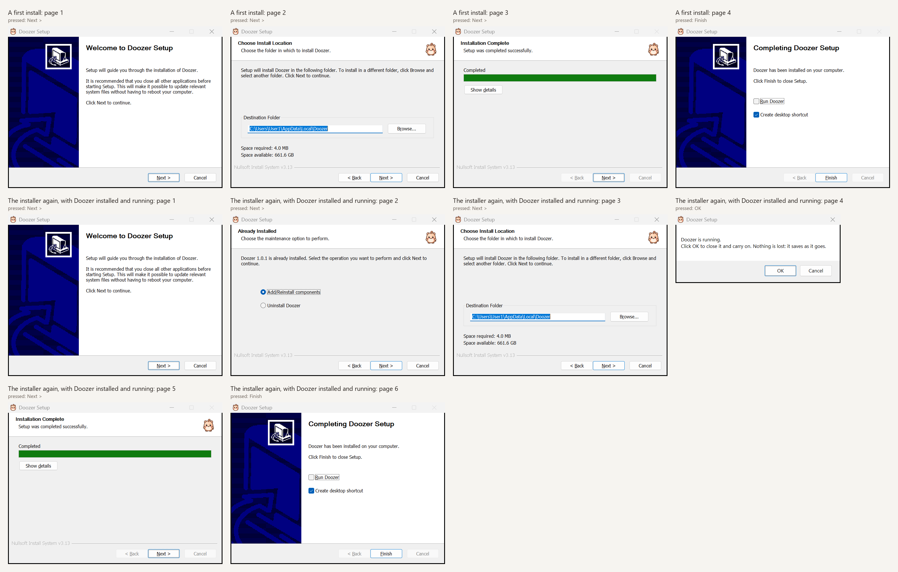
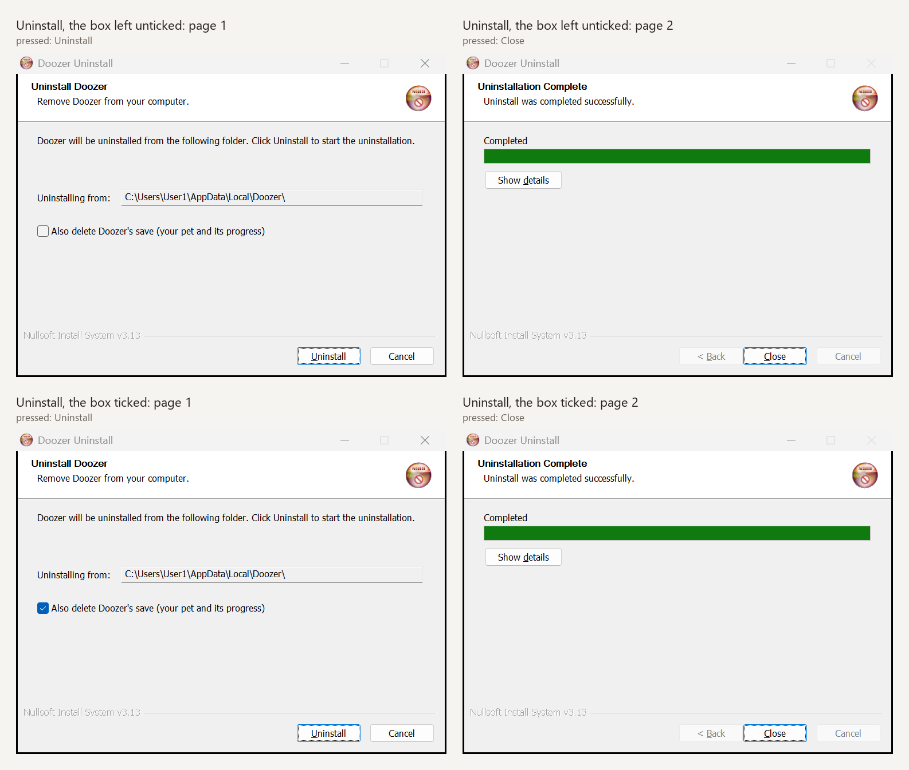

# Release: the installer, and how version 1.0.1 was checked

Phase 11 of [WORK_PLAN.md](../WORK_PLAN.md), brought up to version 1.0.1 (2026-11-20 and 21), the public release. **Is it ready to publish? Yes: section 10.** What a person installing Doozer needs to know is in [user-guide.md](user-guide.md); this is for whoever builds it. What 1.0.1 changed since 1.0.0 is section 4.

## In short

- **One file ships:** `Doozer_1.0.1_x64-setup.exe`, 1.7 MB. It installs for the current user only, with no administrator prompt, into `%LOCALAPPDATA%\Doozer` (4.1 MB installed), adds a Start menu entry and an entry under *Installed apps*, and nothing else.
- **The icon is Doozer:** the whole creature from 48 pixels up, a simplified face at tray sizes.
- **Uninstalling is clean, and the pet is the user's choice.** The uninstaller's one tick box, *Also delete Doozer's save (your pet and its progress)*, decides whether the save goes. Unticked, which is how it starts, the save stays and a later install finds the same Doozer. Everything else goes either way: the program, its shortcuts, the *Start with Windows* entry, the browser's cache, and (new in 1.0.1) the installer's own key in the registry.
- **The page runs under a content security policy** (new in 1.0.1): nothing but the app's own files and its own shell. Section 5.
- **A public release of the installer.** Unsigned, no automatic updates, the source not published; a short licence installed beside the program (free to use and to pass on unchanged, no warranty). Decided by Claude on the owner's delegation, 2026-11-20; section 6. Whether it is ready to go up is section 10, *Ready to publish*.
- **Checked on this machine without a hand on the mouse:**
  - the installer and the uninstaller **page by page, on screen**, with a picture of every page, both ways through the tick box (38 checks);
  - install, run, a second copy, a save, *Start with Windows* from Settings, an update over a running copy, uninstall, silently (49 checks); and 1.0.0 with a pet and settings updated to 1.0.1, both kept (16 checks);
  - no personal details in anything that ships, and nothing found by Windows Defender;
  - every view's scripted checks, the polish set and an hour's Desktop soak on a build of the same commit with the test hooks, each of them failing if the policy refuses anything. Sections 7 and 10.
- **Not checked by a person, and accepted as such:** the icon in the real tray, a PC that is not this one, a monitor that is awake and not 120 Hz. Section 8.

## 1. Building it

From the `app` folder:

```
pwsh scripts/build-release.ps1
```

It runs the type-check and both test suites, builds the page into a new folder, compiles the shell around it and has Tauri bundle the result. Output: `src-tauri/target/release/bundle/nsis/Doozer_<version>_x64-setup.exe`, with its size and SHA-256 printed. `-NoTests` skips the tests.

The first build on a machine fetches the installer maker (NSIS 3.13, and Tauri's helper library for it) from Tauri's releases on GitHub into `%LOCALAPPDATA%\tauri`. That is Tauri's doing and needs the network once. It happened on this machine during Phase 11.

`npm run tauri build` makes the same installer, with one risk the script avoids: the shell embeds the page when it is compiled, and a changed page in an unchanged folder has been silently left out before. To see which page a running copy carries, start it with `WEBVIEW2_ADDITIONAL_BROWSER_ARGUMENTS=--remote-debugging-port=9230` and ask: `node scripts/ask-page.mjs --port 9230 --eval "document.documentElement.dataset.version"`.

### The version

It is written in three places, and a native test (`the_version_is_the_same_everywhere`) fails if they differ:

| File | Read by |
|---|---|
| `app/package.json` | the page (stamped on its `<html>` tag as it is built) |
| `app/src-tauri/tauri.conf.json` | the installer, *Installed apps* |
| `app/src-tauri/Cargo.toml` | the program's own properties, the tray icon's tooltip ("Doozer 1.0.1") |

### The icon

Two drawings in `app/assets/icon/`, both made from the 2D rig's own shapes in the Peach palette:

- `doozer.svg`: the whole creature. Used from 48 pixels up.
- `doozer-small.svg`: the same creature without arms, feet and tail, with a heavier outline and bigger eyes and cheeks. Used at 16 to 40 pixels, where the whole one turns into a peach smudge.

`node scripts/make-icons.mjs` builds every file in `src-tauri/icons/` from them. The 32-pixel layer is written first in `icon.ico` because the shell takes the first layer for the tray icon.


### The third-party notices

`src-tauri/installer/THIRD-PARTY-NOTICES.txt` is installed beside the program. It carries the licences of what is inside it: the Fredoka typeface (SIL Open Font License), three.js (MIT), Tauri's script library, and the 224 Rust libraries a Windows build links, each with its authors' own licence text (97 different texts; where a library offers a choice, the MIT one). Five of those libraries are under the Mozilla Public License 2.0, used unchanged; the file says where their source is. `node scripts/make-notices.mjs` writes it; run it again whenever a dependency changes.

### Doozer's own licence

`src-tauri/installer/LICENSE.txt` is installed beside the program too. It is short and plain: Doozer may be used for free and passed on unchanged, it may not be sold or passed on changed, and it comes with no warranty. The copyright is "the author of Doozer": nobody is named, in it or anywhere else that ships (section 10 says how that was checked). The installer shows no licence page, so nothing has to be accepted to install it. A native test keeps the file shipping, keeps the installer free of a licence page and keeps the wording.

## 2. What the installer does

| | |
|---|---|
| Kind | NSIS, built by Tauri's bundler; settings in `tauri.conf.json` under `bundle` |
| For whom | The current user only. No administrator rights, no prompt from Windows |
| Where | `%LOCALAPPDATA%\Doozer`: `doozer.exe`, `uninstall.exe`, `LICENSE.txt`, `THIRD-PARTY-NOTICES.txt` |
| Shortcuts | Start menu; a desktop shortcut if the box on the last page is left ticked (a silent install, `/S`, always makes one unless `/NS` is given) |
| Listed as | *Doozer*, version 1.0.1, publisher *Doozer*, under *Installed apps* |
| Language | English |
| Does not | Start Doozer with Windows (that is a setting in the app, off by default); write a save; need the network on Windows 11 |
| Over an older copy | Closes a running Doozer, replaces the program, leaves the save and the settings alone |
| WebView2 | Windows 11 has it. On a Windows 10 PC without it, the installer fetches Microsoft's small bootstrapper and runs it; that is the only time anything is downloaded |

A running Doozer is closed by the installer and by the uninstaller without being asked to save first. Nothing is lost by that: anything that happened is written within half a second of happening, the file is replaced in one step so it is never half-written (`save.rs`, and the kill tests there), and the time that passed is worked out again from the clock on the next start.

**Its pages**, as they came up on this screen (section 7 says how they were walked). A first install is four pages: welcome, the folder, the copying, and a last page with two tick boxes, *Run Doozer* and *Create desktop shortcut*, both ticked as they come. With Doozer already installed there is one more, *Already Installed*; and if Doozer is running when the files are about to be replaced, a message says so and offers to close it.



Two things in those pictures are Tauri's and NSIS's own and were left: the blue artwork down the side of the first and last page, and the words *Add/Reinstall components* on the *Already Installed* page. A side picture of Doozer's own would go in `bundle.windows.nsis.sidebarImage` (a 164 by 314 bitmap); nobody has drawn one.

When a newer installer finds an older Doozer and is run by hand, its second page offers *Uninstall before installing* (the first choice) or *Do not uninstall*. Both keep the save. The first runs the old uninstaller in full, which takes the *Start with Windows* entry out; Doozer puts it back the next time it starts, because the setting is in the save and the app brings the registry in line with it at every start.

## 3. What the uninstaller does

| | Box unticked (the default) | Box ticked |
|---|---|---|
| The program, its shortcuts, its *Installed apps* entry | removed | removed |
| The *Start with Windows* entry | removed | removed |
| The browser's cache, `%LOCALAPPDATA%\com.doozer.desktop\` | removed | removed |
| The installer's own key, `HKCU\Software\Doozer\Doozer` (and `HKCU\Software\Doozer` if nothing else is in it) | removed (**1.0.0 left it**) | removed |
| The save, `%APPDATA%\com.doozer.desktop\` | **kept** | deleted |



Most of that is Tauri's own uninstaller. Four things are Doozer's:

- **The wording** (`src-tauri/installer/English.nsh`). Tauri's tick box says *Delete the application data*, which leaves a person guessing whether that means their pet. Doozer's says *Also delete Doozer's save (your pet and its progress)*. And where Tauri's messages about a running copy say "Click OK to kill it", Doozer's say "close": the pet never dies, the installer included. The file is Tauri's own with those four lines changed; after upgrading Tauri, compare the two in case Tauri's has gained a line (the file's header says how).
- **The browser's cache goes even when the save is kept** (`src-tauri/installer/hooks.nsh`). Tauri removes it only with the box ticked. It holds nothing of the pet (the page keeps nothing there); it is some tens of megabytes of WebView2's own files.
- **The installer's own key goes too** (the same hook, new in 1.0.1). The installer notes the folder it installed into under `HKCU\Software\Doozer\Doozer`, so that the next install goes to the same place, and Tauri clears that only with the box ticked. So 1.0.0 left the key behind on every ordinary uninstall. The hook removes it, and its parent only if empty, exactly as Tauri's own lines do when the box is ticked. An update loses nothing by it: the installer reads the folder from the key before it runs the old uninstaller.
- **Start with Windows.** Tauri's uninstaller removes the value named after the product from the user's Run key. That is the name Doozer's own code writes (`autostart.rs`), which is why uninstalling takes the entry away; a native test keeps the two names the same.

Neither of the hook's two removals happens when a later version's updater runs the old uninstaller on the way to an update: then the program is coming straight back and wants both. Native tests keep the hook away from the save's folder, keep everything it removes inside that one "not an update" test, keep the parent key's removal to "only if empty", and keep the wording free of "kill".

A silent uninstall (`uninstall.exe /S`) cannot tick the box, so it always keeps the save.

The uninstaller copies itself into the temp folder to do its work (`~nsu1.tmp\Un.exe` and so on), and Windows removes the copy at the next restart. That is how NSIS works; the check scripts remove the copies they cause.

## 4. What changed in the app

**For 1.0.0, almost nothing, on purpose**: the build that was measured and checked in Phase 10 was the build that shipped. The tray icon's tooltip says the version; the page carries its version on its `<html>` tag, for the check in section 1; and the native tests gained four (the version, the Run key's name, the uninstall hook, the wording) and two repairs. The *Start with Windows* tests shared a scratch registry key that the last test to finish removed, and now and then one test removed it while another was creating its own key inside it; each test's key now stands by itself. The save tests no longer leave their scratch folders in the temp directory.

**1.0.1** is seven things asked for, four in the app and three in the release. Six were done; one (the second) could not be met:

| | What | Where it is written up |
|---|---|---|
| 1 | A content security policy, where there was none | Section 5 |
| 2 | **Not met, and taken out again.** The frame clock was made to aim at whole refreshes on a screen 24 or 60 does not divide, so as not to ask for a frame and pass it over. It worked on every pretend screen and made pictures late on a real one. The clock is as it was in 1.0.0; the rhythm on such screens is now tested | [polish-checks.md](polish-checks.md), section 18.1 |
| 3 | The pet's clock ticks once a second, not four times, while nobody is at the window; a focus session ends within a hundredth of a second of its time | polish-checks.md, section 18.2 |
| 4 | The shell's "style repairs" were never repairs: the counter counted the shell's own catching up. Explained, counted apart, and a real repair now fails the soak | polish-checks.md, section 18.3 |
| 5 | The uninstaller removes the installer's own registry key | Section 3 |
| 6 | The installer's and uninstaller's pages walked on screen and pictured; the tick box run both ways for real | Section 7 |
| 7 | The owner's answer about sharing, written down | Section 6 |

Then the owner handed every open decision over ("Just do everything you need for any decisions that need to be made. Your choice, just test and make sure it's ready to go live."), and 1.0.1 became the public release. That brought: Calm strolling about every four minutes rather than every one to two ([polish-checks.md](polish-checks.md), section 18.4); the licence and a privacy section in the user guide; and the go-live checks of section 10. The decisions themselves are in section 6 and in the spec's section 13.

## 5. The content security policy

`"csp": null` until 1.0.1. The plan had put a policy in Phase 11 and it was missed. It is in `tauri.conf.json` (`app.security.csp`), and Tauri sends it as a header with the page and with the Island's frame:

| Directive | Allows | Why |
|---|---|---|
| `default-src 'none'` | nothing | Whatever is not named below is refused. This is what makes the rest a whitelist |
| `script-src 'self'` | the app's own script files | No script from a string (`eval`, `new Function`), no inline script, none from anywhere else. Tauri adds the hashes of its own start-up scripts |
| `style-src 'self'` | the app's own style sheets | Tauri adds a nonce for the one small style block in each of the two HTML files. A style sheet made by script is refused |
| `style-src-attr 'unsafe-inline'` | a `style` attribute on an element | **The one concession.** The rig and the Radial write their pivots as `style="--px:..."` in the markup they build, and without this the creature comes apart. It allows a style attribute and nothing else. Taking it out means moving those pivots out of the markup (`character/rig-markup.ts`, `ui/radial.ts`) |
| `img-src 'self'`, `font-src 'self'` | the app's own images and its one typeface | Not `data:`, not `blob:` |
| `connect-src 'self' ipc: http://ipc.localhost` | the app's own files (the 3D model) and the shell | The last two are Tauri's channel between the page and the shell. Nothing else can be fetched: the page cannot reach the network at all |
| `frame-src 'self'`, `frame-ancestors 'self'` | the Island's hidden frame, and only inside the app's own page | The 3D engine lives in that frame |
| `base-uri 'none'`, `form-action 'none'` | nothing | There is no use for either |

What needed nothing: WebGL, Web Audio (the sounds are made in the page, not loaded), the CSS variables and styles that script sets on elements directly.

**How it is known to work, and to refuse.**

- Asked of the running app (the Island view, where the most is loaded): the header is there on the page and on the frame; `eval`, `new Function`, an inline script, a style sheet made by script, a fetch from another site and an image from another site are each refused; the Island draws, the typeface is loaded, the shell answers.
- **Every scripted run now watches the policy** (`spike/config.ts`): it listens, in the page and in the Island's frame, for anything the policy refuses, and every check of a run in which something was refused fails, naming the directive and what was refused. On its first run this caught the Island's own checks loading a `data:` picture into an image to count painted pixels; the checks were changed to decode the picture without an image, and the policy was left alone. Nothing in the app itself was refused anything, in any view's checks or in the soak (section 7).
- A native test (`the_content_security_policy_is_there_and_has_not_been_loosened`) fails if the policy is taken out, if a directive appears that is not in its table, or if any directive allows more than the table says. Making the policy stricter passes.

**In development** (`npm run tauri dev`) the page comes from Vite's dev server, which puts its styles in the page by script and talks to it over a websocket. `devCsp` is the same policy with those two allowed. It was not tried with the dev server in this phase (that opens a window on the screen). If the dev server is refused something, loosen `devCsp`, never `csp`: the native test watches only the latter.

## 6. Decisions, and how to change them

**A public release of the installer only.** On 2026-11-16 the owner said "I'll share it"; on 2026-11-20 they handed every open decision to Claude, and Claude decided on a public release: the installer is put up for anyone to download. Unsigned, with no updater, and the source not published. The decisions, each recorded in the spec's section 13 as decided by Claude on the owner's delegation:

- **The terms:** the licence above, and a Privacy section in the user guide: Doozer collects nothing and makes no network requests.
- **Unsigned** and **no updater**: below. Both can be added later without touching the app.
- **The source is not published.** The repository holds the owner's working notes as well as the code; publishing it would be a decision of its own, with a licence for the code chosen for it.

**The name.** The name "Doozer" and the identifier `com.doozer.desktop` stay. Be aware that the Jim Henson Company uses "Doozers": they are the small builder creatures of *Fraggle Rock*, and there has been a children's series called *Doozers*. Whether a free desktop pet of the same name is a problem is a question for someone qualified to answer it; this paragraph is not legal advice. What is certain is the cost of changing course: a rename is cheap before the first public upload (the name in a handful of files, and the identifier, which names the save's folder, before anyone has a save) and costly after it (every installed copy keeps its pet in the old folder, and the name is out in the world).

**Code signing: not signed.** A certificate costs money every year and is issued to a named person or company, so it is the owner's to buy, and only worth buying for a public release. Unsigned, the installer works; on somebody else's PC Windows SmartScreen will show "Windows protected your PC" until *More info → Run anyway* is chosen, and some antivirus programs are wary of any unsigned installer. To sign later: put the certificate's thumbprint in `bundle.windows.certificateThumbprint` (with `digestAlgorithm` and `timestampUrl`), or a signing command in `bundle.windows.signCommand`, and build again. Nothing in the app changes.

**Automatic updates: none.** Doozer makes no network request of its own (the only `fetch` in the page loads the 3D model from inside the program), which is part of being small and polite, and an updater needs three things that do not exist yet: somewhere to publish releases, a signing key kept safe, and a decision to release it publicly. A new version is installed by running its installer; it replaces the program and keeps the pet (checked, section 7). To add an updater later: Tauri's updater plugin, a key pair made with `tauri signer generate`, and an address in `plugins.updater.endpoints`.

**For the current user only.** No administrator prompt, and each Windows user gets their own Doozer, which matches the save being per user. `bundle.windows.nsis.installMode` is the switch.

**WebView2 is fetched only if missing.** The alternative, carrying Microsoft's offline installer inside ours, adds about 130 MB to spare the rare Windows 10 PC a download. `bundle.windows.webviewInstallMode`.

**English only.** The app has no other language either.

**The identifier stays `com.doozer.desktop`**, as settled in Phase 6 and again for the public release: it names the save's folder.

## 7. What was checked, and how

Everything in this section is version 1.0.1. The final installer was built from commit `4f4e4b0`, and the app's own checks were run on a build of the same commit with the test hooks; the commits after it change only scripts, documents and one test-only check (below). The installer's pages were walked on the 1.0.1 installer built from `596f24d`: the final one differs from it only in the licence file it installs, which is not a page, and the owner was at the machine when the final one was built, so nothing more was put on the screen.

### The pages, on screen

`pwsh scripts/run-install-pages.ps1 -Out <folder>` walks the installer and the uninstaller as a person would, page by page, and takes a picture of each (the two sheets in sections 2 and 3 are its pictures).

- **Never the real pointer, never a key.** Each button is pressed by sending its dialog the message a press sends ("this button was clicked"), and a tick box is set by the message that sets one. UI Automation's Invoke and Toggle patterns were the intended way; UI Automation finds these controls but offers neither pattern for them (tried from both PowerShells), and for a Windows button Invoke comes down to that same message.
- **The pictures are taken with PrintWindow**, which asks a window to draw itself, so they are right whatever is in front.
- **It waits for a quiet machine**: a minute with no input and no fullscreen app in front before it puts a window on the screen, and again before each further one. When it ran, nobody had touched the machine for hours.
- **It touches only its own windows**: dialogs titled *Doozer Setup* or *Doozer Uninstall* that belong to the installer it started or to the uninstaller's own copy of itself (known by where the copy is and by its being a file of the product "Doozer"). Anything else on screen is left alone, and only processes it started are ever ended.
- It measures every tick box's and choice's label against the room it has: **none is cut short** (the longest, the uninstaller's box, needs 438 pixels and has 600).
- Like the silent check it refuses to start where a Doozer is installed, running or saved.

| Step | What was checked | Result |
|---|---|---|
| A first install, four pages | Walked to its end; the program installed, in the Start menu, listed as 1.0.1; with *Run Doozer* unticked on the last page it is not started | 5 of 5 |
| The installed program | Starts; the page inside it is 1.0.1; the bowl filled from the Card; the save written | 4 of 4 |
| The installer again, Doozer installed and running, six pages | The *Already Installed* page shown; the message that Doozer is running shown, and it says "Doozer is running. Click OK to close it and carry on. Nothing is lost: it saves as it goes."; the running copy closed; the save untouched | 6 of 6 |
| Uninstall through the pages, **the box left as it comes** | One tick box, with Doozer's wording, unticked; the program, shortcuts, *Installed apps* entry, installer's key and browser's cache gone; **the save still there, byte for byte** | 10 of 10 |
| Install again | **The same Doozer is back**: born at the same moment, its bowl still full | 3 of 3 |
| Uninstall through the pages, **the box ticked** | The box ticked; the program gone; **the save gone**; the cache and the installer's keys gone | 6 of 6 |
| Install again | **No save: a new Doozer hatches.** Then uninstalled, and nothing left | 4 of 4 |

38 of 38, 14 pages pictured. The pictures were also sent to the owner as they are.

A first trial of the script, against the 1.0.0 installer, left two of the uninstaller's windows open on the screen for some minutes: it did not recognise the uninstaller's copy of itself as its own and so, rightly, did not touch it. They were closed and the rule that recognises the copy was written from what was found.

### The installer, silently

`pwsh scripts/run-install-checks.ps1` does the following with the real installer in the real places, silently. It asks the installed program's page questions over the browser's debugging port, and presses the Card's and the Settings panel's own buttons through the page.

| Step | What was checked | Result |
|---|---|---|
| Install (`/S`) | Finishes without an error, in under a second. Program, uninstaller, licence and notices in `%LOCALAPPDATA%\Doozer`; Start menu shortcut; listed under *Installed apps* as Doozer 1.0.1; the program's own properties say 1.0.1; the installer's note of its folder is in the registry. Installing does not register it to start with Windows, writes no save, and does not start it | 14 of 14 |
| The installed program | Starts; the page inside it is 1.0.1; no save, so a new Doozer; a second copy leaves by itself; the bowl filled from the Card and the save written to `%APPDATA%\com.doozer.desktop`; *Start with Windows* switched on in Settings: registered with the installed program's path and kept in the save | 9 of 9 |
| Install again while it runs | The running copy is closed; the program replaced; the save byte for byte the same; *Start with Windows* and the note of the folder still there; it starts again, finds the same Doozer with its bowl still full, and knows it is registered; it quits when asked | 10 of 10 |
| Uninstall (`/S`) | Program, folder, Start menu and desktop shortcuts, *Installed apps* entry, *Start with Windows* entry, the browser's cache, **the installer's key and its parent** all gone; **the save still there, unchanged** | 10 of 10 |
| The tick box, read from the installer's script | Data is deleted only when the box is ticked; what is deleted then is the save's folder, by the identifier; the Run key value is removed by the product's name; the box is worded for a pet; nothing the installer says speaks of killing | 6 of 6 |

49 of 49 on the final installer (the licence file is the forty-ninth). Both scripts remove the save their test pets made, so the owner's first start is still a first start, and the machine was checked afterwards: nothing installed, no save, no key, no shortcut, nothing running, none of the uninstaller's copies in the temp folder. (The copy of the installer's key that the 1.0.0 checks had left on this machine was removed by hand, after seeing that it was the only Doozer key there, that it held the install folder and that nothing was installed.)

One mistake of the check's own is worth keeping, because it shows something true about the app. Its first version switched *Start with Windows* on by asking the shell directly. At its next start the app took the entry out again: the setting in the save said off, and the app brings the registry in line with the setting at every start. The check flips the switch in Settings, as a person would.

### The app

The scripted checks of every view need the test hooks, so they were run on a build of the same commit with the hooks in (`scripts/build-polish-checks.ps1 -Label final`), cloaked and with injected input. Every one of them now also fails if the content security policy refuses anything during the run.

| Set | What it covers | Result on the final build |
|---|---|---|
| The app and the Pill | A first day, a second day, never stuck, the window | 4 of 4 |
| The Room | The furniture, an hour alone, switching views mid-session, reopening, the window, never stuck | 6 of 6 |
| The Island | Hello, never stuck (a lost graphics context among it), the window, a focus session, the still pictures | 5 of 5 |
| The Desktop | Never stuck (twenty minutes of interruptions), the click-through probes | 2 of 2, after one repair to a check (below) |
| Polish | Reduce motion in every view, the interface size in every view, the keyboard way into the Card in each of the four | 6 of 6 |
| **The Desktop soak, a full hour** | 1,730 random actions; 44 hands-off checks, every one finding Doozer at rest; nothing rescued; the shell never found the page silent; of the window's style, 745 flips, 8 catch-ups and **0 repairs** | ok |
| The content security policy, in all 24 of those runs | Nothing refused | 0 |

The slower clock is in all of these: a scripted run's pretend pointer counts as somebody being there, and the runs that leave Doozer alone (the Room's hour, the soak's hands-off checks, the focus sessions) run on the once-a-second tick.

**What failed on the way, and was in each case a check:**

- **The Desktop's lost mouse-up.** The view ended the carry 15 ms after the lost mouse-up, Doozer was back on the line and click-through at rest; but the check read a running total of how carries had ended, for the whole scenario, and an earlier carry, whose mouse-up and the shell's notice of it arrived together, had been counted as the notice. It now counts this carry alone, and passed (this carry counted as the shell's notice, the earlier one as the mouse-up).
- **The second day** (the Pill's checks). The check set the clock fourteen hours ahead and expected a new day; run between midnight and ten in the morning, fourteen hours on is still today. It had never been run at that hour. The night now always reaches the next calendar day.
- **The keyboard way into the Card**, all four views, when the round ran with the screen locked: no program may take the keyboard then. It is now reported as skipped on a locked screen. On the final build, with the owner's screen unlocked and idle a minute, all four passed.
- **The Island's checks**, the first time the policy was on: they loaded a `data:` picture into an image to count painted pixels, which the policy refuses (section 5). They now decode it without an image.

**The tests:** 1,185 page tests in 53 files and 64 native tests (one more is the kill test's helper, ignored by design), type-check clean: three rounds in a row on the final code, one of them with both suites running at once, and once more inside the release build. The save tests leave nothing in the temp folder, and the native tests no registry key.

### Version 1.0.0, for the record

1.0.0 was checked the same way on 2026-11-20, from commit `4e35164`: the silent install check 44 of 44, the Pill 4 of 4, the Room 6 of 6, the Island 5 of 5, the Desktop 2 of 2, the polish set 6 of 6, a fifteen-minute soak, 1,139 page tests and 60 native tests three times over. Its pages were never on screen.

**The Room's ball check failed twice on the way to 1.0.0, and both times it was the check.** The ball game is three kicks, each 90 to 150 px by chance, with Doozer trotting to 30 px short of where the ball lands. The check asked for two things that are only likely: Doozer already trotting a twentieth of a second after the click (when the first toss lands 30 px beyond where Doozer stands, the first leg is no distance at all and Doozer waits without taking a step: about one game in fifteen), and Doozer getting more than 40 px away from where it started (it read 35 in one run). It now watches from the click until the scene ends and asks for what the game guarantees: the scene is "play", Doozer trots in it, the ball ends somewhere new, and Doozer covers at least 60 px of floor.

## 8. Not verified by a person (accepted for the release)

1. **The icon in the real tray**, at this screen's 150 %, and in the Start menu and *Installed apps*. It was judged from enlarged pictures of its layers, not on a real taskbar. (The installer's pages no longer need walking by hand: look at the two pictures in sections 2 and 3 instead, for the wording and for the stock artwork that was left.)
2. **Another PC.** Windows SmartScreen on a machine that did not build the file; a Windows 10 PC; a PC without WebView2 (the installer should fetch it). None of these could be tried here.
3. **A screen that is awake and not 120 Hz.** On a 60 Hz screen Doozer alone should move evenly at 20 pictures a second. That is held by tests on pretend screens, and was seen on this machine's own screen with its monitor asleep (about 56 Hz), not on a real 60 Hz monitor ([polish-checks.md](polish-checks.md), section 18.1).
4. **Start with Windows, for real.** Switch it on in Settings, sign out and in, and see Doozer arrive without taking the keyboard. The scripts prove the entry is written with the installed path and removed on uninstall, not that Windows acts on it.
5. Everything the earlier phases left for the owner still stands: section 16 of [polish-checks.md](polish-checks.md), section 9 of [desktop-checks.md](desktop-checks.md), section 10 of [island-checks.md](island-checks.md).

## 9. Releasing a newer version

1. Change the version in the three files of section 1 (the native test says so if one is missed).
2. If a dependency changed: `node scripts/make-notices.mjs`.
3. `pwsh scripts/build-release.ps1`.
4. On a machine with no Doozer on it: `pwsh scripts/run-install-checks.ps1`, and `pwsh scripts/run-install-pages.ps1 -Out <folder>` for the pages (it waits until nobody is at the machine). On the owner's own machine, once a pet lives there, both refuse to run: install by hand instead. The installer keeps the save.
5. Every view's checks on a build with the test hooks: `pwsh scripts/build-polish-checks.ps1 -Label final`, then `run-app-checks.ps1`, `run-room-checks.ps1`, `run-island-checks.ps1`, `run-desktop-checks.ps1` (and `-Soak 15`) and `run-polish-checks.ps1`, each with `-Exe src-tauri\target\polish\final\doozer.exe`.
6. Tag the commit `v<version>`.

## 10. Ready to publish

**Yes.** Version 1.0.1 is ready for a public release of the installer, as decided (section 6). Nothing was published, pushed, bought or signed up for; putting the file up is the owner's step.

| What ships | |
|---|---|
| File | `app/src-tauri/target/release/bundle/nsis/Doozer_1.0.1_x64-setup.exe` |
| Size | 1,809,260 bytes (1.7 MB); 4.1 MB installed |
| SHA-256 | `088c6a413fc988f6f1c8fba218943b5d918e2c27dc5782148ac1049853f025f5` |
| Built from | commit `4f4e4b0`, tagged `v1.0.1` at the commit that records this list |
| Text to publish with it | [release-notes-1.0.1.md](release-notes-1.0.1.md) |

A rebuild gives a different hash (the build stamps the time); the file above is the one that was checked.

**The go-live checks, each on the final build:**

| Check | Result |
|---|---|
| **a. Personal details** in what ships: the git user's name and email (read from `git config` at run time, written nowhere), the Windows user name, the profile path, the project's path; in the installer, the program and every file installed beside it, and the page | **Clean.** The first scan found the profile path 158 times in the program, from the source paths of the Rust libraries (they live under the profile). The release build now maps those paths to neutral words (`--remap-path-prefix`), and the scan runs at the end of every release build and fails it if anything is found (`scripts/scan-personal.ps1`). The licence names "the author of Doozer" and nobody else |
| **b. Antivirus**: Windows Defender, `MpCmdRun.exe -Scan -ScanType 3`, on the installer and on the program | **No threats found** in either. No administrator rights were needed, and no Defender setting was touched (the scan was run with `-DisableRemediation`, reporting only) |
| **c. The update path**: 1.0.0 installed and given a pet (its bowl filled) and settings (Mint, Sound on, Desktop activity Still), all through the app's own controls; 1.0.1 installed over it while it ran (`scripts/run-update-check.ps1`) | **The same pet**, born at the same moment with the same name, bowl, treats and sessions; **the same settings**, and Doozer drawn in Mint. Then uninstalled; the machine left clean. 16 of 16. (The 1.0.0 installer was rebuilt from its tag for this, in a private folder.) |
| **d. The Desktop soak**, a full hour | **Passed**: 1,730 actions, 44 hands-off checks all at rest, nothing rescued, no style repairs, nothing refused by the policy |
| **e. The budget**, every view: at rest, in a focus session, Calm over twelve minutes, memory | **Met, except Calm by a hair.** Every view at rest and every focus session under 1 % of a core on average (0.31 to 0.75 %); every state under 150 MB (97 to 141). Calm over twelve minutes: 1.08 and 1.04 %, each run carrying one peek, which is now Calm's big cost. Recorded as decided; [polish-checks.md](polish-checks.md), section 18.4 |
| **f. Release text** | [release-notes-1.0.1.md](release-notes-1.0.1.md): what Doozer is, Windows 10 or 11 64-bit, the SmartScreen steps, size and SHA-256, what is new, known limits |
| The installer, silently: install, run, a second copy, a save, *Start with Windows*, an update over a running copy, uninstall | 49 of 49 |
| The installer's and uninstaller's pages, on screen, both ways through the tick box | 38 of 38, 14 pages pictured, no label cut short (on the `596f24d` installer; above) |
| Every view's scripted checks and the polish set | All pass (section 7) |
| The content security policy | Nothing refused in any of 24 runs; `eval`, inline script, a script-made style sheet, outside fetches and images all refused when tried |
| The tests | 1,185 page tests and 64 native tests, type-check clean, three rounds in a row plus once inside the release build |

**Not verified by a person, and accepted as such for the release:**

- the icon in the real tray, the installer's pages by eye (their pictures are in sections 2 and 3), and Doozer's motion and sounds (24 pictures a second; the two extra sounds were decided to stay without being heard);
- another PC: SmartScreen on a machine that did not build the file, Windows 10, a PC without WebView2;
- a monitor that is awake and not 120 Hz;
- *Start with Windows* across a real sign-in.

Each is described in section 8 and in the earlier write-ups. None of them can make the installer harm a PC or lose a pet; the worst they could show is something that looks or sounds less good than it should.

**Before putting it up**, one thing only the owner can weigh: the name (section 6). It stays by decision, and a rename is cheap now and costly after the first upload.
