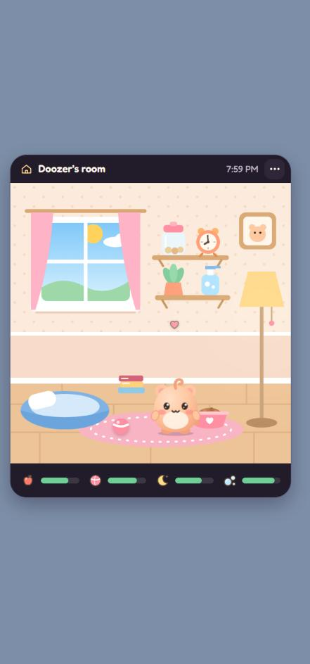
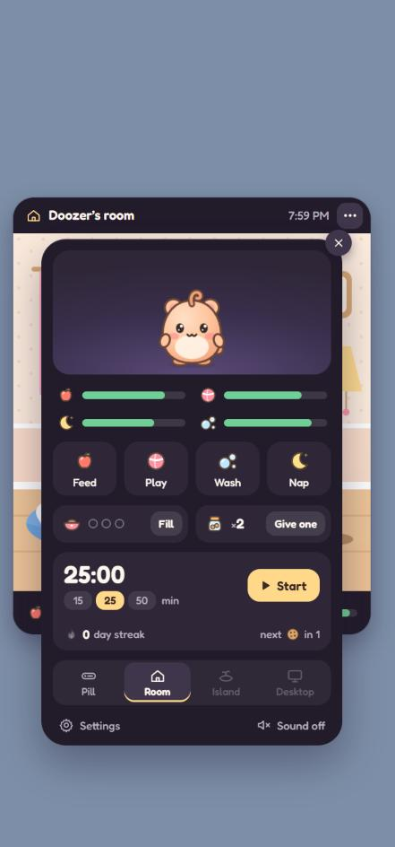

# The Room: what was checked, and how

**Phase 7 of [WORK_PLAN.md](../WORK_PLAN.md)** · run 2026-11-13 · the same machine as [pill-checks.md](pill-checks.md): Windows 11 Pro, one 3840 × 2160 display at 150 % scaling and 120 Hz, 24 logical cores, WebView2.

Phase 7 adds Doozer's second home (DESIGN_SPEC.md 6.2): a framed little room where you set things up by clicking the furniture and Doozer decides when to use them. With it, switching between two views is real for the first time. This file records what was verified, by what means, and what is left for a person.

## In short

| Asked for | Result | How it is known |
|---|---|---|
| Every row of the furniture table works against the real brain | Yes | Unit tests against the real brain, and the same rows pressed in the real window (sections 1 and 2) |
| An hour in the Room with a full bowl: Doozer looks after itself and always comes back to rest | Yes, **on a fast clock, not a real wait** | An hour (and three hours) on a fake clock in the unit tests; an hour of pet time in one minute in the real window (section 3) |
| Switching Pill to Room and back in the middle of a focus session loses nothing | Yes | Through the real host in the unit tests, and in the real window by the tray menu and the Card (section 4) |
| Never stuck, with injected input: furniture clicked mid-walk, every scene interrupted at several moments, the view switched mid-scene, a window drag whose mouse-up never arrives | All pass | Section 5 |
| Idle cost in the Room, release build, against 150 MB and 1 % of one core | 113–126 MB. At rest 0.3–1.0 %; **1.05 % averaged over ten minutes** that included two of Doozer's own outings: memory inside the budget; CPU inside it at rest and a hair over the 1 % line on that average | Release build, `measure-idle.ps1` (section 6) |
| `npm test`, `npm run typecheck`, `cargo test` | 109 new page tests and 3 new native ones pass, with everything that was there before; type-check clean | Section 1 |

What it looks like, as drawn in a browser pane (the page is the same one the app's window shows; the flat backdrop stands in for the desktop):

| The Room by day, Doozer having just eaten from the bowl | The Card, opened from the title bar |
|---|---|
|  |  |

## 1. Tests that run without a window

From `app/`: `npm test` and `npm run typecheck`; from `app/src-tauri`: `cargo test`.

| Where | What it covers |
|---|---|
| `tests/views/room/pure.test.ts` (25) | The window for each size and its bands, where the Card goes (under the title bar; slid up at the bottom of the screen; scrolling on a short one), the hit regions, the sky for any hour, the light, the clock as a timer, walking as a function of time |
| `tests/views/room/room-view.test.ts` (54) | The whole view against the **real brain** in a test DOM: the scene, the sky moving on by itself through dusk and night, every row of the furniture table and each refusal, what Doozer does alone, petting, the Card and settings, the three sizes, the title bar as a drag handle, render on demand, reduced motion, a new Doozer's hello |
| `tests/views/room/room-stuck.test.ts` (30) | Never stuck (section 5), the hour alone (section 3), and Pill to Room and back through the **real host** (section 4) |
| `src-tauri/src/mode.rs` (3 new) | A floating window with a `bleed` may hang over the top and bottom of the work area by that much and no more, never sideways |

**The tests were themselves tested.** The view was broken on purpose in ten ways: a scene that ends without looking where Doozer belongs; a scene with no time limit; an interrupted walk that keeps walking; being sent to bed not interrupting what Doozer is doing; a drag that ignores the shell saying every button is up; a drag with no time limit; timers left running while tucked away; Doozer never coming back after popping out; a glance that animates like a real outing; an interrupted walk to the bowl leaving the bowl "held". Seven were caught at once. Two were not (the walk that keeps walking, and bed not interrupting), which showed two missing tests; both are written now and catch them. The last one is still not caught, because the code undoes a held bowl in a second place as well, so nothing wrong reaches the screen.

One thing these tests could not see, because a test DOM has no layout: at Small and Large the frame was drawn up to 42 px away from the rectangle that catches the mouse (the Size scale was also scaling the frame's own position). The scripted run in the real window caught it (section 2); it is fixed, and that run now probes six points around the frame's edge in each size.

## 2. The furniture table, in the real window

`app/scripts/run-room-checks.ps1` starts the release build with a scratch save folder and runs scripts from `app/src/spike/room-scenarios.ts` against the real app. As in [pill-checks.md](pill-checks.md), a press is made twice over: the native cursor tracker is fed a pretend cursor and button, so the window's click-through state and the shell's events are the real ones, and the page gets the matching pointer events. The real pointer is never moved and the window is cloaked, so nothing appears on screen. (The owner was using the machine, with a fullscreen app in front for most of these runs.)

`app-room-furniture`, on a fresh save, from the Pill into the Room:

| Object | Pressed | Seen |
|---|---|---|
| Bowl | Once, with Doozer not hungry | 3 servings in the brain and in the picture; Doozer leaves them |
| | (Doozer made hungry) | It walks over while the serving is still in the bowl, eats, and comes to rest at the bowl: 2 servings left, tummy 55 → 87 |
| | Again when full | Refused: a wiggle of the bowl and a head-shake |
| Ball | Once | Tossed; Doozer trots after it for three kicks, fun + 28, and comes to rest beside it |
| | With energy at 6 | Refused: no chase, fun unchanged |
| Soap | Once | Clean → 100; scrubbed where it stands (it did not move), 12 bubbles at the busiest moment |
| Lamp | Off | The lamp goes out, Doozer walks to bed and sleeps there |
| | On | The lamp comes on, Doozer wakes, gets up and walks clear of the bed |
| | Off with energy at 97 | Refused: it stays up, the lamp stays on |
| Bed | Once, then again | Tucked in; woken |
| | (asleep) | A pet still lands (fun + 3); a treat is refused without waking it |
| Treat jar | Once | One treat fewer; Doozer comes running to under the shelf, the treat drops from the jar, it eats |
| | With the jar empty | Refused |
| Clock | Once | A 25-minute session starts: glasses on, Doozer fetches the top book and reads on the rug, the clock on the shelf becomes a timer, the title bar counts down (25:00, then 24:57) |
| | Again | The session stops; Doozer is free; nothing earned and nothing owed |
| Title-bar button | Once | The Card opens: the frame, the Card and its close button catch the mouse (3 regions on the native side too). Feed on the Card: tummy + 32 and Doozer eats in the room. The window still refuses the keyboard |
| | Again | The Card closes; one region again |

The window has no row because the spec gives it none ("—"): Doozer goes and looks out by itself (seen in the hour below and in the unit tests).

Also checked this way (`app-room-window`):

- **Click-through:** 29 of 29 probe points have the right window style. On the room, its title bar and its meter strip the window catches; in the empty bands above and below the room, and just outside the room's rounded corner, it lets clicks through. With the Card open, the Card catches where it hangs below the room and the space beside it does not; closed again, it lets through again. In each of the three sizes, six points 5 px either side of the frame's edges are right.
- **The Card stays on the screen.** In the default spot (the bottom-right corner, where the window's lower band hangs off the work area) the Card has slid up and all of it is on the work area. After the window is dragged clear of the edges, the Card hangs under the title bar, centred. With the room asked for right at the bottom edge, the room's bottom is 33 physical pixels above the taskbar and the Card's 12.
- **The three sizes:** the frame is 327 × 399, 380 × 464 and 456 × 557; the window follows; the room's top-left corner stays on the same screen pixel through all three changes; Doozer is back after each.
- **Tuck away:** tucked in the middle of eating a treat, the window is hidden, nothing catches the mouse, the scene has stopped with nothing left lying about, and the view has no timer running; when the app in front leaves, the room is back with Doozer where it belongs, and no focus was taken.

## 3. An hour in the Room with a full bowl

**This was not a real hour's wait.** It was run twice, on two kinds of fast clock:

**On a fake clock, the whole hour** (`room-stuck.test.ts`). The test moves a pretend clock forward a quarter of a second at a time, 14,400 times, ticking the real brain each time exactly as the host does; the view's own timers (when Doozer next does something, every scene, the minute tick) run on the same clock. So everything that would happen in a real hour happens, in about a second.

| Run | What happened | At the end |
|---|---|---|
| An hour, bowl full, a little hungry | It ate from the bowl by itself when it got hungry and the room showed it walking over; it glanced about between 15 and 45 times, and between 5 and 18 times it really went and did something (at least two strolls and a look out of the window among them); it was never "in the middle of something" for longer than one scene may last (16 s) | At rest, awake, lamp on, three timers waiting: the blink, the minute, the next thing it will do |
| An hour, bowl full, tired (energy 7) | The same, and when it was worn out it put itself to bed, once, and the lamp went out | Asleep in bed; only the blink and the minute waiting |
| Three hours, bowl full, tired | It slept, woke rested by itself, got up, ate, and went on | At rest |

Left alone for that hour the room is still nearly all of the time: Doozer is animating for under 2 % of it (the test fails above that; section 6 says why that number matters).

**In the real window, an hour of the pet's time in a minute** (`app-room-hour`). Here the brain's debug time scale runs the pet 60 times faster while the room itself runs at real speed, and a pretend pointer rests in the room so that Doozer keeps the livelier pace it has when somebody is watching. In 66 seconds, in the final run: it hopped once, went for a stroll, walked over and looked out of the window, ate from the bowl once when its tummy fell below 70 (the bowl went from 3 to 2 in the picture as it ate), and when its energy ran out it walked to bed and the lamp went out. The longest it was ever away from rest was 7.7 s. At the end: asleep in bed, at rest. (Which outings come up is dice; other runs of the same script had two strolls, or three look-abouts.)

What neither run is: somebody watching the room for an hour. The motion has not been seen by a person (section 7).

## 4. Pill to Room and back in the middle of a focus session

**Through the real host** (`room-stuck.test.ts`, the Pill view, the Room view, the host and the brain all real; only the shell is a recording fake): a 25-minute session is started in the Pill with the bowl full and treats in the jar. Four minutes in, into the Room: the session is running with the same time left, needs, bowl, jar and streak are identical, Doozer is on the rug with its book and the clock runs. Paused from the Room's Card for two minutes (the time left does not move), resumed, five more minutes, back to the Pill: still running, the pill is a countdown again. It runs out in the Pill and pays in full: 2 treats and 1 for the first of the day, streak 1. Also: the save holds the running session and the Room as the last view; ten switches each in the middle of a treat leave one view, its regions and a Doozer at rest; the Room's window position from a drag is handed back on the next visit and survives a change of size; tucked away in the Room, a session still ends on time and is celebrated on return.

**In the real window** (`app-room-switch`, then `app-room-reopen` on the save it leaves):

| Step | Seen |
|---|---|
| Before | The tray menu offers the Room (no "coming soon"), and so does the Card's view row |
| A session started in the Pill | The pill counts down from 25:00 |
| "Room" chosen in the tray menu | The Room is on screen; the session is still running and has simply kept counting (24:57 in the Pill, 24:57 when first looked at in the Room); needs, bowl, jar and streak identical; Doozer has its book; the tray ticks the Room; the Room is remembered as the last view |
| "Pill" pressed on the Card, in the Room | Back in the Pill; still running, four seconds further on (24:53); everything else identical |
| Into the Room again, session finished there | Doozer celebrates, 3 treats land, 1 session, streak 1, and it comes to rest; Doozer never had the keyboard |
| Quit, start again | The app reopens in the Room, in the same place, with the session counted and no second hatching |

## 5. Never stuck

On a fake clock (`room-stuck.test.ts`), each case ends by asking whether Doozer has come back to rest: where the brain's state says it belongs, doing nothing, in the right pose, the lamp and the book agreeing, nothing left lying about.

| Case | What was done | Result |
|---|---|---|
| Furniture clicked while Doozer is mid-walk | Each of the seven pieces of furniture clicked at three moments of a walk to the bowl (21 cases, at least 17 of them truly mid-stride); a bath begun mid-walk; 14 strolls Doozer took on its own cut by a pet and a click; 210 rapid clicks across everything | Always comes to rest, and the bowl in the picture is the bowl in the brain. In the bath case Doozer stops on the spot, stays exactly there for the whole bath, and faces forward again |
| Every scene interrupted at several moments | The eight scenes (eat from the bowl, hand-fed, treat, play, wash, to bed, fetch the book, celebrate) each cut at three moments by each of the eight (192 cases, the second scene really taking over in more than 120); each cut at eight moments by being sent to bed, woken and sent again; by the Card opening and closing; by being tucked away and brought back; by Doozer popping out for a window change, with and without the host ever bringing it back | Always comes to rest. Tucked away: no timer of the view left running, at any moment of any scene |
| A scene that never finishes | A performance whose promise never settles | Ended by the 16 s limit; Doozer is put where it belongs |
| A missed event | The brain changed while the view could not hear | Put right the moment the view is back |
| The view switched mid-scene | Unmounted at four moments of each scene, with the Card open | No timer, no element, no shell listener left; nothing reacts afterwards. Mounted again, Doozer is where it belongs |
| A window drag whose mouse-up never arrives | A press on the title bar that travels | Ends on the shell's `drag-end`; on its `pointer-released`; on the next pointer move with no button held; and by itself after 20 s if nobody says anything. Never starts if the shell refuses. Doozer carries on with its day meanwhile |

**With injected input, in the real window** (`app-room-stuck`):

| Case | What was done | Result |
|---|---|---|
| Furniture clicked mid-walk | Doozer on its way to the bowl, the soap pressed 400 ms into the walk | It was walking, well short of the bowl; the bath begins and it does not move again until the bath is over; it comes to rest, and the bowl in the picture is the bowl in the brain |
| | Each of the seven pieces of furniture pressed 250, 900 and 1800 ms into a game of ball (21 presses; at 8 of them Doozer was mid-trot, at the other 13 in the hop of a kick) | 21 of 21 come to rest |
| Each scene interrupted at several moments | Treat, play, wash, hand-fed, to bed, fetch the book, celebrate, each cut at 0, 300, 900 and 2000 ms by a press on another piece of furniture, and every third time the Card opened and closed on top (28 cuts) | 28 of 28: at rest, no snack, duck or crumb left in the room, the Card closed, the shell not holding a press |
| The view switched mid-scene | Six times, Room → Pill → Room, in the middle of a treat or a game of ball | Every time: one view in the page, the Pill's two regions and then the Room's one on the native side, Doozer at rest in the Room afterwards |
| A window drag whose mouse-up never arrives | A pretend press on the title bar; the page is given the press and the first 10 px of travel and then nothing at all: no further move, no `pointerup`, no click. The pretend pointer travels 420 px left and 260 px up with the button held and the button comes up there | The window followed to the pixel (3186, 1017 → 2766, 757) and never let go or went click-through while the button was down. The view's own "being dragged" ended 5 ms after the button came up, on the shell's `drag-end`, sent once. Afterwards nothing is held, the window lets clicks through again, it stayed where it was dropped, and the next press on the treat jar works |
| Its position remembered | Away to the Pill and back; then the save read back | The room is where it was dropped (2766, 757), and that is what the save holds |

One finding here was in the script, not the view: two presses of the Card's button 230 ms apart left the Card open, because a second press within 320 ms is the same press, by design. The script now pauses as a person would.

## 6. Idle cost in the Room

Release build, `app/scripts/measure-idle.ps1` with the `app-room-idle` scenario: 25 s to settle, then windows of 30 or 60 seconds; every process counted (the app and its WebView2 processes); the window cloaked and the pretend cursor parked. Memory is private working set, the figure Task Manager shows; CPU is a share of one core. See [shell-spike.md](shell-spike.md) section 2.1 for why those are the right numbers. The budget is **under 150 MB and under 1 % of one core**. (The owner was using the machine throughout, with a fullscreen app in front; the figures are this app's own processes only.)

| State | Memory | CPU, share of one core, per window | Seen during the measurement |
|---|---|---|---|
| **At rest in the Room**, awake, bowl full: ten minutes, ten 60 s windows | **113–126 MB** | Seven quiet windows: 0.29, 0.31, 0.34, 0.36, 0.73, 0.96, 1.01. Three with an outing in them: 1.17, 1.40, 3.96. **Average over the ten minutes: 1.05 %** | Doozer glanced about three times, went for one stroll and looked out of the window once |
| Asleep in bed | 112–124 MB | 0.47, 0.57, 0.62 | Nothing: no blink, no z's |
| A focus session, Doozer reading | 115–130 MB | 0.67, 0.88, 1.84 | The title bar repaints once a second; the high window has a second and a half of animation in it |
| The Card left open, nobody there | 126–138 MB | 0.16, 0.21, 0.41 | The Card goes still after a few seconds |
| At rest at night (the shade over the room and the lamp's glow both on) | 112–122 MB | 0.10, 0.47, 0.57 | |
| Budget | under 150 MB | under 1 % | |

**Verdict.** Memory is inside the budget: about 20 MB more than the Pill (94–97 MB), for a larger window and a picture with more layers. (One run read 144 MB in its first minute, while WebView2 kept an eighth, spare process alive.) At rest, CPU is inside the budget in every state: a still room costs what the still pill costs, by day or by night. **What costs is Doozer moving**, and in the Room it moves by itself, so the honest number is the average: **1.05 % over ten minutes, which is a hair over the 1 % line, not under it.** By arithmetic from these figures (an outing about every six minutes at one to three core-seconds each, on top of about 0.55 % at rest) an hour with the pace as shipped should average about 0.9 to 1.0 %. That is an estimate, not a measurement: the longest measurement is this ten minutes, which had two outings in it.

**What a moving Doozer costs, and what was done about it.** A pretend pointer was rested in the room for a minute, so that Doozer was animating the whole time: 21 to 40 % of one core, roughly two thirds of it in the GPU process, which has a frame to present 120 times a second. So one second of animation costs about a third of a core-second, a stroll about one core-second and a look out of the window about three. The same minute was measured with the room's light layers (the shade and the glow, which are blended over the picture) switched off, and with them left on but drawn as plain overlays: 38 to 40 % and 25 to 34 %. No cheaper, so the layers are not the cost and were left as they are.

The first version of the view had Doozer take an outing every 80 to 200 seconds when alone. Measured that way, two three-minute runs averaged 1.07 and 1.50 %: quiet windows of 0.16 to 1.08 %, and 4.1 and 4.9 % for the 30 seconds that held a single two-second look about. That was over the budget, so the behaviour was changed rather than the number explained away: left alone, about seven in ten of the things Doozer does are now a **glance**, in which only its eyes move (a few redraws, nothing animated: the three glances above fell in quiet windows), and it really goes somewhere about every six minutes. With somebody there nothing changed: it does something every 5 to 11 seconds, and costs what animation costs. While reading it now turns a page every three to five minutes instead of every one to two.

**The lever that is left, for Phase 10.** Everything that moves is drawn 120 times a second on this display. Drawing Doozer at half that rate while it is lively would roughly halve the cost of every outing, in every view, and would allow a livelier Doozer inside the same budget. It is a change to the rig, not to this view.

**How lively Doozer is when nobody is looking is a matter of taste with a price**, and the three numbers that set it are at the top of `app/src/views/room/behaviour.ts`: `ALONE_MS` (60 to 140 s between things it does), `ALONE_OUTING_SHARE` (0.28 of them real outings) and `PAGE_MS`. Raising the share to 0.6 would give an outing about every three minutes and an average near 1.3 %.

## 7. Not verified: needs a person at the mouse

Everything above used scripted input and a cloaked window, because the machine was in use. None of the following is expected to fail; each takes a minute. Run `npm run tauri dev` in `app/` (or the release `doozer.exe`) and pick **Room** in the tray menu or on the Card.

| Not verified | What to do |
|---|---|
| **How it looks and moves** | Watch Doozer walk to the bowl, trot after the ball, fetch its book, go to bed. The pictures were checked in a browser pane, from still frames; nobody has watched the motion in real time, in the real window or anywhere else. Is the walk the right speed? Does the ball's arc read? |
| **A real click on each piece of furniture** | Click the bowl, the ball, the soap, the lamp, the bed, the jar, the clock. Click the wall beside them: nothing should happen. Click just outside the room: the window underneath should react |
| **Dragging the room by its title bar** | Slowly, and with a fast flick; drop it at the bottom of the screen and at the top. It should follow the pointer exactly and stay where it is dropped |
| **The Card near the screen's edges** | With the room at the bottom of the screen, open the Card: it should sit higher, all on the screen, and the round × on its corner closes it |
| **Focus when really clicked** | Type in an editor, click the bowl or Feed on the Card, keep typing: the text should keep going into the editor |
| **Stroking Doozer** | Move the pointer back and forth across it: a small heart. Also while it is asleep in bed |
| **The pace when left alone** | Leave the room open beside your work for half an hour. Doozer should mostly rest, and do something every minute or three. Too sleepy? Too busy? The two numbers are `ALONE_MS` and `ATTENDED_MS` in `app/src/views/room/behaviour.ts` |
| **The sky** | Look at it at dusk and at night. It follows the clock on the wall; nobody has compared it with a real window |
| **The right-click menu on the room** | Right-click the title bar or the scene: the native menu at the pointer |
| **Small and Large** | Change Size in Settings while in the Room: the room should grow from its top-left corner |
| **A real fullscreen app** | With "Tuck away" on, start a game: the room should go, and come back afterwards with Doozer where it belongs |
| **A second monitor, a small screen** | Nothing here ran on a second monitor. On a screen shorter than about 600 CSS pixels the Card should scroll inside the space there is |

## 8. Running it again

From `app/`:

```
npm test
npm run typecheck
cd src-tauri && cargo test
```

The scripted checks and the measurement need a build with the test hooks (as in [pill-checks.md](pill-checks.md) section 6):

```
npx vite build
cd src-tauri && cargo build --release --features spike,tauri/custom-protocol
cd ..
pwsh scripts/run-room-checks.ps1                      # about eight minutes, nothing shown
pwsh scripts/measure-idle.ps1 -Exe src-tauri/target/release/doozer.exe -Scenario app-room-idle -Cloak
```

(These runs were made from a build in its own output and target folders, `app/out/room/`, so as not to overwrite a build another session was running: `npx vite build --outDir out/room/dist`, then `cargo build` with `CARGO_TARGET_DIR` pointing there and `TAURI_CONFIG` set to `{"build":{"frontendDist":"../out/room/dist"}}`.)

| Scenario | What it does |
|---|---|
| `app-room-furniture` | Every row of the furniture table and the Card, from a fresh save |
| `app-room-hour` | An hour of pet time in a minute, with a full bowl. `{"seconds": …, "timeScale": …, "energy": …}` |
| `app-room-switch` | Pill to Room and back mid-session, by the tray menu and the Card; ends with a save |
| `app-room-reopen` | Starts from the save `app-room-switch` left: the app reopens in the Room |
| `app-room-window` | Click-through, where the Card goes, the three sizes, tuck-away |
| `app-room-stuck` | The never-stuck cases of section 5 |
| `app-room-idle` | Sits in the Room for `measure-idle.ps1`. `{"asleep":true}`, `{"focus":true}`, `{"card":true}`, `{"hour":23}` |

A build without `--features spike` contains none of this: the scenario code is not even loaded.
